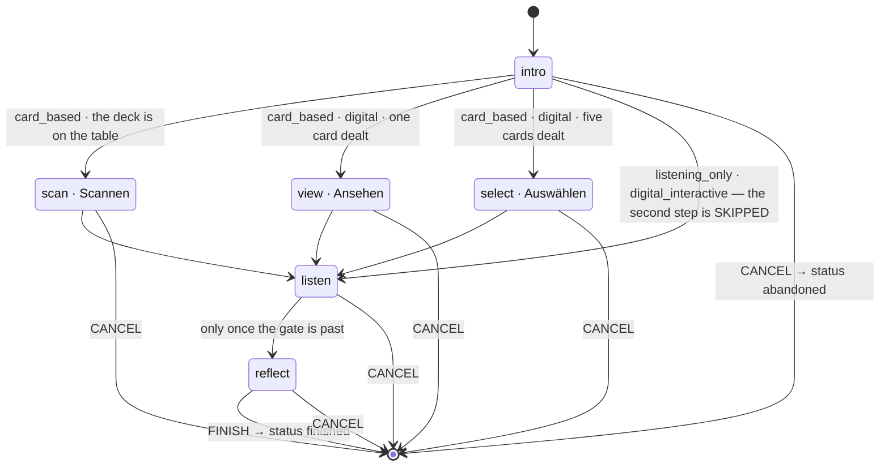
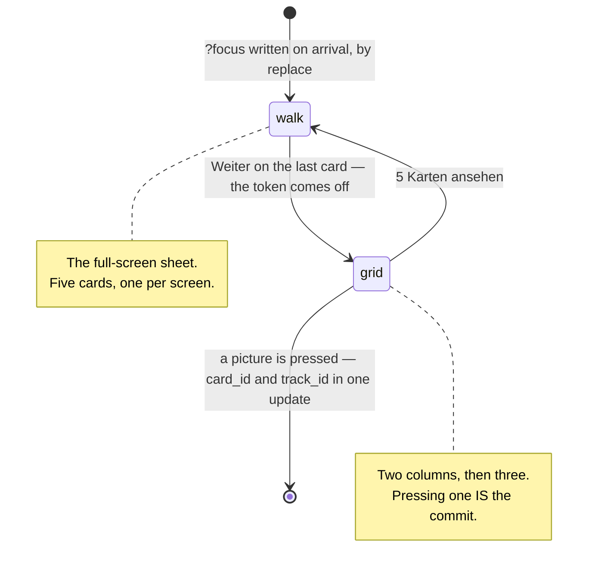

# Digital cards · the second step becomes three steps

Branch `digital-cards-build`. Written 2026-10-14 after Ben walked the built
flow and called the architecture messy. **He is right, and this says exactly
where.** Plan only — nothing here is built.

Read `DIGITAL-CARDS.md` for *why* the feature exists. This is *what* gets
rearranged, in the order it gets done.

---

## 1 · What went wrong, precisely

One step is doing three jobs. `scan` currently renders:

| what `scan` draws | when |
|---|---|
| the QR frame, the camera, the typed-code form | the deck is on the table |
| a two-column grid of five pictures | digital, `cards_dealt > 1` |
| one drawn card with an expand control | digital, `cards_dealt = 1` |

And to keep that readable from the outside it grew a layer of overrides that
all say the same thing in different places:

- `DIGITAL_STEP` — a second label and a second glyph for the same step id, per
  exercise, so the rail can say *Auswählen* or *Ansehen* where the step is
  called `scan`.
- `sheetStep` — a derived constant answering "which step does the card sheet
  belong to", because the sheet is mounted by `Session.tsx` and `?focus` had to
  mean one thing at a time.
- `dealsOnIntro` — a second derivation answering "which step deals", because
  one exercise drew from Einsteigen and the other from the step after it.
- Einsteigen's forward action doing WORK: a write for one exercise, a sheet for
  the other, a plain navigation for everybody else.

None of those is wrong on its own. Together they are four answers to one
question — *what is the second step of this run* — kept in agreement by hand.

**The fix is to let the step be the answer.** Nothing is scanned in digital
mode, so `scan` is not the step: `view` and `select` are, with their own routes,
their own rows in `sessions.step`, and one screen each.

---

## 2 · The three second steps

Every card run has **four steps**. What changes is which one is second.

| run | steps | second step |
|---|---|---|
| card_based · deck on the table | intro · **scan** · listen · reflect | the scanner, unchanged |
| card_based · digital · `cards_dealt = 1` | intro · **view** · listen · reflect | *Ansehen* |
| card_based · digital · `cards_dealt > 1` | intro · **select** · listen · reflect | *Auswählen* |
| listening_only · digital_interactive | intro · listen · reflect | none — skipped |

**The rail stays four markers long for every card exercise** — Ben,
2026-10-14. It may grow and shrink in general (a listening run already draws
three), but flipping the switch on Einsteigen must not change its length; only
the second marker's name and glyph change.

**`cards_dealt` decides which of the two**, and it is the same number that
already decides how many cards the hand holds. One fact, one place, now with
one more consequence.

### 2.1 · `view` — *Ansehen*

The shape Freie Bahn has today, promoted to a step: a question, one line of
instruction, the card in the panel with the expand control, *Zurück* and
*Weiter*. It is the variant **where nothing is chosen** — you are shown
something before you listen.

**The step draws the card.** Ben: *"Der Step sollte die Karte ziehen, der
button im /intro?digitalcards Schritt hat nur das Label bekommen aber macht
nichts weiter als den user weiter bringen."* So Einsteigen's CTA becomes a
plain navigation with a descriptive label, and the write — `card_id` and
`track_id`, one update — happens on arrival here, once, when the row has no
card yet.

### 2.2 · `select` — *Auswählen*, with the sheet inside it

Two phases, **one step**. Ben: *"Hier sollte sich erst das sheet öffnen und
dann, wenn der gesamte Content gesehen wurde, sollte das sheet collapsen und
die Auswahl der Karte im Step stattfinden."*

```
arrive  →  the sheet, five cards one at a time  →  Weiter on the last  →  the grid, in the step
```

The sheet is not a step and not an overlay the user has to find: it is how this
step opens. `?focus` is written **on arrival, by replace** — the same mechanism
and the same reason as the listen step's `?overview`, which has been doing this
since 2026-10-07. So a reload keeps whichever phase you were in, Back closes the
sheet onto the grid, and nothing has to remember anything.

Coming back from Hören lands on the grid rather than re-opening the walk,
because advancing dropped the token. *5 Karten ansehen* re-opens it.

---

## 3 · The diagram

Replacing the one in `apps/docs/features/session.md`.



And the inside of `select`, which is the part that is easy to get wrong —
the sheet is a phase of a step, not a step:



---

## 4 · The work, in order

### 4.1 · One migration, three things

They land together or not at all, so they are one file rather than three.

```sql
-- the two new steps
alter table public.sessions drop constraint sessions_step_known;
alter table public.sessions add constraint sessions_step_known
  check (step in ('intro', 'scan', 'view', 'select', 'listen', 'reflect'));

-- which run this session is
alter table public.sessions add column digital_cards boolean not null default false;

-- how many cards the exercise deals  (today a map in lib/digitalCards.ts)
alter table public.exercises add column cards_dealt smallint;
update public.exercises set cards_dealt = 5 where id = 'mindfulness-cards';
update public.exercises set cards_dealt = 1 where id = 'free-rein';
alter table public.exercises add constraint exercises_cards_dealt_matches_kind
  check ((kind = 'card_based') = (cards_dealt is not null));
```

**Rule 2 · nothing to grant.** Both tables carry table-level grants
(`20260919120000` for `sessions`, `20260918150500` + `20260921100000` for
`exercises`), and a table-level grant covers every column the table ever gets.
Checked, not assumed — `public.tracks` is the exception and is not touched here.

**`digital_cards` is why Ben chose the column** over deriving the mode: the
reachability rule computes from the step LIST, and the step list now depends on
the mode. A session resumed from the drawer without it would compute the paper
run while sitting on `view`, which the rule then refuses.

**`cards_dealt` rides along** because it is nearly free once the other two are
being applied, and `lib/digitalCards.ts`'s header has been promising it since
the day it was written. It is now load-bearing twice over: it decides the hand
AND which second step the run has.

### 4.2 · Then, and only then, two commands — Ben's

```
supabase db reset      # applies it; one Supabase stack serves every worktree (rule 9)
pnpm gen:types         # digital_cards and cards_dealt into database.types.ts
```

Nothing below typechecks until the second one has run. That is the sequencing
and it is not negotiable: a column the generated types do not have is a
compile error in every screen that reads it.

### 4.3 · The pure layer

| file | change |
|---|---|
| `routeHandle.ts` | `STEP_IDS` → `['intro', 'scan', 'view', 'select', 'listen', 'reflect']`. Order is the canonical one for reachability and `completedBefore`; no run holds two of the middle three, so their relative order is unobservable — `scan` keeps its historical place so the paper run's four are where every existing test expects them. |
| `exerciseKind.ts` | `stepsForKind(kind)` → `stepsForRun(kind, { digital, cardsDealt })`. The `Record<ExerciseKind, …>` becomes a function; the "a fourth kind fails the typecheck" guarantee is kept by switching on the kind exhaustively rather than by a record literal. |
| `digitalCards.ts` | `dealsOnIntro` **deleted** — nothing deals on Einsteigen any more. `cardsDealt` reads the column instead of the map, and the map and its 25-line header go. `dealtCards`, `withToken`, `withDigitalCards`, `withSheetOpen` unchanged. |
| `sessionMachine.ts` | nothing. It walks `STEP_IDS` and never names a step. |
| `session.ts` | `completedBefore` nothing. One new writer for `digital_cards`, beside `saveStep`. |

`digitalCards.test.ts` grows cases for `stepsForRun`; `sessionMachine.test.ts`
and `session.test.ts` grow a six-step fixture. Both should go red first from
`STEP_IDS` alone, which is the check that the step list is genuinely the one
source.

### 4.4 · The screens

| file | change |
|---|---|
| `SessionScan.tsx` | **loses its digital branch entirely** — about 90 lines, the `hand` / `onPick` / `pickError` / `onExpand` props, and the `RadioImage` and `Image` imports. It is the scanner again. |
| `SessionView.tsx` | **new.** The question, the breathing line, the card with its expand control. Draws the card on arrival when the row has none. |
| `SessionSelect.tsx` | **new.** The grid (`RadioImage`), and the sheet as its opening phase. Owns `?focus` on this step: written on arrival by replace, taken off by *Weiter* on the last card. |
| `SessionListen.tsx` | unchanged. `digital` already arrives as a prop. |
| `Session.tsx` | `DIGITAL_STEP` and `sheetStep` **deleted**. `STEP_LABEL` and `STEP_ICON` gain `view` and `select` as ordinary entries. The action row gains two cases, each shorter than the one `scan` has now. Einsteigen's CTA becomes a plain `advance()` with a label from `cardsDealt`. |
| `shell.css` | `.musie-cardshow` → `.musie-view__card` or similar; nothing else moves. |

### 4.5 · Copy

No new strings. Two move: `session.step.look` becomes the `view` step's own
label and `session.step.select` the `select` step's, so both stop being
overrides and become what `STEP_LABEL` reads. `session.intro.deal*` keep their
wording and lose their behaviour.

### 4.6 · The walks

`digitalcards.spec.ts` asserts `/scan?digitalcards` in four places; those become
`/select?digitalcards` and the Freie Bahn path gets its own walk against
`/view`. The trial-click guard on the focus sheet stays exactly as it is — it is
about `Sheet`, not about the step.

---

## 5 · What this deletes

Worth listing, because it is the measure of whether the rearrangement was
worth doing:

- `DIGITAL_STEP` (a label and glyph override, 24 lines with its argument)
- `sheetStep` (a derived constant and its paragraph)
- `dealsOnIntro` (a derivation and its 14-line header)
- `CARDS_DEALT` (the app-side map and its 25-line "why this is not a column")
- `SessionScan`'s digital branch (~90 lines) and four props
- `drawCard` and the intro's `pickCard` special case
- the `hand.length === 1 ? … : …` fork inside `SessionScan`

Against: two new screen files, one migration, one widened function signature.

---

## 6 · Answered, and how

All three were open when this plan was written. None of them is now, and two
were answered by walking rather than by reasoning — the record is in
`apps/web/e2e/digitalcards.spec.ts` and `apps/web/e2e/scanlink.spec.ts`.

1. **Does `view` re-draw on a Back?** **No.** The row has a card, so the
   arrival effect does nothing and the same card comes back. Re-drawing would
   make Back a shuffle, which is the mistake `clearScan` was written up for.
   `SessionView`'s docblock carries the reason; the one-card walk carries the
   proof.
2. **Does the switch stay visible on Einsteigen after the second step has been
   reached?** **Yes, and nothing has to be cleared.** Walked: choose a card
   digitally, go back to Einsteigen through the rail, flip the switch on, go
   forward. The rail relabels to `scan` and stays four markers long, the card
   and its recording survive, `digital_cards` goes to `false` on the way out,
   and the scan step shows *Deine Karte · MC-0x* with *Andere Karte scannen* —
   true however the card arrived, so no copy has to apologise for a scan that
   never happened. Clearing the card would punish somebody for finding their
   deck, which is the opposite of §1.1's whole reason for existing.
   `the switch flipped back mid-run keeps the card and the rail`.
3. **`/s/MC-01` into a digital session.** Ben's decision stands — *Scan
   gewinnt* — and it is a write now: `ScanLink` turns `digital_cards` off
   before it redirects, awaited, for the same reason `saveStep` is awaited. It
   matters beyond tidiness, because that column decides which steps the run
   has: a row left saying `true` would land somebody on `listen` under a rail
   naming `select`, a step they never walked, offering five dealt cards that
   need not include the one in their hand. `a deep link into a digital session
   turns the mode off`, asserting the rail as well as the row.

---

## 7 · Done when

1. `/session/:id/view` and `/session/:id/select` are real routes; an unknown
   step still lands on intro.
2. Achtsame Pause digital: Einsteigen → *Auswählen* opens the sheet on
   arrival, *Weiter* on the last card collapses it onto the grid, pressing a
   picture writes both columns and advances. Four markers throughout.
3. Freie Bahn digital: Einsteigen → *Ansehen* has the card already drawn, with
   the expand control and *Weiter*. Four markers throughout.
4. The paper path is byte-identical in behaviour: intro → scan → listen →
   reflect, the scanner with all five of its modes.
5. A session resumed from the drawer computes the right run — `digital_cards`
   is read on resume and the rail is not one marker short.
6. `sessions.step` holds `view` or `select` for a digital run, and a diary
   entry for an abandoned one renders.
7. `pnpm check`, `pnpm test:db`, and the two walks in both locales.
8. `apps/docs/features/session.md` carries both diagrams above.

### Where those two actually stand

**7 — `pnpm check` green** (544 app tests, 51 voice) and **every walk in both
locales green**, now five of them: the five-card path, the one-card path, the
switch flipped back mid-run, and the deep link into a digital session. Two
walks in `scanlink.spec.ts` were red before this branch touched them and are
green now — they anchored on `/listen$`, and the listen step writes its own
`?overview` token on arrival, so the anchor could not match.

**`pnpm test:db` is 2 failed | 140 passed, and neither failure is this
branch's.** The write-up is in `apps/web/OPEN-QUESTIONS.md`: the one local
stack carries four applied migrations from `../maintenance-ui`, which add
`cards_code_shape` (refusing the `ZZ-99` fixture a sessions test inserts) and
move `cards.image_url` under a grid the deck test does not know about. `main`
fails the same two files harder against the same stack. Nothing to fix here,
and a `db reset` to prove it would re-apply this branch's migrations over
whatever that branch is testing against — CLAUDE.md rule 9.

**8 — not done, deliberately.** Ben, during the tuning rounds: *"Dont update
the github documentation yet, we do this in the end."* And this branch is 27
commits behind `main`, which is where `apps/docs` arrived (PR #23) — the file
does not exist in this worktree to edit. Both diagrams are in §3 above, which
is what the merge should carry into `apps/docs/features/session.md`. Doing it
here would mean rebasing onto 27 commits of somebody else's docs work
unattended, which is a worse trade than leaving one page stale for a day.
