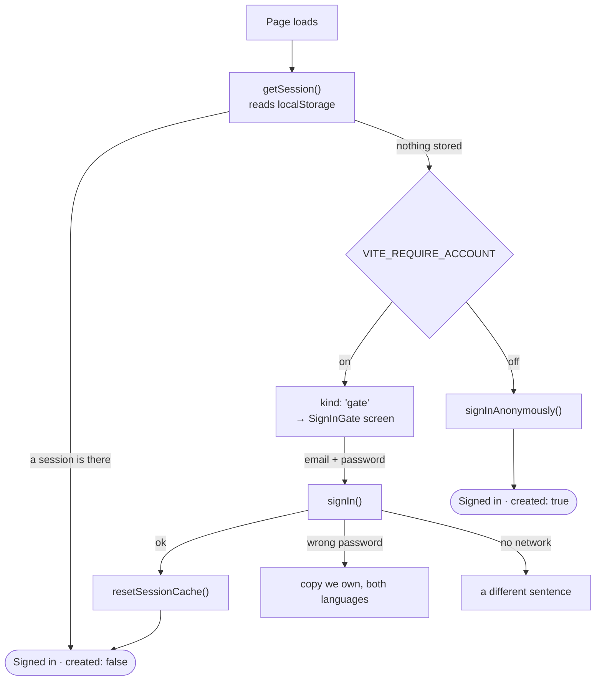

# Auth

Supabase Auth. Two ways in — an anonymous session, or an email and a password —
and one build-time flag that decides which. Today the flag is on, so the beta
is closed.



::: designers
## The two modes, and what each one costs the person

| | Anonymous | Account |
|---|---|---|
| Asks for | nothing | an email address and a password |
| The diary belongs to | the browser — clear its data and it is gone | the person, on any device |
| First exercise costs | nothing at all | signing in first |
| Today | off | **on**, for the closed beta |

The app tells people the truth about the anonymous case up front rather than in
small print: without an account the diary belongs to the browser, and it goes
when the browser's data goes.

## Why the beta is gated at all

Not because a gate is nicer. The gate is what keeps the beta **closed** — and a
closed beta is what keeps subscription-licensed music and a provisional content
set off the open internet while the app sits on a real URL. One tester who
never finds the sign-in control is that argument undone, so the form is the
whole screen rather than a link in a corner.

Accounts are created by hand and handed out. There is **no self-service
sign-up and no password reset** in this build: both need email delivery, email
delivery needs a sending domain, and the domain is still undecided. A forgotten
password is reset in the Supabase dashboard — fine at twenty testers, and also
the ceiling.

## One page is open to everyone

`/beta` — the closed-beta sign-up. The logo, what Musie is, and a form taking a
first name, an email address and how they heard about it. **Reading it creates
no account**, even with the gate off, because the page is decided above the
thing that would create one.

## Four error states, written as four different sentences

The temptation is one "something went wrong". These are genuinely different
problems and the copy says so:

| What happened | What the person is told |
|---|---|
| Wrong password | that the credentials did not match — retyping might fix it |
| No network | that the connection failed — retyping cannot fix it |
| The account was deleted while a tab was open | nothing; the tab signs itself out and reloads |
| Nothing is configured | nothing on screen; it is a developer's console message |

The third is worth knowing about as a designer: telling somebody on a train
that their password is wrong is a support request that ends in "it was the
wifi".
:::

::: devs
## `ensureSession()` — the whole of boot

`apps/web/src/lib/auth.ts`. A **promise singleton at module scope**, not an
effect, because `signInAnonymously()` creates a new user on every call and
React StrictMode mounts, unmounts and remounts everything in development. An
effect would leave two anonymous users behind, one orphaned with a `profiles`
row nobody will ever read.

```ts
export type SessionOutcome =
  | ({ kind: 'session' } & ResolvedSession)   // session + created: boolean
  | { kind: 'gate' };                         // no session, and this build won't make one
```

**A discriminated union rather than a throw**, because a gate is a normal state
and not a failure. `AuthProvider` maps a thrown error onto `status: 'error'`,
whose documented meaning is "the reason is on the console and there is no UI
for this" — the opposite of a screen the user is meant to read and act on.

**The singleton must be resettable.** It caches success as well as failure,
which was free while the only success was "you have a session". `{ kind: 'gate'
}` goes stale the moment somebody signs in, after which every remount would be
served the cached gate and the app would sit behind a form it had already
passed. So `signIn()` and `signOut()` both call `resetSessionCache()` — without
it, signing in appears to do nothing.

**The gate is checked after `getSession()`, never before.** The flag decides
what happens when there is *no* session; asking first would re-read it on a
path where it changes nothing.

## `VITE_REQUIRE_ACCOUNT`

Read at **build** time and compiled into the bundle. Changing it means
rebuilding, not restarting.

`apps/web/src/lib/requireAccount.ts` parses it strictly, and the asymmetry is
the reason:

- A flag meant to be **on** that parses as off opens the beta to anyone with
  the URL, silently — the whole licensing argument undone.
- A flag meant to be **off** that parses as on shows a form nobody can pass:
  annoying, visible in seconds, nobody's licence problem.

So the dangerous direction is the quiet one. `true` / `1` / `on` / `yes`,
case-insensitive. Anything else non-empty is treated as off **and warned about
in the console**. Vite hands every variable through as a string — there is no
boolean coercion in `import.meta.env` — so a bare `Boolean(...)` would be
permanently on.

**On hosted, "off" is not merely open, it is broken.** Anonymous sign-ins are a
*dashboard* setting on the Supabase project and they are disabled there;
`POST /auth/v1/signup` answers `anonymous_provider_disabled`. With the flag off
nobody can get into the hosted app by any route. With it on, the app never
calls `signInAnonymously()` and that setting stops mattering.

The anonymous path is **not dead code** and must not be deleted: it is what
H.2 proves convertible, what H.3 builds sign-up on, and what going public again
looks like. Deleting it makes that a rewrite; keeping it makes it a variable.

## Error mapping

`lib/signIn.ts` maps every failure to a `MessageKey` rather than showing
GoTrue's own text. Those messages are English and untranslated — *Invalid login
credentials* inside a German form is exactly the half-German UI rule 7 exists
to prevent, arriving through the one path no catalogue covers.

Matched on `code`, not on message text: the text is prose Supabase may reword
in any release, and a match against prose fails by showing the *wrong*
sentence rather than by failing to compile.

supabase-js signals the two classes differently — it **throws** for a transport
failure and **returns** an error for a rejected credential — which is why both
are handled and they are not one branch.

## The deleted-identity recovery

`lib/identity.ts`. `getSession()` reads the stored token out of localStorage and
does **not** ask the server whether that user still exists. A signed JWT whose
`sub` has been deleted therefore looks like a healthy session: the app boots,
the gate opens, every screen renders, and nothing is wrong until a write hits a
foreign key.

Measured on 2026-10-07 after a `supabase db reset` — which is the documented way
to verify a migration, and which empties `auth.users`:

```
HTTP 409 /rest/v1/sessions
23503: insert or update on table "sessions" violates foreign key constraint
       "sessions_user_id_fkey" — Key is not present in table "profiles".
```

On screen that reads "the session could not be started", which is true and says
nothing. The cure anybody found was clearing site data by hand. It is not a
local-stack curiosity: deleting one beta tester does the same to whatever tab
they had open.

**The signal is the profile row, not the failed write.** `profiles` is created
by trigger on `auth.users` insert and cascades on delete, so for a live user the
row always exists and is always readable by its own policy. Zero rows for
`auth.uid()` means the identity is gone — and the profile is read on boot, long
before anything is pressed.

The recovery is `signOut()`, which reloads the tab. It is guarded by a **claim,
not a flag**, because if the fresh identity also could not read a profile the
obvious implementation reloads forever, creating a new anonymous user each time
— a worse failure than the one being fixed, and one that writes rows.

## Profiles

`public.profiles`, one row per `auth.users` row, created by the
`on_auth_user_created` trigger — **never inserted from the client**. A client
upsert would race itself on every double mount, and would need an insert path a
client could also use to write a row for someone else.

The function is `security definer` with `set search_path = ''`. That is not
decoration: a definer function with a mutable search_path can be pointed at an
attacker's `profiles`, so every name in it is schema-qualified. It inserts
`on conflict do nothing`, because this trigger must never be the reason a
signup fails.
:::

---

**Source of truth:**
[`lib/auth.ts`](https://github.com/product-ben/musie/blob/main/apps/web/src/lib/auth.ts),
[`lib/signIn.ts`](https://github.com/product-ben/musie/blob/main/apps/web/src/lib/signIn.ts),
[`lib/requireAccount.ts`](https://github.com/product-ben/musie/blob/main/apps/web/src/lib/requireAccount.ts),
[`lib/identity.ts`](https://github.com/product-ben/musie/blob/main/apps/web/src/lib/identity.ts),
[`20260918142704_profiles.sql`](https://github.com/product-ben/musie/blob/main/supabase/migrations/20260918142704_profiles.sql),
[docs/MUSIE-SETUP.md](https://github.com/product-ben/musie/blob/main/docs/MUSIE-SETUP.md) §2.
