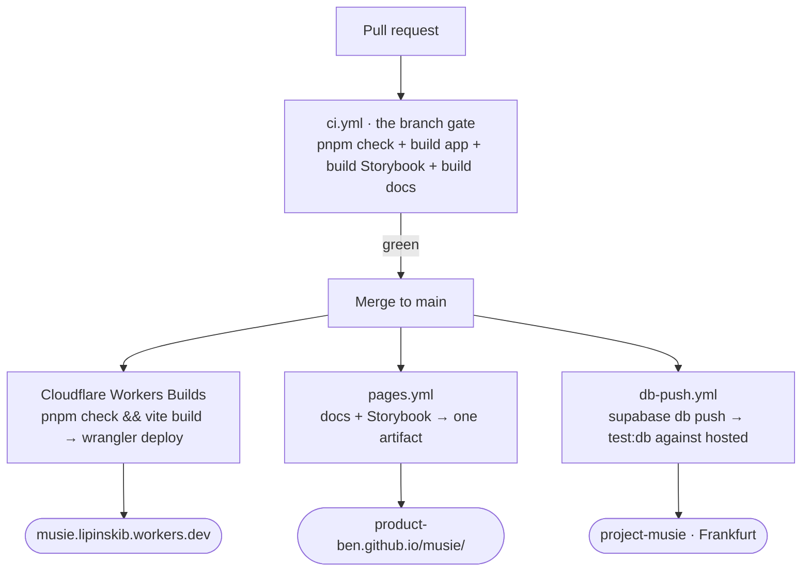

# CI/CD and deployment

Three things deploy, from three different triggers, and none of them is a
button anyone presses.

| What | Where | Trigger |
|---|---|---|
| the app | Cloudflare Workers, `musie` | push to `main`, by Workers Builds |
| these docs + Storybook | GitHub Pages | push to `main` touching `apps/docs/` or `packages/design-system/` |
| migrations | the hosted Postgres | push to `main` touching `supabase/migrations/` |



::: designers
## What this means day to day

**Merging is deploying.** There is no release step, no staging sign-off and no
deploy button. A merged pull request is live within a few minutes — the app, the
docs and the database schema, each by its own route.

**A red test stops a deploy.** Cloudflare's build command is the full gate, so
a broken test means the old version keeps serving rather than a broken one
replacing it.

**Every branch gets its own URL.** A non-production build publishes a preview
URL, so a change can be looked at on a real phone before it is merged. Those
preview URLs sit behind Cloudflare Access; production is closed by the app's
own sign-in gate instead.

## Where to look at something

| | URL |
|---|---|
| The app | `musie.lipinskib.workers.dev` — needs an account |
| The open page | `/beta` — the closed-beta sign-up, no account needed |
| These docs | `product-ben.github.io/musie/` |
| Storybook | `product-ben.github.io/musie/storybook/` |

There is **no custom domain**, and that is a real open decision rather than an
oversight: a printed QR code carries an absolute URL, and the first print run
fixes the domain permanently for that edition. Five hundred cards cannot be
renamed. So the domain decision is the one with an actual clock on it.

## The two databases, and the trap

There are two: the one on a developer's laptop, and the hosted one in
Frankfurt. They can drift apart silently — every check stays green while the
schema in the two places disagrees — and the failure then surfaces later,
elsewhere, looking unrelated.

That is why there is a whole script whose only job is to answer "do they
agree?", and why it says **UNKNOWN** rather than "in sync" when it could not
check. "I could not look" and "they agree" looking alike was the original bug.
:::

::: devs
## `ci.yml` — the branch gate

Runs on every pull request and every push to `main`.

```
pnpm install --frozen-lockfile
pnpm check                      # typecheck + lint + unit tests
pnpm --filter web build
pnpm build:storybook
pnpm --filter docs build
```

**Why it builds as well as checks:** `tsc --noEmit` resolves neither CSS
imports, font assets, nor the `vite.config.ts` plugin that pins
`/fonts/*.woff2`. A change can typecheck cleanly and still fail the bundle.

**Why it exists at all:** until this file, every check in the repo ran only
*after* a merge. Breakage was found on `main`, by the next person, instead of
on the branch, by its author.

`--frozen-lockfile` fails if `package.json` and `pnpm-lock.yaml` disagree,
rather than quietly resolving something newer than what was reviewed.

<span v-pre>`concurrency: ci-${{ github.ref }}`</span> with `cancel-in-progress` — pushing twice
to a PR cancels the first run rather than paying for a verdict nobody is
waiting for.

## `pages.yml` — both documentation sites, one artifact

```
docs    → site/
sbook   → site/storybook/
upload site/
```

**A Pages deployment replaces the entire site.** There is no partial upload and
no merging of artifacts, so two workflows each uploading their own half would
take turns clobbering each other and the live site would be whichever ran last.
That is why `storybook.yml` is gone rather than sitting beside this.

- `fetch-depth: 0`, because VitePress reads git for each page's *Last updated*
  line; a shallow clone dates every page the day of the build.
- No `pnpm check` here — M12. It ran the whole gate a second time on a commit
  `ci.yml` had already gated (runs 38352717855 and 38352717823: same commit,
  same second, 1m19s and 1m23s). Each build compiles the thing it publishes, so
  a type error still fails the job.
- The base paths are passed in: `DOCS_BASE_PATH=/musie/` and
  `STORYBOOK_BASE_PATH=/musie/storybook/`. Pages serves a project site under
  `/<repo>/`, so without them every root-absolute asset 404s.
- `concurrency: pages`, `cancel-in-progress: true`.

**The trade-off M12 named, still true:** a red `ci.yml` no longer blocks a
Pages deploy. Each docs build is its own gate.

## `db-push.yml` — migrations to hosted

Push to `main` touching `supabase/migrations/**`, then `pnpm test:db` against
hosted immediately after.

**Why automatic is defensible:** it runs only on `main`, so the change is
already merged and reviewed; the hosted suite runs straight after and fails the
job loudly; and `supabase db push` applies only what a migration says — it
invents no deletions.

**Two secrets, not five.** `SUPABASE_ACCESS_TOKEN` and
`SUPABASE_DB_PASSWORD`. The anon and service-role keys are **fetched at run
time** by the access token and masked explicitly, because GitHub masks the
secrets it was *given*, not values computed from them. And `PROJECT_REF` is not
a secret at all — it is half of every public URL this project serves, so it
sits in the `env` block in plain sight. Storing it as a secret would have
implied otherwise and cost a third setup step for nothing.

**The token expires.** The one created on 2026-10-13 runs out a year later;
`SCHEDULED-MAINTENANCE.md` carries the date and what breaks. `pnpm db:status`
is the backstop that catches it anyway.

`concurrency: db-push` with `cancel-in-progress: false` — never cancel one
half-done. A migration applied but not recorded is the one state rule 4 cannot
talk its way out of.

**Open, for Ben (M8):** fully automatic, or one click? This repository is
public, so a GitHub Environment with a required reviewer is free. Adding
`environment:` to the job makes the push wait for approval.

## The app's deploy is not a workflow

Workers Builds is connected to the repository, so a push to `main` builds and
deploys on its own. `.github/workflows/` holds CI, Pages and Database only.

```
build:  pnpm check && pnpm --filter web build
deploy: npx wrangler deploy
root:   /
```

`wrangler.jsonc` is the whole configuration, and two things in it are
load-bearing:

- **`not_found_handling: "single-page-application"`** — the `/*` → `/index.html`
  rewrite. `router.tsx` is a `createBrowserRouter`, so `/diary` and
  `/session/:id/:step` are real paths with no file behind them. Cloudflare does
  not infer this from the presence of `index.html`; omit it and deep links and
  refreshes break.
- **`workers_dev` and `preview_urls`** — production plus a public URL per
  non-production branch build. A dashboard toggle does not hold; the next deploy
  restores whatever this file says.

Environment variables are set **per build trigger**, not in `wrangler.jsonc`,
and are read at build time and compiled into the bundle — changing one means
rebuilding. Three of them, and none is a secret:

```
VITE_REQUIRE_ACCOUNT   = true
VITE_SUPABASE_URL      = https://xliwtiiopwyfunxkdmxh.supabase.co
VITE_SUPABASE_ANON_KEY = sb_publishable_…
```

## The drift guard

`pnpm check` never touches a database, so typecheck, lint, tests and CI are all
green while the migration files and the hosted database disagree.

| Command | What it does |
|---|---|
| `pnpm db:status` | do the files and hosted agree? Read-only, authenticates with the CLI's own login, no secret in any file. **Exit 0 in sync, 1 drifted, 2 unknown** |
| `pnpm db:sync` | pushes. **Refuses** unless you are on `main`, the tree is clean, and `main` is level with `origin/main` |
| `predev` | runs the status check before `pnpm --filter web dev`. Warns, never blocks; always exits 0; gives up after 8s |

**Unknown is never printed as in sync.** "I could not check" and "they agree"
looking alike is the original bug (M6).

`db:sync`'s three refusals each have a reason: a migration pushed from a
feature branch puts schema in production that no deployed code uses and rule 4
forbids withdrawing it by editing the file; an uncommitted migration pushed is
one that exists on hosted and in nobody's history; behind `origin` means
someone else's migrations are missing from the comparison, and ahead means the
push would land schema whose code has not been pushed.

It deliberately does **not** run `pnpm gen:types` (that would dirty the tree,
contradicting its own precondition on the next run) and does **not** run the db
suite against hosted (that needs the service-role key, which does not belong in
a file — the Action does it, where the key is a secret).

Raw `supabase db push` stays denied in `.claude/settings.json`. The guard is
the point, and it guards everyone (M5).
:::

---

**Source of truth:**
[`.github/workflows/`](https://github.com/product-ben/musie/tree/main/.github/workflows),
[`wrangler.jsonc`](https://github.com/product-ben/musie/blob/main/wrangler.jsonc),
[`scripts/db-sync.mjs`](https://github.com/product-ben/musie/blob/main/scripts/db-sync.mjs),
[`scripts/db-status.mjs`](https://github.com/product-ben/musie/blob/main/scripts/db-status.mjs),
[docs/MUSIE-SETUP.md](https://github.com/product-ben/musie/blob/main/docs/MUSIE-SETUP.md),
[SCHEDULED-MAINTENANCE.md](https://github.com/product-ben/musie/blob/main/SCHEDULED-MAINTENANCE.md).
