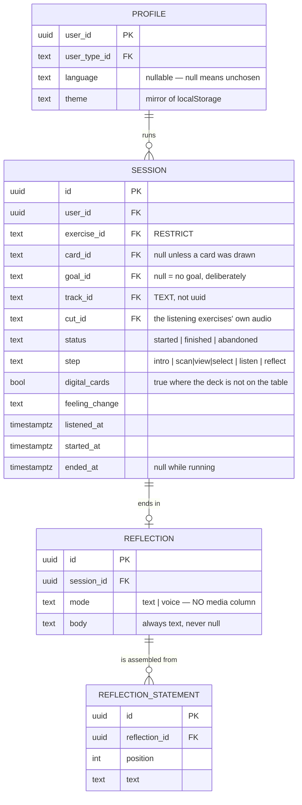
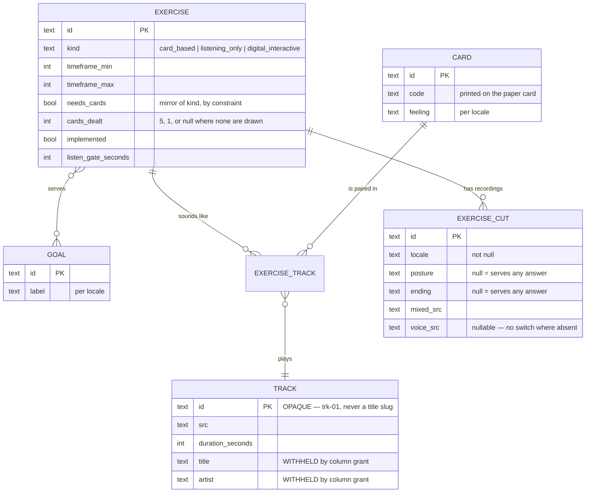
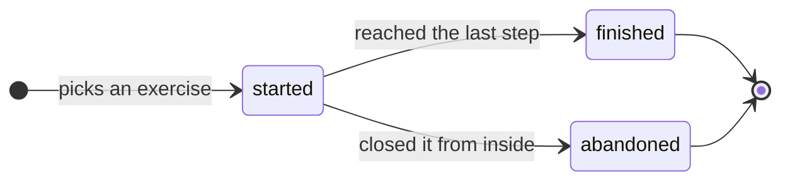

# Data model

Seventeen tables and three views. Content is seeded by migration and read-only
to the client; a person's own rows are the only ones they can write.

**A person's own rows** — everything below is written by the person it belongs
to, and readable by nobody else.



**The catalogue** — seeded by migration, `select` only for the client, and
every table with copy has an `_i18n` sibling.



A session's five foreign keys into the catalogue — exercise, card, goal, track
and cut — are on `SESSION` above. What each one does when the thing it points
at is deleted is the table in the developer tab, and no two of them agree.

The session's life:



At most **one** `started` session per person, enforced by a partial unique
index rather than by the app hoping.

::: designers
## The vocabulary, and it is enforced

These words are the schema's words. Using a different one in a screen means the
screen and the database disagree about what a thing is.

| Word | Means |
|---|---|
| **Exercise** | one of the five guides. Never "method" — that term was retired everywhere |
| **Session** | one run through one exercise, intro to reflection |
| **Card** | one of the nine printed picture cards, each a feeling |
| **Deck** | the whole Mindfulness Cards set |
| **Reflection** | what you write or say at the end. Always text, however it was entered |
| **Diary** | all of a person's sessions that are no longer running |
| **Goal** | the reason somebody starts an exercise — modelled, not yet asked |
| **Reveal** | the release of title and artist after listening |

## Five things the model decides for you

**1 · A session records what actually happened, not what was planned.** It
keeps the track that played, the step it reached, when listening began, and
whether it ended or was walked out of. So the diary can be honest without the
screens having to remember anything.

**2 · `abandoned` is a real outcome, not a failure.** Somebody who stops
halfway has still had the session. A diary that only records completions is a
diary that flatters. Design for three outcomes, not two.

**3 · One session at a time, always.** Two tabs cannot produce two. While one
is running the drawer offers *Continue session* and hides *Start a session* —
that is a direct consequence of the constraint, not a separate rule.

**4 · The same recording can serve two exercises, and the same card can play
different music in different exercises.** A recording is stored once and only
*paired*. Licensing follows: a track shared by two exercises is one licence,
not two, and a themed second deck can recombine the same recordings at no new
rights cost.

**5 · Step copy belongs to the exercise, not to the card.** All four steps'
text — intro, scan, listen, reflect — is per exercise and per language. So
*Mindful Pause* can ask for a name for the scene while *Free Rein* asks how the
moment feels. The same question in every exercise would collapse the
difference between them.

## What is modelled but not asked

- **Goals** (*Meine Gefühle spüren · In den Tag starten · An einem vollen Tag
  entspannen*). Every exercise is mapped to one or more; every session records
  which goal it came from. **Nothing asks.** The entry axis is prepared and
  the screen is not built.
- **`profiles.theme`** is written and never read; the real source is
  `localStorage`, because the theme has to resolve before any network call.
- **`display_name`** exists and is never set. Musie does not ask for a name.
:::

::: devs
## The tables

| Table | Rows | Client may |
|---|---|---|
| `profiles` | one per `auth.users`, by trigger | `select`/`insert`/`update` own — **no delete** |
| `user_types` + `user_type_i18n` | 4 | `select` |
| `goals` + `goal_i18n` | 3 | `select` |
| `exercises` + `exercise_i18n` | 5 | `select` |
| `exercise_goals` | mapping | `select` |
| `cards` + `card_i18n` | 9 | `select` |
| `tracks` | the recordings | `select (id, src, duration_seconds)` only |
| `exercise_tracks` | pairings | `select` whole — it holds only ids |
| `exercise_cuts` | the listening exercises' audio | `select` |
| `sessions` | a person's runs | all four, own rows |
| `reflections` | one per session | all four, own rows |
| `reflection_statements` | one per statement, in position order | all four, own rows |
| `session_feelings` | the feelings a session held on to | `select, insert, delete`, own rows — **no update** |
| `beta_signups` | the closed-beta form | `insert` only |
| `missing_translations`, `missing_cuts`, `question_rejections` *(views)* | every content hole; every uncovered audio combination | `select` |

`goals` and `goal_i18n` were `situations` / `situation_i18n` until
`20261007100000`, which renamed the tables, the indexes, the policies and
`sessions.situation_id` → `goal_id` in one migration. The db suite asserts the
old names no longer answer.

## The foreign keys are not all cascade, and each choice is a sentence

| | On delete | Because |
|---|---|---|
| `sessions.user_id` | `cascade` | a person's deletion takes their diary |
| `sessions.exercise_id` | **`restrict`** | retiring an exercise somebody has done must *fail*, not rewrite the entry saying they did it |
| `sessions.card_id` | `set null` | two of the exercises draw no card, and an old entry survives its card being retired |
| `sessions.goal_id` | `set null` | the goal is how the exercise was *found*, not what was done |
| `sessions.track_id` | **`restrict`** | what somebody heard is part of what they did |

## The constraints that make illegal states unrepresentable

```sql
-- one running session per person
create unique index sessions_one_running_per_user
  on public.sessions (user_id) where status = 'started';

-- status and ended_at cannot disagree, in both directions
constraint sessions_ended_at_matches_status
  check ((status = 'started') = (ended_at is null))

-- the four steps are fixed here, not in the app
constraint sessions_step_known
  check (step in ('intro','scan','view','select','listen','reflect'))
-- six legal names, four used per row: the second step is scan, view or
-- select and never two of them
constraint exercises_cards_dealt_matches_kind
  check ((kind = 'card_based') = (cards_dealt is not null))

-- needs_cards is a mirror of kind, not a second answer
constraint exercises_cards_match_kind check ((kind = 'card_based') = needs_cards)

-- one pairing per (exercise, card), where null card = the exercise's own track
constraint exercise_tracks_one_per_pair
  unique nulls not distinct (exercise_id, card_id)
```

`sessions_ended_at_matches_status` is written as one equality between booleans
rather than two or-ed implications because **both failures are equally bad**:
`finished` with a null `ended_at` is a diary entry with no date, and `started`
carrying one is a session that ended before it stopped running.

It is in the **database** and not only in the state machine, because the state
machine lives in one client and a second client, a repair script or a future
edge function would each have to be told again.

## `tracks.id` is TEXT and deliberately meaningless

`trk-01`, never `morgenlicht`. `exercise_tracks.track_id` *is* granted to the
client, so a slug id would leak the answer through the join the column grant
exists to protect — and the URL must not carry it either.

DOMAIN-MODEL.md originally said `sessions.track_id` was a `uuid`. Written as
uuid the table does not create; only `exercise_tracks.id` is a uuid.

## `exercise_cuts`: the listening exercises' audio

Addressed by four answers — exercise, locale, posture, ending.

- `locale` is `not null`: a recording that does not say which language it
  speaks is a file nobody can safely play, and nothing ever crosses locales.
- `posture` and `ending` **are** nullable, and null means *this recording
  serves any answer*. Bodyscan is one recording for every combination;
  Klangreise is two that differ by ending and not by posture. Eight rows
  pointing at four files would be the same fact entered twice and a lie about
  how specific the audio is.
- **A more specific row always wins** — `getListenAudio` prefers an exact match
  over a null — so a posture-specific cut arriving later takes over with
  nothing deleted.
- `mixed_src` is what plays and is `not null`. `voice_src` is the same cut with
  the bed removed and is nullable; its absence is simply a run with no switch.
  `music:upload` refuses a pair whose durations differ by more than 250 ms,
  which is what makes the swap land on the same moment rather than near it.

## Localisation is a sibling table, never a column

Every content table with copy has an `_i18n` sibling keyed `(id, locale)` with
`check (locale in ('de','en'))`. **`tracks` has none, deliberately**: a title
and an artist name are not translated.

`select * from public.missing_translations` finds every hole. The view is
`security_invoker = true`, so it is subject to the caller's own policies.

## No `media_path` anywhere

`session_feelings` stores a **path through the emotion wheel**, never a word:
`(emotion_id, detailed_id, specific_i)`, with nulls from wherever the path
stopped. `content/emotionWheel.ts` says why a label cannot be a key —
*Powerful* appears twice in the wheel and *Delighted* appears twice — and the
label is resolved in the active locale at read time, which is what lets one
dataset serve both languages.

It is the only table in the app with **no update policy and no update grant**,
and that is the feature: editing a confirmed feeling is out of scope, the two
verbs are add and remove, and the schema is where that can be enforced rather
than promised. Its unique constraint is `NULLS NOT DISTINCT`, without which
the level-1 stop would be the one feeling you could hold twice.

`reflections` has `mode` (`text` | `voice`) and `body`, and **no column for
audio or an image**. DOMAIN-MODEL.md originally proposed `media_path`; it was
cut. The product's claim that a recording is never stored is therefore a fact
about the schema rather than a statement of intent — there is nowhere to put
one.

`photo` is not a `mode` either. The surface exists; the recognition step is
undecided (D1).

## The step copy is four markdown columns

`intro_md`, `scan_md`, `listen_md`, `reflect_md` on `exercise_i18n` — per
exercise, per locale. There is no `question` column: the question is part of
the step's markdown.
:::

---

**Source of truth:**
[DOMAIN-MODEL.md](https://github.com/product-ben/musie/blob/main/DOMAIN-MODEL.md),
[`supabase/migrations/`](https://github.com/product-ben/musie/tree/main/supabase/migrations),
[`apps/web/src/lib/database.types.ts`](https://github.com/product-ben/musie/blob/main/apps/web/src/lib/database.types.ts)
(generated — `pnpm gen:types`).
