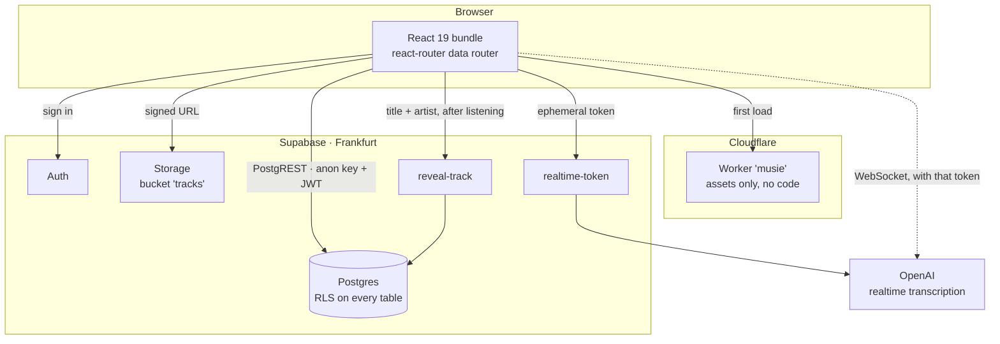
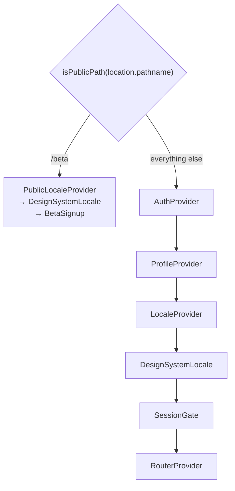

# Architecture

One static bundle in the browser, one Postgres behind it, two edge functions
for the things a browser must not be trusted with. No application server.

::: designers
## Why this shape matters to a design decision

**There is no server to put logic in.** Anything the product does, the browser
does — or the database does. That has two visible consequences:

- **A rule that must always hold is written in the database, not in a screen.**
  "Only one session at a time" is a database constraint; two tabs open cannot
  produce two running sessions, because the second write is refused. You can
  design as though that rule is never broken.
- **Anything the browser can read, a determined person can read.** So the one
  mechanic that *must* stay hidden — the track title before you have
  listened — is not hidden by not drawing it. It is withheld by the database
  and released by a small server endpoint after the fact. See
  [Listening](/features/listen).

**The database is in Frankfurt.** Round trips from Europe are fast; from
elsewhere they are not. Screens are built to show something before data
arrives rather than to block on it.

## The five things that load before anything is drawn

In this order, and each one is a decision:

1. **Four stylesheets**, in a fixed order — fonts, tokens, token amendments,
   components. Wrong order and the components lose their tokens.
2. **The theme**, from a script in the HTML head, before the first paint, so
   nobody sees a white flash on the way to dark.
3. **`<html lang>`**, from the cached locale, also pre-paint — because German
   hyphenation under `lang="en"` breaks German compounds in the wrong places.
4. **The session** — are you signed in, and if not, is this build going to let
   you in at all.
5. **The profile**, which carries your language and your theme.

Only then does a route render. It is why the app never flashes English at a
German reader, and it is the reason to be careful about adding anything to
that list.

## What is *not* in the picture

No analytics. No tracking pixel. No error-reporting service. No font CDN —
the two typefaces are served from the app's own origin. No notifications. The
network tab on a session shows Supabase and nothing else.
:::

::: devs
## The pieces

| Piece | What it is | Where |
|---|---|---|
| `apps/web` | React 19, Vite 6, react-router 7 data router | one bundle, no SSR |
| Host | Cloudflare Workers, assets-only Worker `musie` | serves `apps/web/dist`, runs no code |
| Database | Supabase Postgres, Frankfurt, project `xliwtiiopwyfunxkdmxh` | RLS on every table |
| Auth | Supabase Auth — anonymous or email+password | see [Auth](/architecture/auth) |
| Storage | bucket `tracks`, private, signed URLs | the mp3s |
| `reveal-track` | edge function, service role | the only route to `tracks.title` |
| `realtime-token` | edge function, holds the OpenAI key | mints ephemeral tokens |
| `@musie/design-system` | tokens + 35 components + Storybook | `packages/design-system` |
| `@musie/voice` | speech-to-text core | `features/voice` |

## The provider tree, which is the architecture

`apps/web/src/main.tsx`. The nesting is not stylistic — each layer depends on
the one above it, and two of the orderings were paid for in bugs.

**`/beta` branches above `AuthProvider`, and that is the whole mechanism.**
With `VITE_REQUIRE_ACCOUNT` off, no session means `signInAnonymously()` — so a
landing page mounted anywhere *inside* `AuthProvider` would create a real
`auth.users` row for every stranger who read the pitch and left. The flag is
on today and is meant to come off again, so "the marketing page does not
create accounts" must not rest on a deploy variable.

**`SessionGate` is below `LocaleProvider`, not in `AuthProvider`.** BUILD-PLAN
H.0b put the gate in `AuthProvider`; that is above `LocaleProvider`, so the
gate's first `t(...)` call would throw and every design-system label on it
would fall back to the package's German. The half-German UI rule 7 exists to
prevent, on the first screen a tester ever sees. `AuthProvider` publishes the
state; the decision about what to render moved down.

**`ProfileProvider` is inside `AuthProvider`** because reading `profiles` needs
a user, and `LocaleProvider` is inside *it* because the locale comes from
`profiles.language` rather than from a second fetch.

## Routing

`createBrowserRouter` — a data router, which is what makes step validation a
loader redirect rather than a render-time one. Every screen is a real route:
`/menu` presents as a drawer but **is** a route, so Back closes it and the URL
is linkable. `handle.overlay` is the whole difference between a screen that
replaces the page and one that comes forward over it.

`sessionLoader` validates `:step` against the four step ids and redirects an
unknown one to `intro` **before anything renders** — where a `<Navigate>`
would mount the wrong step and flash it.

Cloudflare needs `not_found_handling: "single-page-application"` in
`wrangler.jsonc` for this; omit it and only deep links and refreshes break.

## Data access

There is no API layer. The browser talks to PostgREST with the anon key plus
its own JWT, and **row level security is the authorisation model** — see
[Security](/architecture/security). `lib/` holds one module per concern
(`session.ts`, `diary.ts`, `content.ts`, …), each a thin typed function over
`getSupabase()`.

`apps/web/src/lib/database.types.ts` is generated by `pnpm gen:types` from the
local database. It is denied in `.claude/settings.json` because it reads the
*shared* stack and writes into whichever branch is checked out — so it can
commit another branch's tables to this one and typecheck cleanly until the
merge.

## The two edge functions, and why each one exists

| | Guards | Could it be a policy? |
|---|---|---|
| `reveal-track` | `tracks.title` / `artist` are withheld by **column grant** — `?select=title` fails outright | No. A column the client cannot read is one it can never read; the product must eventually say what you heard |
| `realtime-token` | the OpenAI API key | No. A browser WebSocket cannot set an `Authorization` header, so the credential travels in the subprotocol list — `openai-insecure-api-key.<key>` is the protocol's own name for handing your key to everyone |

`reveal-track` takes a **session id, never a track id**. An endpoint taking a
track id would let anyone signed in walk `trk-01`…`trk-09` and collect all nine
titles without listening — the column grant undone by the thing built to
complement it.
:::

---

**Source of truth:**
[`apps/web/src/main.tsx`](https://github.com/product-ben/musie/blob/main/apps/web/src/main.tsx),
[`apps/web/src/router.tsx`](https://github.com/product-ben/musie/blob/main/apps/web/src/router.tsx),
[`wrangler.jsonc`](https://github.com/product-ben/musie/blob/main/wrangler.jsonc),
[DOMAIN-MODEL.md](https://github.com/product-ben/musie/blob/main/DOMAIN-MODEL.md).
