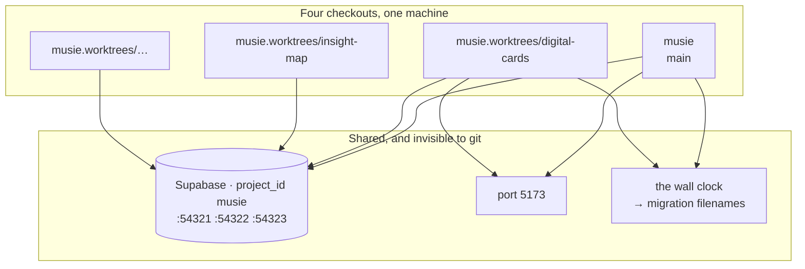

# Local stack and worktrees

A worktree isolates files and nothing else. There is one Supabase stack, one
port 5173, and one wall clock minting migration timestamps — and none of the
three is visible in `git status`.



::: designers
## Why you might care

If you are reviewing a change on a branch and something looks wrong, the cause
may not be the branch. Parallel work shares one database and one dev-server
port on the machine, so:

- **The app you are looking at may not be the branch you think.** Two dev
  servers cannot both own `localhost:5173`; the second one quietly attaches to
  the first. Checking which branch is actually serving is a real step.
- **The content may be from another branch.** The database is shared, and
  rebuilding it from one branch's migrations replaces what every other branch
  was looking at.

Practically: if a screen shows content that does not match the copy you were
given, ask which branch last rebuilt the database.
:::

::: devs
## There is one Supabase stack

`supabase/config.toml` declares `project_id = "musie"` and fixed ports — 54321
api, 54322 db, 54323 studio. **Every worktree's `supabase` command drives the
same Docker containers.**

So a `db reset` run from one branch re-applies *that branch's* migrations over
whatever another agent is testing against. Its `pnpm test:db` then fails
against a schema that exists nowhere in its own tree, and it goes hunting for
the bug in its own migration.

`supabase db reset` and `pnpm gen:types` are denied in `.claude/settings.json`
for that reason. Run them yourself, from one session, knowing the others are
affected.

`supabase db push` is denied too, and **not for this reason** — it touches the
hosted database, where no worktree is involved at all. Three commands were
denied as one rule until 2026-10-13, and reading them as one rule is what hid
the real problem: phrased as *who* may push rather than *when* a push is
correct, it never protected Ben, who was free to push from a feature branch and
whose actual failure was forgetting to push after a merge. `pnpm db:sync` is
the guard that replaces it (M5).

`pnpm gen:types` reads the shared database and writes the local
`apps/web/src/lib/database.types.ts`, so it will commit another branch's tables
to this one and typecheck will pass right up to the merge.

## There is one port 5173

`apps/web/playwright.config.ts` **reuses whatever is already serving it**, and
the comment above that line says why. Rule 8 sends every agent to `pnpm --filter
web dev` to verify its work; with two servers up, the walk verifies the other
branch's app.

**Check what is on the port before believing a result.**

```bash
lsof -ti tcp:5173           # is anything serving?
curl -s localhost:5173 | head -5
```

## Migration timestamps order the schema; merges do not

Two branches minting `2026…` filenames in parallel interleave by wall clock. A
fresh `db reset` applies them in one order; `db push` applies them in the order
they reached the remote. **A migration that assumes the other branch's `alter
table` already ran is correct in exactly one of those.**

Rule 4 is why it cannot be repaired by editing the file afterwards: Supabase
records an applied migration by **timestamp, not by content**, so editing a
pushed file changes nothing on the remote and is skipped in silence.

## A stale worktree reads like a confused agent

Before trusting one, ask what it is:

```bash
git rev-list --left-right --count main...HEAD
```

A worktree 76 commits behind reports a file missing that exists on `main`,
re-implements what already landed, and applies an older copy of CLAUDE.md.

## A subagent inherits the directory, not the conversation

Its whole world is its prompt plus `CLAUDE.md`. A constraint established by
talking — which migration is half-written, which package to leave alone — does
not exist unless the prompt restates it.

Prefer `Explore` and `Plan` for fan-out: neither can write, so neither can
collide. Do the writing in one session, where a single context holds the whole
tree.

## The commands, and which of them are denied

| | |
|---|---|
| `supabase start` | fine. Starts the one stack |
| `supabase db reset` | **denied.** Re-applies this branch's migrations over everyone's |
| `supabase db push` | **denied.** Use `pnpm db:sync`, which guards the three preconditions |
| `pnpm gen:types` | **denied.** Reads shared, writes local, commits the wrong tables |
| `pnpm db:status` | allowed, read-only |
| `pnpm db:sync` | allowed, and refuses off `main`, dirty, or out of step with origin |
:::

---

**Source of truth:**
[CLAUDE.md](https://github.com/product-ben/musie/blob/main/CLAUDE.md) rule 9,
[`supabase/config.toml`](https://github.com/product-ben/musie/blob/main/supabase/config.toml),
[`.claude/settings.json`](https://github.com/product-ben/musie/blob/main/.claude/settings.json),
[docs/BRANCHES.md](https://github.com/product-ben/musie/blob/main/docs/BRANCHES.md).
