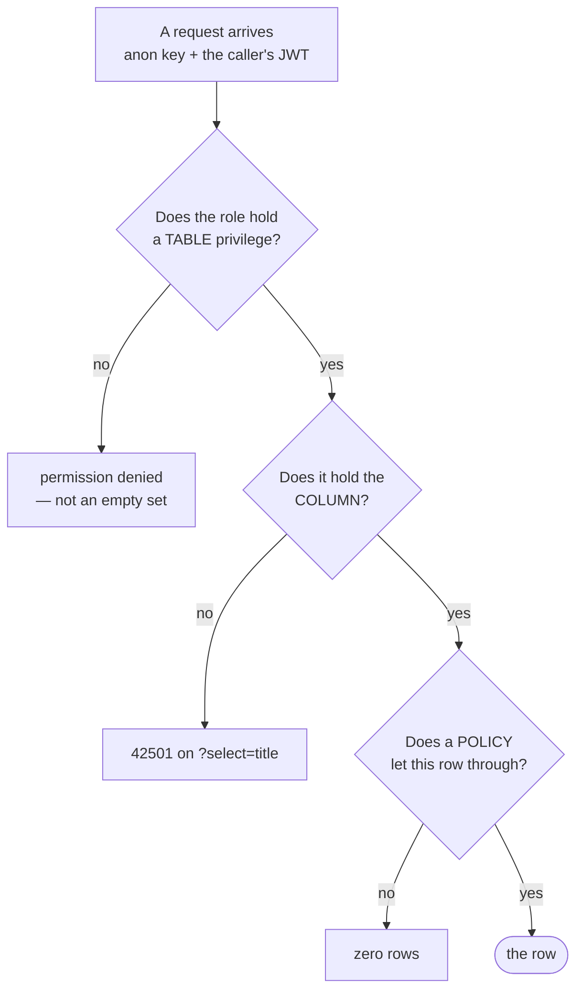

# Security

There is no application server, so authorisation lives in the database. Every
table has row level security, every table's privileges are revoked before they
are granted, and two columns are withheld by column grant because the product
depends on their being unreadable.



That order is the thing to remember: **Postgres checks table privileges
first, for every role — including `service_role`, which has `BYPASSRLS` but
does not bypass grants.**

::: designers
## The three promises the product makes, and where each is kept

| Promise | Kept by | Can a screen weaken it? |
|---|---|---|
| Nobody else can read what you write | row level security on `sessions` and `reflections` | No |
| The track's title is hidden until you have listened | the column is not granted to the browser at all | No |
| The voice recording is never stored | there is no column to put it in | No |

That last one is worth repeating because it is the strongest kind of promise: it
is not a policy anyone could change by accident. The reflection table has no
media column, so "we do not keep the audio" is a fact about the schema and not
a claim about intent.

## What this means when you are designing a screen

- **You can show a destructive action plainly.** Delete-everything cannot touch
  another person's rows; there is a test that proves it. So the question is only
  whether *this* person meant it, which is a copy and placement question.
- **A screen cannot leak the title by accident.** If a designer asks for the
  track name on the listen step, the answer is not "we will hide it with CSS" —
  the browser does not have it. It arrives from a server call after the fact.
- **An empty screen is more likely a missing permission than a missing row.**
  When content does not appear, the cause is usually a grant or a policy, never
  a design problem. See the devs tab.

## The privacy position, as the product states it

- Musie never asks for a name.
- Without an account, the diary belongs to the browser — and goes with its
  data. The app says so beforehand, not in small print.
- What you write, nobody else can read.
- No tracking, no advertising, no streaks, no notifications.

Three promises are rendered **at the control they are about** rather than
collected on one page: beside the record button, and on the reflect step's
written and photo modes. A single page stating all of it at once was deleted on
2026-10-13 along with its copy — if it comes back it is a screen, not a string.
:::

::: devs
## The rule, as CLAUDE.md states it

> Every migration that creates a table: **enable RLS, write the policies,
> revoke, then grant** — to `authenticated` what the client may read, **and to
> `service_role` what the server may.**

### Why the revoke is not decoration

The local stack ships

```sql
alter default privileges in schema public
  grant all on tables to postgres, anon, authenticated, service_role;
```

so a new table arrives **already fully granted to `anon` and
`authenticated`** — every privilege, `DELETE` and `TRUNCATE` included. Hosted
exposes nothing until granted. The two environments disagree, and the local one
is the permissive one.

Two consequences:

1. A later **column-level** grant merely ADDS to a table-wide grant already
   there. Without the revoke, `grant select (id, src, …) on tracks` leaves
   `title` and `artist` readable and the column grant **looks implemented while
   doing nothing**.
2. "No delete" resting on there being no delete policy is one permissive policy
   away from being false.

### `revoke all`, never an enumerated revoke

Measured on PostgreSQL 17.6: `revoke delete, truncate, references, trigger`
left `authenticated=arwm`. The trailing `m` is **MAINTAIN**, a privilege that
arrived in PG 17 and that no enumeration written before it could name. Nothing
leaked — it only permits VACUUM / ANALYZE / REINDEX / CLUSTER / REFRESH — but
the lesson is the shape: an enumerated revoke stops being complete the next
time Postgres invents a privilege, and **it fails open**.

### The `service_role` hole, which was real

The hosted project is created with *Automatically expose new tables* **off**,
which is also what switches off the local stack's default grant to
`service_role`. On 2026-09-21 the role therefore held **nothing on any table**:
23 db tests failed in three files for one cause, and `reveal-track` would have
failed three phases later with no test around it. Fixed by `20260921100000` and
`20260921103000` — read the second for why the first was too narrow.

`service_role` has `BYPASSRLS`, so one assumes grants are irrelevant to it.
They are not.

## The shape of it, table by table

| Tables | RLS | Policy | `authenticated` holds |
|---|---|---|---|
| `profiles` | on | `select`/`insert`/`update` where `user_id = auth.uid()` | `select, insert, update` — **no delete** |
| `sessions`, `reflections`, `reflection_statements` | on | all four, own rows only | `select, insert, update, delete` |
| content tables (11+) | on | `select … using (true)` | `select` only |
| `tracks` | on | `select … using (true)` | `select (id, src, duration_seconds)` |
| `missing_translations` (view) | `security_invoker` | — | `select` |

`anon` is revoked everything, everywhere. An unauthenticated caller has no
business in any of it, and the app signs in before it reads anything.

**No delete policy on `profiles`, deliberately.** A profile dies with its auth
user through `on delete cascade`, and by no other route.

### The column grant is the product mechanic

```sql
grant select (id, src, duration_seconds, licence_ref) on public.tracks to authenticated;
```

Not `title`, not `artist`. `?select=title` fails with a permission error rather
than returning null — there is no policy to get wrong and no filter to forget.
`licence_ref` was later revoked too: it is an operator record, not a listener's.

Track ids are **deliberately meaningless** — `trk-01`, never `morgenlicht` —
because `exercise_tracks.track_id` *is* granted, so a slug id would leak
through the join the column grant exists to protect. The URL must not carry the
answer either.

Release happens in [`reveal-track`](/features/listen), which takes a **session
id, never a track id**, and runs three checks: a valid JWT, the session is
yours, and the session reached `listen` or `reflect`.

### One session at a time is a constraint, not a hope

```sql
create unique index sessions_one_running_per_user
  on public.sessions (user_id) where status = 'started';
```

A partial unique index, so it constrains only the rows in flight. Two tabs
cannot produce two running sessions; the second insert is refused by the
database.

## What is proven, and by what

`apps/web/src/lib/db.security.db.test.ts` — 19 tests, run by `pnpm test:db`
against whichever database you point it at. It asserts, with two real anonymous
users:

- the trigger gives each user a `profiles` row;
- one user is shown **nothing** of the other, even when asking by id;
- a write aimed at the other user is refused **and changes nothing**;
- the `anon` role, holding no JWT, gets nothing at all;
- the three granted `tracks` columns read — the positive control, so a
  false pass is visible;
- `title`, `artist` and `licence_ref` are refused;
- `exercise_tracks` is granted whole, because it holds only ids;
- content tables are readable and **never** writable;
- the renamed goal tables kept the access they had, and no longer answer to
  the old names.

**Run `pnpm test:db` after any change under `supabase/migrations/`.** It is
deliberately not in `pnpm check`: CI has no Supabase, and a suite that silently
skips is worse than no suite.

## Never disable RLS to make something work

A query returning nothing means a missing policy or a missing grant.
`alter table … disable row level security` is not a debugging step.

Note the difference in symptom, because it is the fastest diagnostic you have:
a missing **policy** returns an empty set; a missing **grant** returns a
permission error. An empty set that reads like broken RLS is usually a grant.

## Secrets

| Secret | Lives | Never |
|---|---|---|
| anon / publishable key | the bundle, by design — constrained by RLS | — |
| service-role key | the Supabase dashboard; pasted for one command at a time | in any file, any `.env`, any workflow input |
| OpenAI API key | a Supabase secret, read only by `realtime-token` | in the browser |
| Supabase access token | a GitHub secret, for `db-push.yml` | — |

`lib/supabase.ts` **refuses to start** on an `sb_secret_…` key or a JWT whose
payload says `role: service_role`. A hard failure, not a warning: a warning in
a console nobody reads is how the key ends up in production.

`db-push.yml` stores **two secrets, not five** — the access token fetches the
anon and service-role keys at run time and masks them explicitly, because
GitHub masks the secrets it was *given*, not values computed from them.
:::

---

**Source of truth:**
[CLAUDE.md](https://github.com/product-ben/musie/blob/main/CLAUDE.md) rules 2
and 3,
[`20260918150500_content_schema.sql`](https://github.com/product-ben/musie/blob/main/supabase/migrations/20260918150500_content_schema.sql)
(the ACCESS section),
[`20260918142704_profiles.sql`](https://github.com/product-ben/musie/blob/main/supabase/migrations/20260918142704_profiles.sql),
[`20260919120000_sessions.sql`](https://github.com/product-ben/musie/blob/main/supabase/migrations/20260919120000_sessions.sql),
[`db.security.db.test.ts`](https://github.com/product-ben/musie/blob/main/apps/web/src/lib/db.security.db.test.ts).
