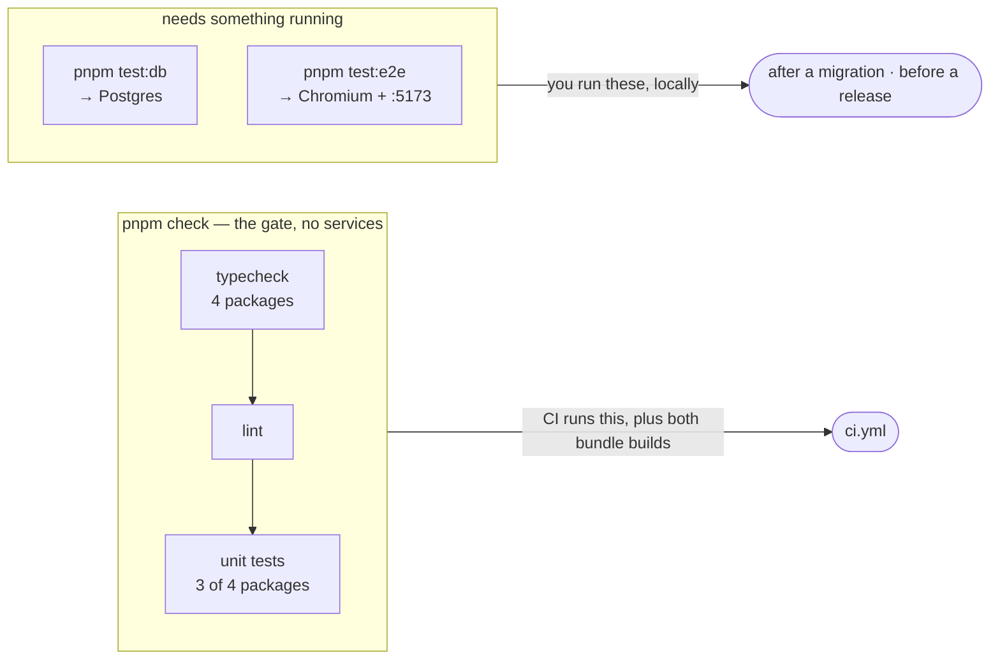

# Testing

Three suites, and the split between them is the point: one runs anywhere, one
needs a database, one needs a browser. Only the first is in `pnpm check`.

| Suite | Command | Files | Needs | In `pnpm check` |
|---|---|---|---|---|
| unit | `pnpm test` | 37 + 3 + 2 | nothing | **yes** |
| database | `pnpm test:db` | 10 | the local stack | no |
| end-to-end | `pnpm test:e2e` | 8 specs | a browser + the stack | no |

954 unit tests pass in about a second — 524 in `apps/web`, 51 in
`@musie/voice`, 379 in `apps/docs`.



::: designers
## What is actually guaranteed

Tests here are not a ritual. Three of them hold up promises the product makes
to a person, and they are worth knowing by name because they are what lets a
screen state a promise plainly:

- **Nobody can read your diary.** Two real users are created, and one is shown
  nothing of the other — even when asking by id.
- **Delete-everything deletes only yours.** The write aimed at the other user
  is refused *and changes nothing*.
- **The title stays hidden.** Asking the database for `title` fails outright,
  and there is a positive control beside it so a false pass is visible.

## What is not covered

**There are no visual regression tests and no component unit tests.** The
design system has no `test` script at all. What covers it instead is real but
different in kind: two scripts that fail the build if a token or a layout rule
loses its documentation page, and one story that proves all four stylesheets
and the theme attribute reached the Storybook preview.

So a component's *appearance* is checked by a person looking at Storybook.
That is the honest state of it, and it is why a design review is a real step
rather than a formality.

**The end-to-end walk runs once per locale** and goes through a whole session:
pick an exercise, scan a card, listen, reflect, see it in the diary. It uses a
fake camera and fake audio, so it proves the flow and the copy — not that the
music sounds right.
:::

::: devs
## The two Vitest projects

`apps/web/vitest.config.ts`, deliberately separate from `vite.config.ts` —
which carries a dev-server middleware serving woff2 files out of the design
system, the React plugin and production asset naming. None of that has anything
to do with running a pure function in Node, and inheriting it would resolve the
design system on every test run just to discover it was not needed.

```
unit  src/**/*.test.ts, minus *.db.test.ts   environment: node
db    src/**/*.db.test.ts                    environment: node + globalSetup
```

Both are `environment: 'node'`: nothing under test touches the DOM, and a jsdom
dependency bought for nothing is a dependency to keep updated.

**Not `passWithNoTests`.** Vitest's default — fail when a project matches
nothing — is exactly what is wanted. A suite that has silently stopped running
should be red, not green.

## Why `test:db` is not in `pnpm check`

CI runs `check` on a runner with no Supabase. A suite that silently skips is
worse than no suite, so each of these fails loudly with a message telling you
to start the stack.

**Run `pnpm test:db` after any change under `supabase/migrations/`.** That is
rule 4, and it is not advisory: `pnpm check` never touches a database, so
typecheck, lint, tests and CI are all green while the migration files and the
hosted database disagree.

### It runs against whichever database you point it at

Bare, it uses the local stack. Set all three of `SUPABASE_TEST_URL`,
`SUPABASE_TEST_ANON_KEY` and `SUPABASE_TEST_SERVICE_ROLE_KEY` — all three or
none — and it runs against hosted. **That is how the `service_role` grant hole
was found.** It prints its target on the first call.

Pass the keys for one run; the service-role key does not belong in a file.

### The trap in `.env.local`

`.env.local` decides what `getSupabase()` returns *inside tests*, while
`test:db` is aimed wherever `supabase status` or the `SUPABASE_TEST_*`
variables point. Those two can differ, and when they do **the suite can pass
while testing nothing.** A db test uses `anonClient()` from `db.support.ts`,
never `getSupabase()`.

### The globalSetup, and the bug it fixed

`createSignedUrl` checks the object exists. The `tracks` bucket is created
empty by a migration and filled by nobody — the masters are licensed and are an
operator upload — so the only things that ever filled it were a hand upload and
Playwright's own globalSetup, which runs on `test:e2e` and never on `test:db`.
Rule 4 sends you to `test:db` after every migration, and it landed on `Object
not found` for an unrelated reason: an order dependency wearing a schema
failure's clothes. (M9.)

The fix reuses `e2e/fakeTracks.ts` rather than rewriting it, because that file
already makes the careful decisions: reads `tracks` instead of a hard-coded
list, leaves a NULL `src` alone, and skips keys already present so a stack with
real masters is untouched.

## No mocks of the Supabase client

`vi.mock` appears in no test in this repo. A hand-built `from().select()` chain
is a fake to maintain forever. The pattern instead is: the **pure** part is
exported and unit-tested directly, and the **round trip** is tested against the
real stack in a `*.db.test.ts`. `lib/signIn.ts` is the clearest example — the
error-code table is asserted in the unit test, the codes the stack actually
returns are asserted in the db test.

## End-to-end

Playwright, `apps/web/e2e/`. Eight specs — `session`, `listen`, `reveal`,
`cancel`, `resume`, `scanlink`, `camera` and a WebKit-only `capture` — holding
13 tests, across three projects (`en`, `de`, `webkit`).

- It starts the dev server itself and **reuses one already on :5173** — which
  is a hazard, not a feature, when another worktree is serving that port
  (rule 9). Check what is on the port before believing a result.
- `workers: 1`. Untouched, because no measurement: the walk could not be run
  on 2026-10-13 — the port was taken and `.env.local` pointed the browser at
  hosted while the assertions read local, which `e2e/support.ts` rightly
  refuses. No measurement, no change. (M13.)
- First run needs browsers: `pnpm --filter web exec playwright install
  chromium`.

## What the design system has instead of tests

`packages/design-system` has **no `test` script**, so `pnpm -r run test` passes
over it without a word. Covering it instead:

| | What it proves |
|---|---|
| `verify-tokens.mjs` | every token still has a documentation page — runs inside `typecheck` |
| `verify-layout.mjs` | every Layer 3 rule still has one — same |
| `Smoke/Badge` story | all four stylesheets and `data-theme` reached the preview |

So the design system is **asserted about, not unit-tested**. CLAUDE.md rule 8
said "every package" until 2026-10-13, which is the shape of claim that stops
being read. (M11.)
:::

---

**Source of truth:**
[`apps/web/vitest.config.ts`](https://github.com/product-ben/musie/blob/main/apps/web/vitest.config.ts),
[`apps/web/playwright.config.ts`](https://github.com/product-ben/musie/blob/main/apps/web/playwright.config.ts),
[`lib/db.support.ts`](https://github.com/product-ben/musie/blob/main/apps/web/src/lib/db.support.ts),
[CLAUDE.md](https://github.com/product-ben/musie/blob/main/CLAUDE.md) rules 4 and 8.
