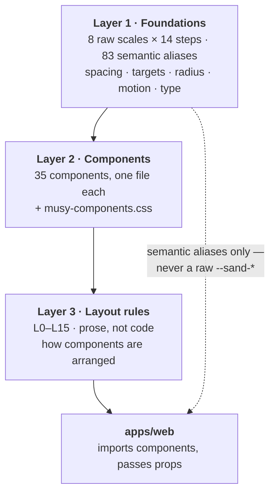

# The design system

`@musie/design-system` — three layers, 35 components, 258 stories, and one rule
that governs everything about how the app uses it: **the app consumes it; it
does not reimplement it.**



::: designers
## The three layers, and what each one is for

**Layer 1 — the tokens.** Eight colour scales of fourteen steps, 83 semantic
aliases over them, and the whole dimension system: spacing, touch targets,
radius, borders, elevation, focus, motion, z-index, iconography, typography,
breakpoints.

The raw scales are **never used directly**. `--sand-9` is a value; `--surface`
is a decision. Only the second kind appears in a screen.

**Layer 2 — the components.** 35 of them, each with its own Storybook page and
every state shown: rest, hover, active, disabled, error, empty, loading.

**Layer 3 — the layout rules.** Sixteen written rules, L0 to L15, about how
components are *arranged*. They are prose rather than code because arrangement
is the part a component cannot own.

## The two facts every layout rule assumes

**Mobile first, and it is not a slogan.** Design at **393px** and let the
layout grow. Every measurement in Layer 3 was taken at 393px first and 1280px
second, in that order. A layout designed wide and then squeezed fails in a way
that is invisible on the machine it was designed on — and two rules exist
*because* that happened and was caught only by measuring the phone column.

**Thumb-first, and right-handed.** The product is used one-handed and
right-handed users are the majority. That single fact decides two rules: **the
action a user is most likely to want sits at the right edge**, because that is
where the thumb already is. Anything contradicting it needs a reason written
next to it.

## The sixteen rules, in one table

| | |
|---|---|
| **L0** | mobile first at 393px; thumb-first, right-handed |
| **L1** | a screen's root carries five properties and nothing else |
| **L2** | the gap ladder — which spacing step means what |
| **L3** | a list of things is a list (`<ul>`), not a stack of divs |
| **L4** | card anatomy: the text leads, the controls float beside it |
| **L5** | control size follows the pointer |
| **L6** | the primary action is right-aligned to its parent |
| **L7** | width can be a state cue |
| **L8** | type: the floor, and the one exception |
| **L9** | drag and drop |
| **L10** | waiting, provisional, empty |
| **L11** | feedback: where it goes |
| **L12** | motion |
| **L13** | selection and gestures |
| **L14** | custom patterns — when a screen may invent one |
| **L15** | verify by measurement |

## The one thing a screen may never do

**A screen never reaches into a component's geometry.** Not its padding, not
its alignment, not its width.

When a component cannot do what a screen needs, **the fix goes into the
component.** That is why `CtaButton` has an `align` prop rather than the app
overriding `justify-content` — and why the app overrides the design system in
exactly zero places today.

This matters in a design review: "move that button to the left on this one
screen" is a change to the component's API, which means it changes everywhere.
That is the cost and also the point.

## When a screen may invent a pattern

Only where the system has **no component** for it (L14). Then:

1. every declaration resolves to a Layer 1 token or arithmetic over one;
2. the class is prefixed `musie-`, never `musy-`, so a screen file can never
   be mistaken for a system file;
3. **a pattern that recurs is a component request**, not a second copy.

`.musie-sheet` is the live example, and it is logged as a component request.

## Where to look

[**Storybook**](https://product-ben.github.io/musie/storybook/) — 258 stories,
light and dark side by side, plus the foundations token reference and the
Layer 3 rules as pages.

Note what Storybook is *not*: there are no visual regression tests. A
component's appearance is checked by a person looking at it. That is the honest
state, and it is why a design review is a real step.
:::

::: devs
## The package

```
packages/design-system/
  tokens/            Layer 1 — CSS custom properties, the DTCG mirror for
                     Figma, the pre-paint theme script, self-hosted woff2
  src/               Layer 2 — one file per component + musy-components.css
  docs/              Layer 3 — 10-layout.md, 15-layout-evidence.md
  stories/           258 stories, CONVENTIONS.md, OPEN-QUESTIONS.md
  scripts/           verify-tokens.mjs, verify-layout.mjs, verify-coverage.mjs
```

## The four stylesheets, in this exact order

```ts
import '@musie/design-system/tokens/musy-fonts.css';
import '@musie/design-system/tokens/musy-foundations.css';
import '@musie/design-system/tokens/musy-foundations-amendments.css';
import '@musie/design-system/musy-components.css';
```

Loaded once, at the app root — `apps/web/src/main.tsx`. **The order is
load-bearing**, and they are four files rather than one on purpose:

| | Why it is where it is |
|---|---|
| `musy-fonts.css` | `@font-face` carries no cascade weight, so its position is about *discovery*: the declarations should be parsed before the first element that needs a face. Without it every token still resolves and every step renders in a system fallback |
| `musy-foundations.css` | the whole token system, and `[LOCKED]` — byte-identical to the signed-off version except for two recorded breaks |
| `musy-foundations-amendments.css` | the two gaps Layer 2 needs and Layer 1 does not have: `--icon-stroke-sm` (G1) and `--border-style-solid`/`-dashed` (G2). A separate file so Layer 1 stays untouched; absorbing them later is a copy-paste, not a rewrite |
| `musy-components.css` | consumes both. It references `--icon-stroke-sm` and `--border-style-dashed`, which **only** the amendments define — load it earlier and those declarations are unresolved |

Merging them would lose the guarantee that Layer 1 is unmodified.

## Rule 1, as CLAUDE.md states it

> Import from `@musie/design-system` and pass props. **Never reference a raw
> scale token** (`--sand-*`, `--green-*`, `--terracotta-*`, and the
> `--success-*` / `--warning-*` / `--error-*` status scales) from `apps/web`:
> semantic aliases only.

There are **zero** raw-scale references in the app today. Keep it so.

## The two breaks in the Layer 1 lock, both recorded

1. **2026-09-19** — the two accent families were renamed at source:
   `--interactive-accent-placeholder1/2` became `--interactive-accent-*` and
   `--interactive-accent-alt-*`. No value, no alias, no override changed. Taken
   in Layer 1 rather than aliased in the amendments because "placeholder" was in
   the public API of nine components, and an alias would have left both names
   live and both greppable.
2. **2026-10-09, and this one changed a VALUE.** `--measure-heading` went from
   `26ch` to `50ch`. The tight measure was bought to stop German compounds
   stranding a word on the last line — a job `--text-wrap-heading: balance` was
   already doing — and what it actually did was break headings that had no
   reason to break: a 52-character question wanting 656px was given 425px inside
   a 1076px column. It had been worked around twice rather than fixed (a raw
   `50ch` in `shell.css`, and `ContentBox`'s `headlineWide`), and 50ch is that
   workaround's own number promoted. `--measure-compact: 26ch` was added in the
   same act for the two places using the old value as a width budget.

## Fonts

Self-hosted. Nothing in the package ever calls `fonts.googleapis.com` or
`fonts.gstatic.com` — no `<link>`, no `@import`, no `preconnect`. Both families
are SIL OFL 1.1 and the licence texts ship beside them, as the licence
requires.

**Onest × Literata** since 2026-10-10, replacing Space Grotesk × Inter. The
pairing inverts which family does which job: **Onest labels and heads, Literata
READS.** Literata is a serif built for long-form screen reading, which is most
of what a session asks — so the change is not a skin.

Both ship as variable fonts clamped to `wght 400–700`, which is exactly the
range consumed. Google's API returns the *same file* for `wght@400;500;600;700`
as for `wght@400..700`, so asking for statics would commit identical bytes four
times.

**169.7 KB total, of which 71.3 KB is the German critical path.** German
umlauts live entirely in the `latin` subset, so ordinary German costs only the
two latin files; `latin-ext` is fetched only when a Central or Eastern European
character actually appears.

Two single rules are easy to lose in a cleanup and worth knowing: **Literata
700** serves only the wizard's `aria-current="step"` label, and **Literata 400
italic** serves exactly one rule, the `DraggableList` empty state. Drop either
and the browser synthesises a fake bold or a fake oblique.

## What covers the package instead of tests

It has **no `test` script**, so `pnpm -r run test` passes over it silently.

| | Proves |
|---|---|
| `verify-tokens.mjs` | every token still has a documentation page — runs inside `typecheck` |
| `verify-layout.mjs` | every Layer 3 rule still has one — same |
| `Smoke/Badge` story | all four stylesheets and `data-theme` reached the preview |

So it is **asserted about, not unit-tested** (M11).

## Storybook's base path

Published at `/musie/storybook/`. Anything in a story pointing at a served file
must go through `asset()` in `stories/_decorators.tsx`, which prefixes
`import.meta.env.BASE_URL`. Written as `/assets/…` it resolves against the
domain root and 404s. The one place that cannot reach is `Logo`'s default
`src`, which is root-absolute in the component; the Logo stories pass a
base-aware `src` instead.
:::

---

**Source of truth:**
[packages/design-system/README.md](https://github.com/product-ben/musie/blob/main/packages/design-system/README.md),
[docs/10-layout.md](https://github.com/product-ben/musie/blob/main/packages/design-system/docs/10-layout.md),
[CLAUDE.md](https://github.com/product-ben/musie/blob/main/CLAUDE.md) rule 1,
[Storybook](https://product-ben.github.io/musie/storybook/).
