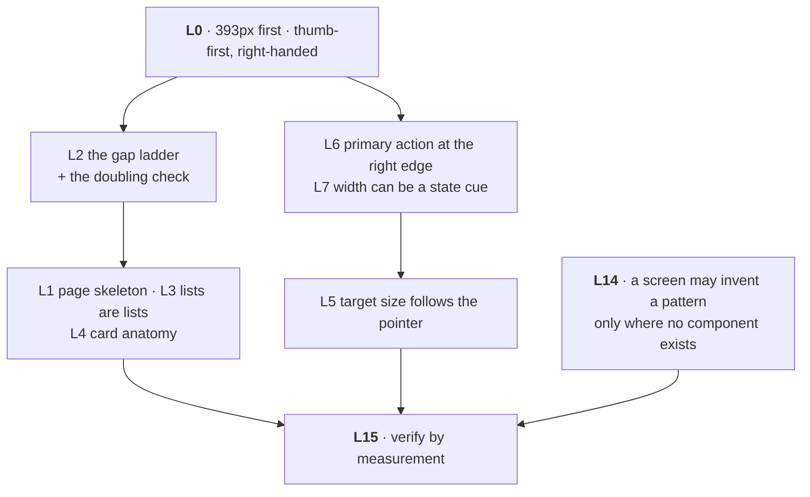

# Layout — Layer 3

Sixteen written rules about how components are arranged. Prose, not code,
because arrangement is the one part a component cannot own — and every number in
them was measured rather than chosen.



::: designers
## L2 — the gap ladder, which the whole layer hangs on

**Use the name, never a number, and never pick a gap by eye.**

| Between | Token | px |
|---|---|---|
| An icon and its own label | `--space-gap-inline` | 8 |
| Atoms that belong together — label+field, title+subtitle, two buttons that are alternatives | `--space-gap-related` | 12 |
| Controls inside one molecule, and the content they act on | `--space-gap-stack` | 16 |
| Molecules that do **not** belong together | `--space-gap-group` | 32 |
| Page-level sections | `--space-section` / `-lg` | 48 / 96 ≥ lg |

### The doubling check — a check, not a guideline

> The gap between two groups is always **at least double** the largest gap
> inside either group.

After laying a screen out, read the gaps off the computed styles and verify it.
On the reference screen: three regions at 32px, each containing 16px — exactly
double.

**If it fails, the grouping is ambiguous**, and the fix is a divider or a shared
surface, **never a bigger gap**. That is the useful part: a failed doubling
check is a signal about structure, not about spacing.

## L6 — the primary action is right-aligned

From L0: right-handed, one-handed, thumb at the right edge.

**A primary CTA is right-aligned to its parent. A Continue button always is.**
One permitted exception: a control that is the *stage's* single action — an
onboarding step, a confirmation screen, a sheet with one way forward — may be
centred on the stage.

**Action rows: likely action outermost.**

| Row | Visual order | Outermost |
|---|---|---|
| Disclosed card actions | Delete · Edit | Edit |
| Editor | Discard · Save | Save |

Two buttons that are alternatives sit at `--space-gap-inline` — they read as one
control pair, not two controls.

**DOM order follows visual order, not importance.** So tab order matches the
screen instead of contradicting it. That puts a destructive action first in the
tab order, and it is accepted: an undo affordance makes it reversible, which is
a better safety net than a confirm dialog nobody reads.

**Weight carries state, not position.** Save is `secondary` and disabled until
there is something to save, then `primary`. Discard is `secondary` throughout:
when there is nothing to save, the two buttons do the same thing and should look
alike.

## L5 — control size follows the pointer

`--target-min` (24px) is permitted for inline controls in prose and for card
controls **on a fine pointer only — never a coarse one.** Everything primary is
44px. 56px and 64px exist for reach, assisted and guided use.

## L7 — width can be a state cue

A control whose state changes what it contains **may** change width with it. The
change is feedback, not a jump to be suppressed: the record control hugs its
label when ready and widens when recording.

This rule exists because the opposite was shipped first and only caught by
measuring the 393px column.

## L3 — a list of things is a list

A run of repeated items is `<ol>` or `<ul>` with `list-style: none`, not a stack
of divs. The count and the position then reach assistive technology instead of
being drawn.

That is why the diary graph is **a list of links drawn like a chart** —
keyboard, focus and find-in-page all work on it.

## L10, L11, L12 — the states that are easy to skip

- **L10 · waiting, provisional, empty.** Each has a defined treatment. An
  unimplemented exercise is *provisional*, not disabled, and says so.
- **L11 · feedback goes where the action was**, and an undo affordance is
  preferred over a confirm dialog.
- **L12 · motion** comes from the five durations and four eases, and
  `prefers-reduced-motion` is handled in Layer 1, so a component needs no
  branch.

## L14 — when a screen may invent a pattern

Only where the system has **no component**. Then every declaration resolves to a
Layer 1 token or arithmetic over one, the class is prefixed `musie-` (never
`musy-`), and **a pattern that recurs is a component request, not a second
copy.**

## L15 — verify by measurement

The rule under all the others, and the reason this layer can be argued with: a
layout claim is checked by reading computed styles in a real browser at 393px
and 1280px, not by looking at it.
:::

::: devs
## Where it lives

```
packages/design-system/docs/10-layout.md        the rules, L0–L15
packages/design-system/docs/15-layout-evidence.md  the measurements behind them
```

`verify-layout.mjs` runs inside the package's `typecheck`, so **`pnpm check`
fails if a rule loses its documentation page.**

## L1 — a screen's root carries five things and nothing else

```css
.page {
  isolation: isolate;                 /* base-ui portals clear local z-index */
  background-color: var(--surface);
  color: var(--on-surface);
  font-family: var(--font-text);
  padding: var(--space-inset-card);
  border-radius: var(--radius-panel);
}
```

Plus `data-theme` on that same element rather than on `<html>` when the screen
is one route inside a larger app. Layer 1 declares every token on
`:root, [data-theme]` precisely so a nested subtree recomputes `light-dark()`;
scoping it there keeps `color-scheme: dark` off pages that are not ours.

`body { position: relative }` and one `<MusyTooltipProvider>` near the root are
**app-shell** requirements, not screen ones.

## The three primitives

```css
.stack { display: flex; flex-direction: column; gap: var(--space-gap-stack); }
.group { display: flex; flex-direction: column; gap: var(--space-gap-group); }
.row   { display: flex; flex-wrap: wrap; align-items: center; gap: var(--space-gap-stack); }
```

They cover almost every arrangement. Use those names.

## The one place a literal is correct

CSS cannot take a custom property in a media query. Write the literal and name
the token in a comment — the convention `musy-components.css` already uses:

```css
/* --space-section-lg above --bp-lg. */
@media (min-width: 1024px) { .page { gap: var(--space-section-lg); } }
```

## L4 — card anatomy

A card carrying content **and** its own controls puts the content first in the
DOM, floats a **spacer** the size of the control cluster, and positions the
cluster over it. So the text leads for a screen reader and the controls still
sit beside it visually.

## L14 in practice, in this app

`.musie-sheet` is the live example of a permitted custom pattern: there is no
sheet component, every declaration resolves to a token, the class carries the
`musie-` prefix, and **it is logged as a component request** in
`apps/web/OPEN-QUESTIONS.md` because it recurs.

The prefix is not cosmetic. `musy-` is the system; `musie-` is the app. A screen
file can therefore never be mistaken for a system file by grep.

## Measuring, in practice

Rule: measure the stylesheet, do not read it. `musy-components.css` overrides
itself late, so the value you find by reading the file is often not the value
that applies. Render it and read the computed style.

```js
// in a browser, on a real screen at 393px
getComputedStyle(document.querySelector('.page')).gap
```
:::

---

**Source of truth:**
[docs/10-layout.md](https://github.com/product-ben/musie/blob/main/packages/design-system/docs/10-layout.md),
[docs/15-layout-evidence.md](https://github.com/product-ben/musie/blob/main/packages/design-system/docs/15-layout-evidence.md),
the Layer 3 pages in [Storybook](https://product-ben.github.io/musie/storybook/).
