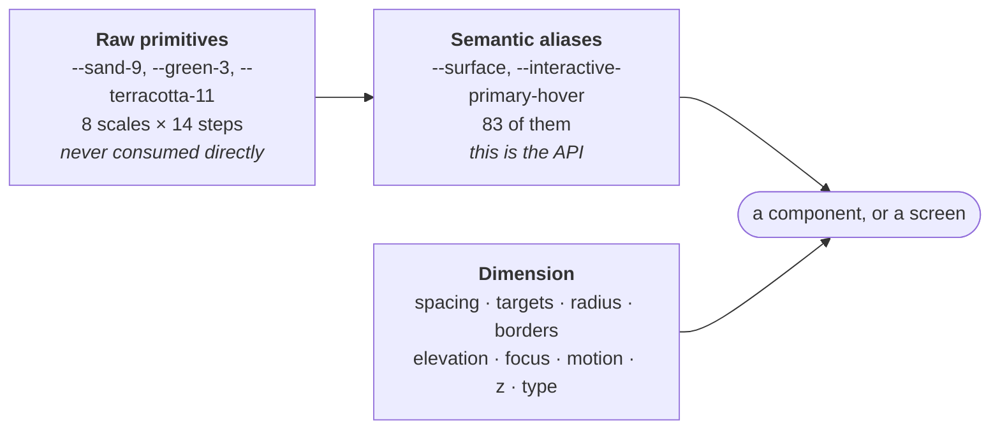

# Tokens

Layer 1. Three levels: raw scales nobody consumes, semantic aliases everybody
consumes, and the dimension system.



::: designers
## Naming

`<category>-<role>-<variant>-<state>`, lower-case, hyphens only.

```
--interactive-primary-hover
  │           │       └── state
  │           └────────── role
  └────────────────────── category
```

It mirrors Figma one-to-one: CSS `--interactive-primary-hover` is Figma
`interactive/primary-hover`. The last hyphen group, when it is a known state
name, becomes the state.

## The colour families

| Family | What it is |
|---|---|
| **sand** | the linen neutral with a green-black ink. Page, surfaces, text, borders |
| **green** | **the brand.** Buttons, links, focus, wordmark, and the default for every interactive element |
| **terracotta** | the accent — the second voice |
| **success / warning / error** | the status scales |

Each is a Radix-structured 12-step scale plus `edge` and `press`. Steps 1–8 are
curve-placed; 9 and 10 are anchored on the Figma brand values; **11, 12, `edge`
and `press` are contrast-solved** against every surface a foreground can
legally land on — including other scales' tinted fills — rather than eyeballed.

So `--sand-11` is not "a mid grey", it is *the lightest sand that still clears
4.5:1 on every legal background*. That is why the raw steps are not a palette
to pick from.

## Theming is a manual toggle, and the system preference is not consulted

`[data-theme]` sets `color-scheme`, and every themed token resolves through
CSS `light-dark()`. Tokens are **re-declared** on `[data-theme]` so a nested
override recomputes rather than inheriting.

One consequence worth knowing: there is no "follow the system" setting, by
design. See [Light and dark](/features/theming).

## Spacing: a ladder with meanings, not a scale to taste

| Token | Means |
|---|---|
| `--space-gap-inline` | icon ↔ its own label. **Never widen this** |
| `--space-gap-related` | atoms that belong together: label+field, title+subtitle |
| `--space-gap-stack` | between controls inside one molecule |
| `--space-gap-group` | between molecules that do **not** belong together |
| `--space-section` / `-lg` | between sections — mobile, then ≥lg |
| `--space-inset-control` | inside a control — gives 44px min height at `label-lg` |
| `--space-inset-card` | inside a card |
| `--space-inset-sheet` | inside a sheet or modal |

Picking a gap is therefore answering a question about relatedness, not choosing
a number.

## Touch targets: four rungs, each with a use

| Token | Size | For |
|---|---|---|
| `--target-min` | 24px | absolute floor. Inline controls in prose, and card controls **on a fine pointer only** — never coarse |
| `--target-primary` | 44px | every primary action |
| `--target-comfort` | 56px | one-handed reach, noisy room, gloved or shaky hands |
| `--target-guided` | 64px | kindergarten / assisted use — session choice cards |

**`comfort` has zero call sites and it stays.** It is the rung for when Musie is
optimised for elderly and for children: 56px between the 44px default and
`guided`'s 64px — the size a shakier or a smaller hand wants without the whole
interface going large. (M15.)

The *token* `--target-comfort` can never go regardless: `guided`'s multi-line
height is `calc(var(--target-comfort) * 2)` — "two comfort rows, derived, not
picked" — and two further rules use it.

## Radius, and the semantic layer over it

`xs 4 · sm 8 · md 12 · lg 16 · xl 24 · full 999`, then the aliases that say
what a thing *is*: `--radius-control` (full — from the Figma button geometry),
`--radius-input` (sm), `--radius-card` (md), `--radius-panel` (lg),
`--radius-sheet` (xl).

Use the alias. A card is `--radius-card`, not `12px` and not `--radius-md`.

## Motion

Five durations — `instant 80ms · fast 140 · base 220 · slow 340 · slower 520` —
and four eases: `standard`, `entrance`, `exit`, `emphasis`.

`prefers-reduced-motion` is honoured **at the token level**, so a component
needs no branch of its own. Same for `prefers-contrast: more` and
`forced-colors: active`.

## Type

61 type tokens, as complete steps rather than loose sizes: each step carries
its own family, size, weight, line-height and letter-spacing. `display-xl`,
`display-lg`, `stage`, `heading-lg/md/sm`, `body-xl/lg/md/sm`, `label-lg/md`.

Three text tokens are easy to miss and are load-bearing:

| | |
|---|---|
| `--text-wrap-heading: balance` | stops a heading stranding one word |
| `--text-wrap-body: pretty` | body and two-line labels |
| `--text-hyphens: auto` | **required** for German compounds at 393px |

That last one is why `<html lang>` must follow the locale: `hyphens: auto`
hyphenates by the element's **declared** language, so German under `lang="en"`
breaks German compounds at English hyphenation points, silently.
:::

::: devs
## Where they live

```
tokens/musy-foundations.css          the whole system
tokens/musy-foundations.tokens.json  the DTCG mirror, for Figma
tokens/_palette.json                 the raw scales as data
tokens/_audit.json                   the contrast solve
tokens/theme-init.js                 the pre-paint theme script
tokens/proof-manifest.json           what was verified, and against what
```

## The rule the app is held to

Never reference a raw scale token from `apps/web` — not `--sand-*`, not
`--green-*`, not `--terracotta-*`, and not the `--success-*` / `--warning-*` /
`--error-*` status scales. **Semantic aliases only.**

There are zero raw-scale references today:

```bash
grep -rE '--(sand|green|terracotta|success|warning|error)-[0-9]' apps/web/src
```

## `light-dark()` and the baseline

Every themed token is one declaration carrying both themes:

```css
--sand-2: light-dark(#F3EEE4, #191D1A);
```

Baseline is **evergreen browsers + iOS Safari 18+**, with no fallbacks. That is
a deliberate choice recorded in the file header, not an oversight.

Tokens are declared on `:root, [data-theme]` precisely so a nested subtree
recomputes `light-dark()` instead of inheriting a resolved value.

## The verify scripts are the test suite

`verify-tokens.mjs` and `verify-layout.mjs` run inside the package's
`typecheck`, so `pnpm check` fails if a token loses its documentation page or a
Layer 3 rule loses its own. That is what stands in for unit tests here (M11).

```bash
pnpm --filter @musie/design-system verify:tokens
pnpm --filter @musie/design-system verify:layout
pnpm --filter @musie/design-system verify:coverage
```

## Token drift

`packages/design-system/TOKEN-DRIFT.md` records where the CSS and the Figma
mirror have diverged and why. Read it before reconciling anything by hand.

## Two tokens Layer 1 does not have

`--icon-stroke-sm` (gap G1) and `--border-style-solid` / `--border-style-dashed`
(gap G2) live in `musy-foundations-amendments.css`, a separate file so that
`musy-foundations.css` stays byte-identical to the signed-off version.
`musy-components.css` references them, which is why it must load after the
amendments.

Absorbing them into Layer 1 later is a copy-paste, not a rewrite.
:::

---

**Source of truth:**
[`tokens/musy-foundations.css`](https://github.com/product-ben/musie/blob/main/packages/design-system/tokens/musy-foundations.css),
[packages/design-system/README.md](https://github.com/product-ben/musie/blob/main/packages/design-system/README.md),
[TOKEN-DRIFT.md](https://github.com/product-ben/musie/blob/main/packages/design-system/TOKEN-DRIFT.md),
the Foundations pages in [Storybook](https://product-ben.github.io/musie/storybook/).
