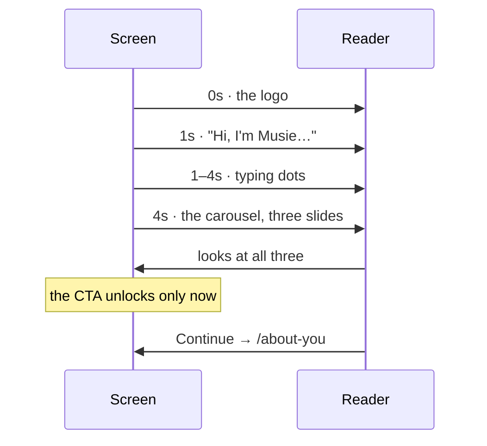

# About Musie

`/about` — the explainer, and the way into a first session. Musie introduces
itself in a chat rhythm, then a three-image carousel, then one button.



::: designers
## What it is

One character introducing itself. The two messages arrive in turn, like someone
typing: the greeting at 1s, typing dots standing in until the carousel arrives
at 4s.

**The cadence is the screen**, not decoration — it is the product's voice. Which
is why the timing lives in this screen rather than in a shared animation
utility.

The carousel is three images: *choose an exercise · Musie guides you through
exercise and reflection · feel and understand yourself better.*

## Two behaviours that are deliberate

**The sequence restarts on every arrival**, not only on first load. This is a
page the nav drawer offers as *How Musie works*, so it is navigated **back** to.
A sequence that only ever played once would leave a returning reader looking at
a screen that had already finished happening.

**The button is locked until the whole flow has been seen.** And "seen" only
ever moves forward — it is *the furthest slide you have looked at*, not *where
you are now*. Going back to slide 1 does not re-lock the button.

## It no longer skips itself

This screen used to redirect a returning visitor to the library on a cold
arrival, because it *was* `/` and had nowhere else to put that decision. Since
2026-10-02 the decision lives at [the root](/features/entry) and this route is
**unconditional**.

What that buys beyond tidiness: ask for `/about` and you get the explainer —
reloading, deep-linking, sending it to somebody, or tapping the drawer row. A
page that sometimes silently goes somewhere else was the bug the old skip was
patched twice to avoid, and there is no branch left for it to recur in.
:::

::: devs
## Files

| | |
|---|---|
| `routes/AboutMusie.tsx` | the screen, and the two timers |
| `shell.css` | the typing-dots animation, a `musie-` pattern |
| `lib/entry.ts` | where the old skip went |

## The carousel is controlled from outside

`seenMax` is held by the screen, not by `Carousel`, because it only ever moves
forward:

```
slide 1 → 2 → 3   seenMax = 3   CTA unlocked
back to 1          seenMax = 3   still unlocked
```

That is the fact the carousel cannot hold for you — it knows where you are, not
where you have been — and it is the reason `Carousel` is a controlled component
here.

## The timers are in the screen on purpose

1s and 4s. They are the product's voice rather than a motion token, so they are
not in Layer 1 and should not be lifted into it. Layer 1 has no "conversation
cadence" and inventing one for a single screen would be a token with one caller.

`prefers-reduced-motion` still applies to the dots themselves, because the
animation is CSS driven by Layer 1 durations, which Layer 1 collapses.

## Rule 7 applies to all of it

Every string — the greeting, the three slide captions, their alt text, the
button — comes from `i18n/en.ts` / `de.ts`. Nothing is inline, and the
carousel's own labels are passed rather than defaulted.
:::

---

**Source of truth:**
[`routes/AboutMusie.tsx`](https://github.com/product-ben/musie/blob/main/apps/web/src/routes/AboutMusie.tsx),
[`apps/web/src/i18n/en.ts`](https://github.com/product-ben/musie/blob/main/apps/web/src/i18n/en.ts).
