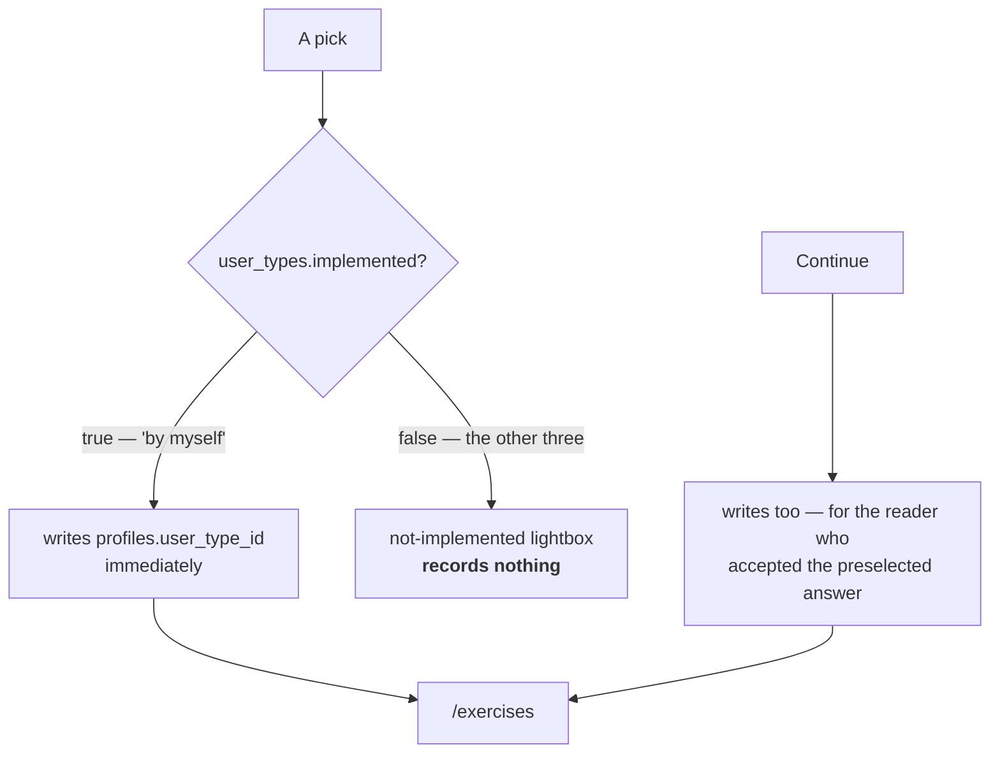

# About you

`/about-you` — one question, four answers, and only one of them is built. The
first and almost only thing Musie stores about a person.

> **Here as …** — by myself · with a group · with my partner · with a patient

::: designers
## What it asks, and what it does not

One question. **No name, no email, no age.** That is the whole screen.

"By myself" is offered **preselected**, because it is what almost everyone
picks.

## Picking writes; Continue commits and navigates

A pick writes immediately, so the choice survives a closed tab whether or not
anyone presses Continue.

Continue **also** writes, for the one case a pick cannot cover: the reader who
accepts the preselected answer without touching it. A Continue that only
navigated would send that reader to the library with nothing recorded — and the
drawer, which forks on the same column, would send them straight back here.

## The three unbuilt answers open a lightbox and record nothing

Exactly one of the four is implemented. Picking one of the others says why it
will not open.

This screen is a **gate on the way into a session**, so it has to refuse rather
than accept an answer it cannot act on.

## The decision that was taken and then lost

`/settings` used to do the **opposite**, on purpose: every type was selectable
there and the implemented flag ignored, because *a preference is something you
are entitled to record whether or not the product has caught up with it.*

Ben settled that asymmetry on 2026-09-19 — and unsettled it on 2026-09-24 by
deleting the screen. The question is asked in one place now, and an
unimplemented type cannot be recorded anywhere.

**That is a real loss of the 2026-09-19 decision**, and it is logged rather
than left to be discovered.

## Why the four answers matter beyond this screen

They are four different businesses. A group suggests workshops and education; a
partner suggests gift and retail; a patient suggests therapy, reimbursement and
regulation. **Which of them Musie is for is the most important open product
decision, and it is deliberately not taken.**

So this screen is not merely onboarding — it is the question the business model
has not answered yet, asked of the user.
:::

::: devs
## Files

| | |
|---|---|
| `routes/AboutYou.tsx` | the screen |
| `components/GoalSheet.tsx` | the goals, where they are offered |
| `components/NotImplementedLightbox.tsx` | the refusal |
| `lib/profile.ts` | the write |
| `user_types` + `user_type_i18n` | 4 rows, `implemented` on one |

## One write path, no local copy

The column written is `profiles.user_type_id` — the same one
[`lib/entry.ts`](/features/entry) and the nav drawer fork on. There is no
localStorage mirror to reconcile, which is the point: a second source of truth
for "has been here before" is a second thing that can disagree.

## `implemented` is read, not assumed

`user_types.implemented` is `true` for exactly one row. The screen reads the
flag rather than hard-coding which answer works, so switching one on is a
migration and no code change.

## The copy is in the user's own voice, which changes the grammar

The four labels are the **user speaking**, so they are first person — *Mit
meiner Partnerin oder meinem Partner*, not *mit deiner*. The alt text
describing that same option is Musie speaking about the reader, so it is du:
*Musie mit deiner Partnerin oder deinem Partner nutzen*.

That is the one documented exception to the du rule, and it is in
[German UI writing](/product/content).
:::

---

**Source of truth:**
[`routes/AboutYou.tsx`](https://github.com/product-ben/musie/blob/main/apps/web/src/routes/AboutYou.tsx),
[apps/web/OPEN-QUESTIONS.md](https://github.com/product-ben/musie/blob/main/apps/web/OPEN-QUESTIONS.md),
[docs/GERMAN-UI-WRITING.md](https://github.com/product-ben/musie/blob/main/docs/GERMAN-UI-WRITING.md).
