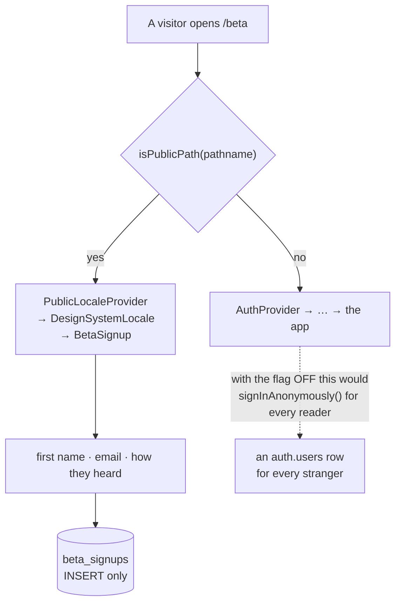

# The closed beta

`/beta` — the one URL this app answers without an account. The logo, what Musie
is, and a form. **Reading it creates no account**, and that property does not
rest on a deploy variable.



::: designers
## What is on it

Three things, in this order: **the logo, what Musie is, and the form.** That is
the whole brief and the whole page — no header, no nav, no way into the app and
nothing that needs an account to render.

The form takes a **first name**, an **email address**, and **how they heard
about it**.

## It has its own language control

The app's one language control lives in the nav drawer, which is behind the
gate. So this page carries its own — and its own document title, for the same
reason.

## Adding a "how did you hear about us" option

Three lines and no migration: a row in the list, the English label, the German
label. The German cannot be forgotten — an English key with no German fails the
build.

**Removing one is different**, and the asymmetry is why a code is stored rather
than the words: rows already written keep the code they were written with, and
nothing stops them. An old code simply stops being *offered*.

## Why this page exists at all

The app is live on a real URL behind a gate. A page that says what Musie is and
collects interest is the only public surface — and it has to be public without
costing anybody an account.
:::

::: devs
## It lives in `components/`, beside `SignInGate`, not in `routes/`

Everything in `routes/` is reached through `router.tsx`. This is not: it is
mounted **directly by `main.tsx`, above `AuthProvider`.**

```ts
if (isPublicPath(window.location.pathname)) {
  root.render(<PublicLocaleProvider><DesignSystemLocale><BetaSignup /></DesignSystemLocale></PublicLocaleProvider>);
} else {
  root.render(/* AuthProvider → ProfileProvider → … → RouterProvider */);
}
```

**Why above `AuthProvider`:** with `VITE_REQUIRE_ACCOUNT` off, no session means
`signInAnonymously()`. A landing page mounted anywhere *inside* that provider
would create a real `auth.users` row for every stranger who read the pitch and
left.

The flag is on today **and is meant to come off again** —
`lib/requireAccount.ts` is explicit that the anonymous path is not dead code —
so "the marketing page does not create accounts" must not be a property that
rests on a deploy variable.

`lib/publicRoute.ts` holds the path and the match, and says what the page gives
up by not being a route: its own `document.title` and its own language control,
both of which a route would get for free.

**What it keeps** is everything that makes copy work. `PublicLocaleProvider`
publishes the same `LocaleContext` that `LocaleProvider` does — from the cache
and the browser rather than from `profiles.language`, since there is no profile
— so `useT()`, `<html lang>` and `DesignSystemLocale` behave exactly as they do
in the app.

The four stylesheets are imported at the top of `main.tsx` and so load for both
branches, in the README's order. That is deliberate: it is the one thing the
public page must not be allowed to get wrong on its own.

## It adds no CSS

Checked rather than claimed, and it is the same three patterns the sign-in gate
stands on:

| | |
|---|---|
| `.musie-stage` | a centred column with the stack gap between its children |
| `.musie-stage--full` | the viewport and the gutter it cannot inherit — there is no shell above either screen |
| `.musie-stage__box` | takes `--measure-body`, so two stacked boxes land on the same measure as the messages on `/about` |

Responsive by construction rather than by a breakpoint written here. L14.3 says
a pattern that recurs is a component request; **a pattern that already exists is
just used.**

What makes it work on a phone is `min-block-size` on the stage rather than
`block-size`: this page has more in it than the gate does, so at 393px with
German copy it is taller than the viewport and has to push past it and scroll,
not shrink to fit.

## The table

`public.beta_signups` — `insert` only for `authenticated`… and the page has no
session. The insert path and its policy are in `20261006120000_beta_signups.sql`;
read it rather than assuming, because "a public page writing to a table" is
exactly the shape that deserves a second look.

## Rule 7, with no exceptions

Every string is passed, **including** `ContentList`'s and `RadioGroupText`'s
`emptyLabel`, neither of which can be reached here — the list is three literal
items and the options come from a constant.

They are passed anyway, because the rule has no exceptions and because the
German defaults those two would fall back to (`Noch keine Einträge`, `Keine
Optionen verfügbar`) are exactly the leak rule 7 exists to prevent.

## Reading the list

`docs/MUSIE-SETUP.md` §7 is how to read the sign-ups and how to add a reason to
the radio.
:::

---

**Source of truth:**
[`components/BetaSignup.tsx`](https://github.com/product-ben/musie/blob/main/apps/web/src/components/BetaSignup.tsx),
[`lib/publicRoute.ts`](https://github.com/product-ben/musie/blob/main/apps/web/src/lib/publicRoute.ts),
[`lib/betaReasons.ts`](https://github.com/product-ben/musie/blob/main/apps/web/src/lib/betaReasons.ts),
[`20261006120000_beta_signups.sql`](https://github.com/product-ben/musie/blob/main/supabase/migrations/20261006120000_beta_signups.sql),
[docs/MUSIE-SETUP.md](https://github.com/product-ben/musie/blob/main/docs/MUSIE-SETUP.md) §7.
