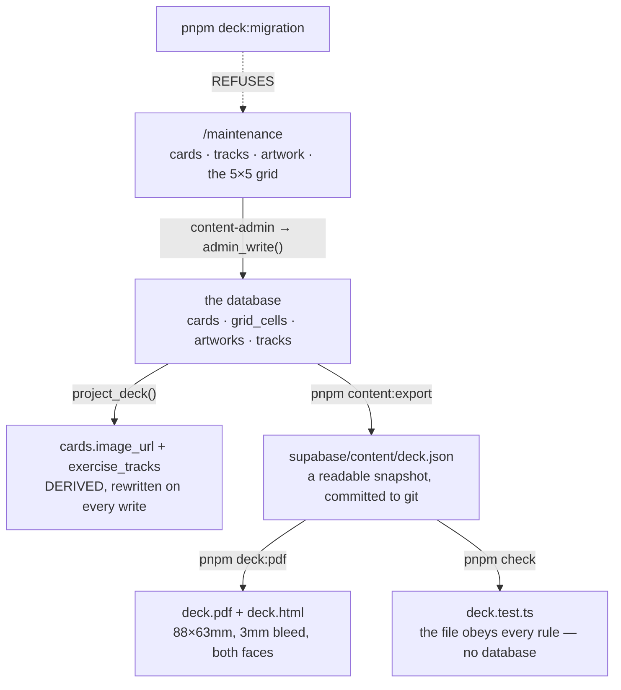

# The paper deck

One file, two outputs: the migration that lands the deck in the database, and
the print-ready PDF. `deck.json` is the **only** place the deck is written by
hand.

**This flow reversed on 2026-10-14.** The file used to be the source and the
database the copy. It is the other way round now: the deck is edited at
`/maintenance`, lives in the database, and `deck.json` is an **export**.



::: designers
## Why this matters strategically

**A new deck is a file, a command and a print order.** An edition for a
partner, a clinic, a bookshop, a language or a theme is not product
development.

That is the lever: the deck's content, its database rows and its printed cards
all come from the same nine objects, so they cannot drift from one another.

## What a card is

```
id        mc-01            what a diary row stores
code      MC-01            PRINTED on the card, and what the QR encodes
sort      1                the order the deck is dealt
feeling   Freude / Joy     both locales, both required
imageAlt  null / null      null in BOTH, or written in both
plays     per exercise     which recording this card plays, per exercise
```

**`code` is the one that cannot change.** Changing it on a deck that has been
printed invalidates the paper.

**`imageAlt` null in both locales is data** — the source has no alt text. Null
in *one* is a translation somebody dropped. The checker knows the difference.

## The PDF is built from the design system itself

The real webfonts, the real semantic colour aliases, printed through the
Chromium that Playwright already installs. **So the card cannot drift from the
interface** — and there is no new dependency.

```
pnpm deck:pdf                            a proof against the dev server
… --layout sheet                         9-up on A4, for an office printer
… --locale de                            German only
… --codes MC-03,MC-07                    two cards
```

`deck.html` is written beside the PDF — open it in a browser to iterate on the
design without waiting for a render.

Defaults: **88 × 63 mm landscape, 3 mm bleed, both locales, one face per page.**
`--card 63x88` turns it portrait, and **every type size is keyed to the card's
short edge**, so a word prints the same physical size either way.

## Two printing details that are easy to get wrong

**The single layout has no crop marks, on purpose.** The page *is* trim plus
bleed, so the cut line is the bleed inset from every edge — and a mark inside
the bleed is a mark that gets cut through.

**The sheet layout turns A4 to match the card.** Landscape cards go 3 × 3 on a
landscape sheet — the whole deck on one page per face instead of two — and it
prints fronts then backs with each back sheet's columns **reversed** for
long-edge duplex. Print one sheet of each and hold them to the light before
running the deck.

## Nothing goes to a printer yet

A printed QR carries an **absolute URL** and the domain is not chosen. So
`--base-url` defaults to the dev server and the PDF is a proof you can cut out
and scan against the local app. Print day is the same command with the real
address.

## What is still open

- **No per-card artwork.** The printed front reads a master from outside the
  repository and **falls back to the feeling set in type**, so the press needs
  no database column. The *screen* needs a small web copy — and needs a screen
  that renders it, which none does.
- **`cards.image_url` names a file that has never existed**, for all nine.
- **The German is provisional.** The spreadsheet owns this copy and will
  overwrite it. When it lands, it lands *here* — one file — and the loop turns
  it into one migration.
- The illustration **replaces** the feeling word once it exists: the image *is*
  the card, and a word over it would be the design arguing with the
  illustration.
:::

::: devs
## Files

| | |
|---|---|
| `supabase/content/deck.json` | the deck |
| `supabase/content/README.md` | the full account |
| `apps/web/scripts/deck-migration.mjs` | → a migration |
| `apps/web/scripts/deck-pdf.mjs` | → the PDF |
| `apps/web/scripts/qr-codes.mjs` | bare QR svgs |
| `lib/deck.ts`, `lib/deck.test.ts` | the rules, in `pnpm check` |
| `lib/deck.db.test.ts` | the database **is** the file, row for row |

## Content stopped travelling by migration — rule 4.1

**Schema still travels by migration and rule 4 is untouched for it.** A column,
a constraint, a function: new file, new timestamp, `pnpm db:sync`.

Deck *content* does not. `20261014100100_maintenance_import.sql` is the last
migration that will ever state it, and `20261013192229_deck_update.sql` is the
last generated one — grandfathered, kept because it applies before the import in
timestamp order.

## Why the generator had to be switched off, and not just discouraged

Because each generated migration states the **WHOLE deck** — upserting every
row and deleting what the file no longer has, rather than only the difference.

That was the right shape while the file was the source: a migration carrying
just the changed row would depend on the database already being in the state
the generator imagined, which is the assumption rule 4 exists because nobody can
make safely. Stating it in full lands the same deck whatever it finds.

**Now that an operator edits the deck, that same completeness is the hazard.**
Generating a migration today would put the file's version back over whatever was
changed at `/maintenance` — silently, on the next `supabase db reset` or the
next merge to `main`, with every check green. So `pnpm deck:migration` refuses
and prints where the deck is edited now, and `pnpm music:migration` writes
`exercise_cuts` only: the `tracks` half came out, because that was the overlap
that would clobber an edit on the next run.

It is not a hypothetical. On 2026-10-14 the grandfathered deck migration was
three migrations short of being pushed to hosted, where an operator had just
re-placed all nine cards and uploaded twelve tracks; applying it would have
written two of those pairings back to where they had been in September. It was
marked applied instead of run.

## `deck.json` is a snapshot, and `content:export` writes it

`pnpm content:export` reads the local stack and rewrites `deck.json`,
`music.json` and `grid.json`. The file keeps the same shape it always had, so
`deck:pdf` and `deck.test.ts` are unaffected — what changed is who writes it.

`deck.db.test.ts` still asserts that the database matches the snapshot, which
means a fresh export is part of committing a content change rather than an
afterthought. Note what it compares after an edit: `supabase db reset` yields
**factory** content, not live, so local and hosted agree only until the first
real edit through the UI.

## It does not own `tracks`

`deck.json` owns `cards`, `card_i18n` and `exercise_tracks`. A recording is a
file, a duration and a licence, and it arrives through
[the music pipeline](/features/music-pipeline).

Name a `trk-NN` that is not there and **the foreign key fails the migration on
`supabase db reset`, locally, before anything is pushed.** That is a better
check than one the generator could fake, so it does not try.

## Adding and removing

**Adding** — append with the next `sort`, both feelings, and the exercises that
should draw it. A card paired with nothing is **legal**: it is the honest state
while a recording is being chosen, and the generator says so rather than
refusing.

**Removing** — nothing is hard-deleted any more. A card is **archived**
(`cards.archived_at`), which keeps every diary entry that ever drew it intact
and keeps a history with something to return to. The old guard here —
`pnpm deck:migration --allow-removal` — is gone with the command: the generator
refuses outright, because a generated migration states the WHOLE deck and would
put the file's version back over whatever an operator changed, silently, on the
next `supabase db reset`.

`sessions.card_id` is still `on delete set null`, and that is still the reason
retiring a card is a product decision rather than a content edit.

## The output is not committed

Same reason `qr-codes.mjs` gives about its own: the thing that gets printed must
be reproducible, and **nine files nobody can regenerate are nine files nobody
can check.** `deck-print/` and `qr-codes/` are gitignored.

Print masters live outside the repository in `~/Documents/musie-assets/cards/`,
found by card id — `--masters` points it elsewhere on another machine. That is
M1: git keeps every version of a binary forever, every worktree is a full copy,
and a binary diff tells a reviewer nothing.
:::

---

**Source of truth:**
[supabase/content/README.md](https://github.com/product-ben/musie/blob/main/supabase/content/README.md),
[`supabase/content/deck.json`](https://github.com/product-ben/musie/blob/main/supabase/content/deck.json),
[`apps/web/scripts/deck-pdf.mjs`](https://github.com/product-ben/musie/blob/main/apps/web/scripts/deck-pdf.mjs),
[DECISIONS.md](https://github.com/product-ben/musie/blob/main/DECISIONS.md) M1.
