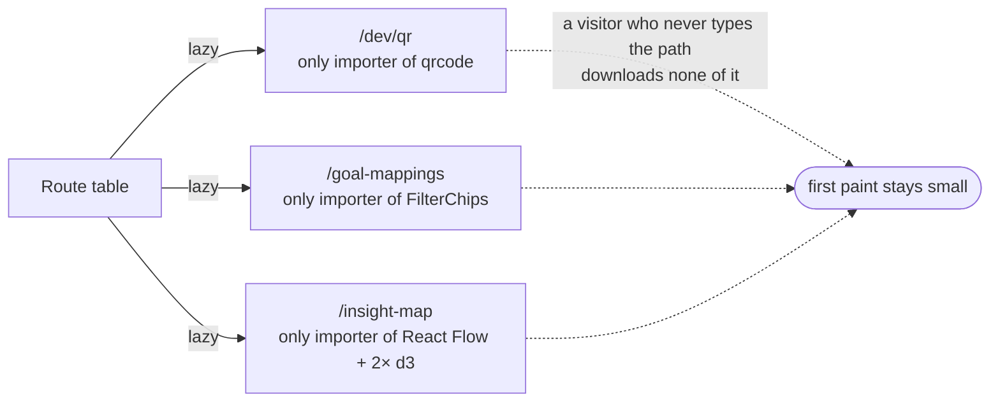

# Dev tools

Four screens that exist so a decision can be made quickly, rather than because
the product shows anybody anything. All linked from nowhere, all `lazy`, all
carrying stated exemptions from two rules.

| Route | What it answers |
|---|---|
| `/dev/qr` | the deck's QR codes, on screen, for pointing a camera at |
| `/dev/experiment-mixer` | things about two audio streams that only a locked phone can settle |
| `/goal-mappings` | which exercises each goal offers, as a thing you can tick |
| `/insight-map` | the organisation, as a canvas |

::: designers
## They are not product surfaces, and they do not pretend to be

Linked from nowhere, reachable only by typing the path. They are the team's
tools.

That is why they carry **stated exemptions** from the copy rules: strings in
them may be English-only and may be written inline. An exemption that is
written down is a decision; one that is discovered is a bug.

## `/dev/qr` — the trick worth knowing

The deck is not printed, and the in-app camera cannot be built or hand-tested
without something to scan. This is that something.

**Every code is generated from the address the page was actually served from.**
Open it on the laptop at `http://192.168.0.24:5173/dev/qr`, scan a tile with a
phone on the same network, and the phone opens
`http://192.168.0.24:5173/s/MC-01` — a running Musie.

No domain, no tunnel, no configuration, and nothing to keep in step: **the sheet
cannot generate a code for a server it is not being served by.**

The codes come from the database rather than a list of nine strings, so a tenth
card cannot silently invalidate it.

## `/dev/experiment-mixer` — a spike that earned its keep

It was written to be **deleted** the moment its one question was answered.

The question: *does iOS keep two simultaneous audio elements playing with the
screen locked?* **Answer: yes** — confirmed on a real iPhone, 2026-10-13.

And the answer arrived with a second question attached, which is why the bench
stays: **pressing pause in iOS's own lock-screen widget stops the foreground
track and leaves the background bed playing.** A person who presses pause has
asked for silence, and getting music without guidance is worse than either.

That is a real bug in the two-stream design rather than in the bench, and this
is the only place it can be tried against a locked screen without shipping it.

## `/goal-mappings` — it writes nothing, and that is the design

It shows which exercises each goal offers, lets that be edited in the browser,
and **emits the configuration**. Ben pastes it back and it becomes the next
migration.

The round trip is the point: it keeps the database's history honest — every
change is a migration with a reason in its header — while making the thinking
part, which exercise serves which goal, something you do by **looking at it**
rather than by writing SQL.
:::

::: devs
## `lazy` is load-bearing on three of them

| Route | Sole importer of |
|---|---|
| `/dev/qr` | `qrcode` |
| `/goal-mappings` | `FilterChips` |
| `/insight-map` | `@xyflow/react`, `d3-force`, `d3-hierarchy` |

**Keep it that way.** An ordinary import in `/dev/qr` would put a QR encoder in
everybody's first paint.

## `/goal-mappings` cannot write even if it tried

Content changes by migration only: there is **no insert, update or delete policy
on `exercise_goals`**, and a client write would be refused by the privilege
check before RLS was even consulted.

## The rule exemptions, named

Rule 6 (German is written, not reported) and rule 7 (every user-visible string
is passed explicitly) do not apply to these four. They are tools linked from
nowhere and opened only by the team.

The exemption is **stated in each file's header**, which is the difference
between a decision and an oversight. If one of these ever becomes a product
surface, the exemption is what has to be paid off first.

## `/dev/experiment-mixer`, and why keeping a spike is unusual here

The repo's own rule is that a spike stays a spike: build only what answers the
question, then delete it.

This one is kept on an explicit call (M16) because the answer came with a second
question that **only a locked phone can settle**, and rebuilding the bench to
ask it again would cost more than keeping it. `lib/mixer.ts` is where the fix
lands; [Backlog](/work/backlog) B2 holds the shape of it: one
`navigator.mediaSession` with handlers that act on the **pair**.

It keeps its exemptions on the same footing as `/dev/qr` and `/goal-mappings`.

## `/insight-map` has four test files

`orgModel`, `orgLayout`, `orgCard`, `orgProse` — all pure, all in `lib/`,
because `vitest.config.ts` includes `src/**/*.test.ts` only and a `.test.tsx`
would never run. See [The insight map](/features/insight-map).

## The file equivalent of `/dev/qr`

`apps/web/scripts/qr-codes.mjs` — the same codes as svg files, for the day
there is a printer involved. Output is gitignored, for the reason the deck's PDF
is: a printed thing that cannot be regenerated is one nobody can check.
:::

---

**Source of truth:**
[`routes/DevQrSheet.tsx`](https://github.com/product-ben/musie/blob/main/apps/web/src/routes/DevQrSheet.tsx),
[`routes/DevExperimentMixer.tsx`](https://github.com/product-ben/musie/blob/main/apps/web/src/routes/DevExperimentMixer.tsx),
[`routes/GoalMappings.tsx`](https://github.com/product-ben/musie/blob/main/apps/web/src/routes/GoalMappings.tsx),
[DECISIONS.md](https://github.com/product-ben/musie/blob/main/DECISIONS.md) M16.
