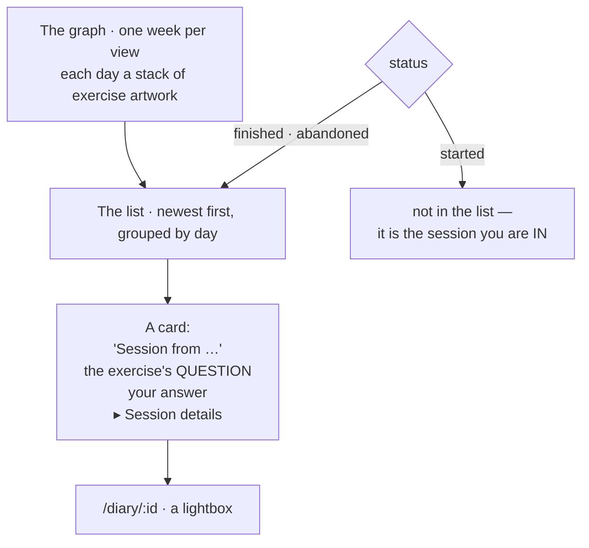

# The diary

`/diary` — every session that has ended, newest first, grouped by day, with a
graph above it. A list of **moments**, not of exercises.



::: designers
## The heading is the moment, not the exercise

A card says **"Session from …"**, not the name of the exercise. Three sittings
of the same exercise were previously three cards with one heading.

On each card the exercise's **question** sits above your own answer, so the
answer reads as an answer.

Everything factual — exercise, when it stopped, status — is folded away behind
*Session details*.

**Deleting is not folded away.** A destructive action behind a flap is harder to
find when you want it, and no harder to hit when you do not.

## The graph is a list of links drawn like a chart

Every day is a column; the sessions of that day stack up it as their exercise's
artwork. Tapping one opens that entry.

**Not an SVG, not a table, no charting library.** It is a list of days, each
holding a list of that day's sessions, each of those a link. So keyboard order,
focus, the browser's own find, middle-click and "open in new tab" all work
without a line of script.

That is also what makes it honest for a screen reader: **there is no "chart" to
describe.** There is a named region, a named list per week, and a link per
session whose accessible name says which session, which exercise and how it
ended. The picture is the sighted presentation of a list that is already
complete without it.

## A week at a time

Whole weeks, **including their empty days** — the gaps are what make a run of
sessions read as a run. Oldest week first, ending with the one containing today.

One gesture is one week, by CSS scroll-snap rather than by script. And **no
script puts it on the current week**: the weeks render newest-first into a
reversed scroller, so the engine rests it there by itself. Two scripted attempts
preceded that and both lost the position.

## Two deletes, and only one of them asks

- **Delete one session** — from its own card.
- **Delete everything** — which moved here when `/settings` was deleted.

Delete-everything confirms. Signing out does not, because signing out is
reversible and this is not. A confirmation for a reversible act is noise that
teaches people to tap through the ones that are not.

Both are immediate, both are final, and neither needs an email.

## A running session is not a diary entry

The list excludes it: it is the session you are **in**, and it lives at its own
URL.

But deep-linking a running session's id **does not** say "this entry does not
exist" — it sends you into the session. True of the diary, and useless to the
person holding the link.

## Three outcomes, shown as three

`finished` and `abandoned` are kept apart, so a session someone walked out of
is not shown as one they completed. A diary that only records completions is a
diary that flatters.
:::

::: devs
## Files

| | |
|---|---|
| `routes/Diary.tsx` | the list |
| `routes/DiaryEntry.tsx` | `/diary/:id`, `overlay: true` |
| `components/DiaryCard.tsx` | one card |
| `components/DiaryGraph.tsx` | the weeks |
| `lib/diary.ts` | both reads, and the pure parts the two screens share |
| `lib/useDiary.ts` | the hook |
| `lib/diary.db.test.ts` | against the real stack |

## It follows `content.ts`'s rules rather than restating them

**1 · Screens never see the join.** A `sessions` row arrives joined to
`exercises`, joined to its own `_i18n` table; what leaves this module is
`entry.exerciseName` and flat fields. **Two tables of column spellings stop
here.**

The `cards` join went on 2026-10-09 with the card fact it fed: the diary showed
the feeling word alone, that word left every screen, and nothing was left for
the join to carry.

**2 · A missing translation is never silent.** `pickTranslation` is **imported**
from `content.ts`, not copied — a second copy is a second place for the warning
to be deleted from, and the warning is the rule.

## A query, not a view

The obvious alternative is a `public.diary` view. It would need its own grant,
its own `security_invoker = on` so RLS still applies as the caller, and its own
row in the security tests — **for one caller and no reuse.** The join is two
embeds deep and costs none of that.

## No `user_id` filter, on purpose

`sessions_select_own` already restricts every row to `auth.uid()`, and
`reflections_select_own` follows the session.

Repeating the filter in the client would **read as the access model while the
real one lives in the policy** — and the day the two disagree, the client's copy
is the one that looks authoritative and is wrong.

Rule 3's corollary: an empty diary is a missing policy or a missing grant, never
something to paper over here.

## The asymmetry between the list read and the entry read

| | filters `status <> 'started'` |
|---|---|
| the list | **yes** — a run in progress never appears as history |
| the entry | **no** — it redirects into the session instead |

That is why `/diary/:id` has no router loader: **the redirect needs the row.**
Only the session's own status and step can say whether to redirect and where. A
loader would read it, and the screen would read it again to draw it — two
fetches of one row, and two places holding the locale fallback and the status
narrowing.

## `body` is one string

`joinStatements` glues a spoken answer together, so the diary draws one
paragraph per statement and never learns there is a second table.

## The graph's DOM

```
<ol> weeks
  <ol> days
    <a href="/diary/:id">  ← one per session, artwork as its content
```

`scroll-snap` with `scroll-snap-stop: always` — the technique `Carousel` proves
and documents. `weeksFrom` builds whole weeks including empty days.
:::

---

**Source of truth:**
[`lib/diary.ts`](https://github.com/product-ben/musie/blob/main/apps/web/src/lib/diary.ts),
[`components/DiaryGraph.tsx`](https://github.com/product-ben/musie/blob/main/apps/web/src/components/DiaryGraph.tsx),
[`routes/DiaryEntry.tsx`](https://github.com/product-ben/musie/blob/main/apps/web/src/routes/DiaryEntry.tsx),
[DOMAIN-MODEL.md](https://github.com/product-ben/musie/blob/main/DOMAIN-MODEL.md).
