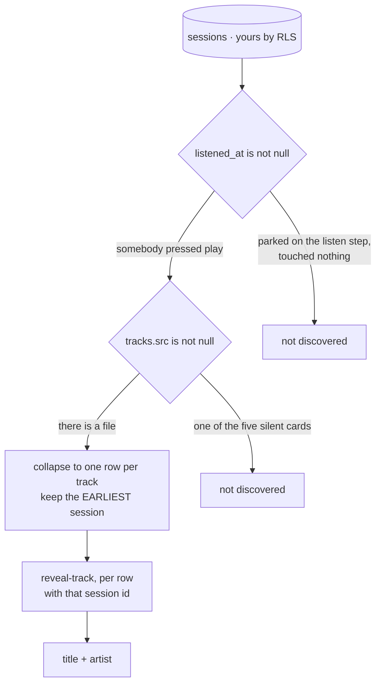

# Discovered music

`/discovered-music` — the recordings this person has actually played, one row
per recording, each carrying the session where it was first met.

::: designers
## What "discovered" means

**A recording that was playing, in a run of yours.** Not a recording you were
offered, and not one you were shown.

Two conditions, and both are the point:

- **Somebody pressed play.** Reaching the listening screen is not enough — a
  session parked there having touched nothing would otherwise be
  indistinguishable from one that played a track to the end.
- **There is a file.** Five of the nine cards are silent, and the listen step
  answers a press on one of them with a simulated clock. A row with no
  recording would be a player for nothing.

## One row per recording, and it keeps the first time

The same recording can be met more than once — Free Rein draws the same nine
cards as Mindful Pause. The listing is of **music**, so it collapses to one row
per recording, and the session it keeps is the **first** one that played it.

That is the discovery. Later runs are re-listens of something already found.

## Why this page can exist at all

A browser cannot list recordings by name under any circumstances — the title
and artist columns are not readable by it. So this is not "a list of tracks you
have met"; it is **your own sessions, with the music derived from them**, and
each title fetched one at a time through the same reveal the listen step uses.

The consequence worth knowing: this page can only ever show music **you** have
played. There is no version of it that could show a catalogue.
:::

::: devs
## Files

| | |
|---|---|
| `routes/DiscoveredMusic.tsx` | the screen |
| `lib/discovered.ts` | the derivation |
| `lib/discovered.test.ts` | the pure parts |
| `lib/reveal.ts` | one call per row |

## It reads `sessions`, never `tracks` by name

There is no table of tracks somebody has met, and **there must not be a query
that reads one.** `tracks.title` and `tracks.artist` are withheld by column
grant — naming either fails the whole request with `42501` rather than
returning null.

So this reads sessions, which are the person's own by `sessions_select_own`,
and derives the music from them.

## `listened_at` exists for this and nothing else

`20261002100000_sessions_listened_at.sql`. Not `step`, which only says which
screen was reached.

## The session id is not decoration

It is **the only thing that can be exchanged for a title**: `reveal-track`
takes a session id and reads the track from the row on the server. So the
earliest session per track is both the product answer ("when you found it") and
the mechanical one (what the reveal needs).

## The cost, stated

One reveal call per row. That is N round trips for N discovered tracks, and it
is the price of the column grant — there is no batch endpoint, and adding one
would mean an endpoint that takes a list, which is a step back toward
enumeration.
:::

---

**Source of truth:**
[`lib/discovered.ts`](https://github.com/product-ben/musie/blob/main/apps/web/src/lib/discovered.ts),
[`routes/DiscoveredMusic.tsx`](https://github.com/product-ben/musie/blob/main/apps/web/src/routes/DiscoveredMusic.tsx),
[`20261002100000_sessions_listened_at.sql`](https://github.com/product-ben/musie/blob/main/supabase/migrations/20261002100000_sessions_listened_at.sql).
