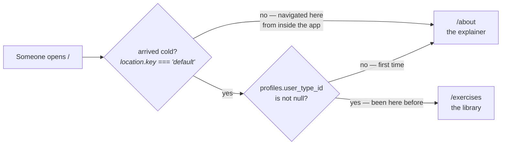

# Entry: where `/` goes

`/` paints nothing. It is a two-input decision about where opening Musie takes
you, and keeping it at the root rather than inside a page is what makes the
decision possible at all.



::: designers
## What it does

Opening Musie takes a returning person **straight to the library**. A first-time
visitor gets the explainer. And asking for `/` from *inside* the app always
gives the explainer — because that is what the front page is.

That last case is the one worth reading twice: "opening Musie" and "asking for
the front page" are genuinely different intentions, and `/` answers them
differently.

## The definition of "been here before"

One column: has this person answered *Here as …* yet. Nothing else — no
localStorage flag, no visit counter, no first-run marker.

That matters because the nav drawer forks on **the same column** to decide
where *Start a session* goes. One definition of "returning", in one place, so
the two cannot disagree.

## What was decided, and reversed

`/` **was** the explainer itself until 2026-10-02. The argument for that: a root
which only redirects costs a round trip and leaves the site with no home.

User testing replaced it with a plainer argument — the explainer is a page
people are **sent** to, come back to, and talk about, and a page like that has a
name. So `/about` became the page and `/` became the decision.

The explainer is now unconditional: every skip it used to perform moved here.
Ask for `/about` and you get the explainer, every time — reloading it,
deep-linking it, sending it to somebody, or tapping *How Musie works* in the
drawer. A page that sometimes silently goes somewhere else was the bug the old
skip was patched twice to avoid, and the branch no longer exists.
:::

::: devs
## Files

| | |
|---|---|
| `routes/Entry.tsx` | renders nothing; reads the two facts and navigates |
| `lib/entry.ts` | the decision, pure |
| `lib/entry.test.ts` | the four input pairs |

```ts
export type EntryDestination = '/about' | '/exercises';

export function entryDestination(arrivedCold: boolean, hasUserType: boolean): EntryDestination {
  return arrivedCold && hasUserType ? '/exercises' : '/about';
}
```

Not `string`: there are two destinations.

## Why the decision could not move with the page

The skip's first condition is "this page is where the app was opened", which
React Router expresses as `location.key === 'default'` — the first entry in a
history stack.

**A `/` that merely redirected to `/about` would mint a second entry**, so the
condition would be false by the time anything could read it, and every returning
visitor would see the explainer on every cold open. Keeping the decision at `/`
keeps the condition true by construction: **`/` IS the cold arrival.**

## Why it is a pure function

Both inputs are facts the caller already holds, and the whole of the behaviour
is in which pair maps to which destination — exactly the part that can be wrong
without anything throwing.

The pattern is worth copying: when the risky part of a module is a mapping, make
the mapping a pure export and test it directly rather than reaching for a mock.
:::

---

**Source of truth:**
[`lib/entry.ts`](https://github.com/product-ben/musie/blob/main/apps/web/src/lib/entry.ts),
[`routes/Entry.tsx`](https://github.com/product-ben/musie/blob/main/apps/web/src/routes/Entry.tsx),
[`router.tsx`](https://github.com/product-ben/musie/blob/main/apps/web/src/router.tsx).
