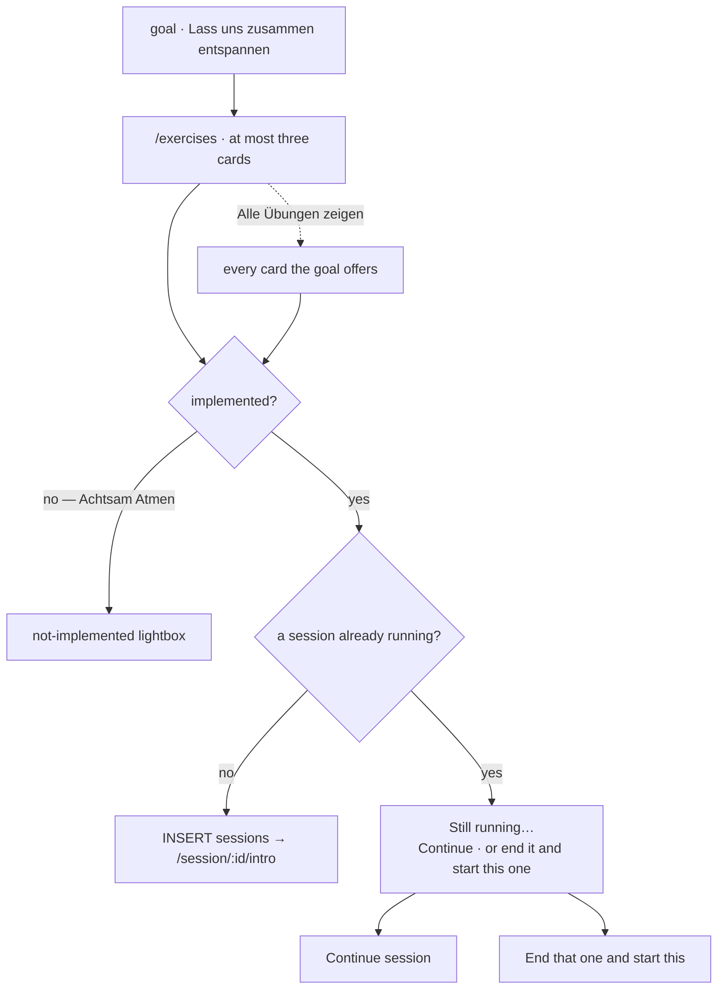

# The exercise library

`/exercises` — eight exercises as cards, with a duration, what you need, and a
picture. A goal decides which of them you see, and the screen shows **at most
three**. Seven of the eight open; one says why it will not.



::: designers
## The screen, top to bottom

- **The headline** — a greeting, then *Lass uns zusammen **entspannen***. The
  goal is a control: pressing it opens the sheet *Was brauchst du gerade?*.
  See [Goals](/features/goals).
- **The toolbar** — *Such mir eine Übung aus*; *Ziel ändern*, which opens the
  same sheet (from `--bp-sm`, 480px; on a phone it sits below the cards instead); the
  **help** button, which brings the onboarding card back; and the switch
  between *Stapel* and *Liste*. The three buttons are filled (`secondary`) and
  stand at one height: the help button is an `IconButton` at the 40px `sm`
  rung, level with the `min` buttons beside it.
- **The pile** (or the list) — the goal's first three exercises, in their own
  order. Swipe or use the chevrons beside it to see another; press one to start
  it.
- **Under the pile** — *Alle Übungen zeigen*, a switch, only when the goal has
  more than three. Then, on a phone, *Ziel ändern*.

## At most three, and the onboarding card says so

Ben, 2026-11-11: fewer to choose between makes choosing easier. The pile and
the list show the first three of whatever the goal offers, and *Alle Übungen
zeigen* shows the rest. Today only *Entspannen* has more than three (six), so
it is the only goal with the switch, and the instruments are behind it. The
switch belongs to one goal: changing the goal turns it off, and a reload
forgets it — it is a look at more, not a setting.

The **onboarding card** lies on top of the pile the first time a browser sees
the screen. It says *Musie schlägt dir immer nur drei Übungen vor, damit du
einfacher aussuchen kannst*, and shows how the pile works: swipe for the next,
press to start. The number is the same constant the pile reads, so the card
cannot promise a different count from the pile it is lying on. It **goes like
a card**: a press, or a swipe either way, takes it off. The help button in the
toolbar brings it back.

## The card

Each exercise card carries its **name**, its **timeframe** as a range, and what
it **needs** ("You need: the Mindfulness Cards set").

The timeframe is a **range** and not a label, and that is a decision with a
history: two fields used to say how long an exercise takes and **they
disagreed** — the range said *2–12 minutes* and a separate label said *about 15
minutes*, both on the same screen. The range won: it is structured, a number
needs no translation, and it cannot drift from itself. Found on the first
walk-through of the hosted app.

## The one that is not built is provisional, not disabled

Achtsam Atmen is drawn normally and says why it will not open when pressed.
That is Layer 3's rule about provisional states doing real work: a greyed-out
card invites the question "is this broken?", and a card that answers it does
not. It is the first card under the default goal, so it is the one most people
meet. *Such mir eine Übung aus* is the one thing that skips it, so the shuffle
can never start something that refuses — and it picks only from the cards that
are shown.

## Starting while one is already running

Only one session can run at a time, enforced by the database. So pressing an
exercise while another session is live is a real, common state, and it is
answered with a choice rather than a refusal:

- **Continue session** — pick it up where you left it;
- **End that one and start this** — and the copy says plainly that *a session
  you end cannot be picked up again.*

## The exercises

| | Exercise | Takes | Needs | Built | Goals |
|---|---|---|---|---|---|
| 1 | Achtsame Pause · Mindful Break | 2–12 min | the deck | **yes** | Achtsamkeit üben |
| 2 | Freie Bahn · Free Rein | 2–5 min | the deck | **yes** | Energie sammeln · Achtsamkeit üben |
| 3 | Achtsam Atmen · Mindful Breathing | 5–8 min | sound | no screens | Entspannen · Energie sammeln |
| 4 | Klangreise · Sound Journey | 10–14 min | sound | **yes** (listening) | Entspannen · Energie sammeln · Achtsamkeit üben |
| 5 | Bodyscan · Body Scan | 4–7 min | sound | **yes** (listening) | Entspannen |
| 6 | Kalimba | 3–10 min | sound | **yes** (instrument) | Entspannen |
| 7 | Marimba | 3–10 min | sound | **yes** (instrument) | Entspannen |
| 8 | Harfe · Harp | 3–10 min | sound | **yes** (instrument) | Entspannen |

The number is `exercises.sort`, which is also the order inside every goal. The
goal column is the whole of what decides which exercises you see. See
[Goals](/features/goals).

## The headline stopped counting

From 2026-10-15 the `h1` said how many — *Drei Übungen zum Entspannen* — and
the count was the pile: every exercise the goal mapped to, built or not. (It
counted only the startable ones for half a day, which read *2 Übungen* over a
pile of three, and Ben reported it as a bug on sight: the count sits directly
above the thing it counts.)

Since 2026-11-11 the pile shows at most three, so a number above it would only
ever say *three*. The number moved to the onboarding card, and the headline
became an invitation.
:::

::: devs
## Files

| | |
|---|---|
| `routes/Exercises.tsx` | the library |
| `lib/content.ts`, `lib/useContent.ts` | the fetch, per locale |
| `lib/session.ts` | `createSession`, and the running-session branch |
| `lib/exerciseKind.ts` | which steps a kind of exercise runs |
| `lib/goals.ts` | the filter, and `startable()` — the shuffle's candidate set |
| `components/GoalSheet.tsx` | the goal sheet behind the headline and *Ziel ändern* |
| `i18n/slot.ts` | splitting the headline around its `InlineButton` |
| `components/DeckGuide.tsx`, `lib/deckGuide.ts` | the onboarding card, and whether this browser has seen it |
| `components/NotImplementedLightbox.tsx` | the refusal |

## Three, as one constant

`SUGGESTED = 3` in `routes/Exercises.tsx`. The pile and the list draw
`visible.slice(0, SUGGESTED)` — `visible` being everything the goal offers —
and `DeckGuide` takes the same number as `count` for its sentence
(`exercises.guide.count`), so the card and the pile cannot disagree.

**The switch is stored as the goal it was turned on for** (`allFor`), so
changing the goal turns it off by construction rather than by an effect a
render late. The deck's `dealKey` carries it too — `relax:all` against
`relax:3` — so showing all deals a fresh pile from the top.

**The onboarding card is the deck's `cover`**, and the deck moves it like a
card. Both endings land in `closeGuide`: the card's own press, and
`onCoverDismiss` when a swipe, a chevron or a key has flown it off. Without the
second, a swiped-away card would leave the screen thinking it was still up, and
the help button could never bring it back.

## `exercises.kind` decides the step list, and the step list is code

One column, four legal values: `card_based`, `digital_interactive`,
`listening_only`, and `instruments` (2026-11-09).

**What each kind's run consists of is in `lib/exerciseKind.ts`, deliberately
not in the database.** A step is a React screen, so a step list in a content
table could promise a screen that does not exist, and a content edit could
empty a run.

> The database says which kind; this module says which screens a kind runs.

It is a `Record`, not a lookup with a fallback, **so a new kind fails the
typecheck** — a value added to the check constraint is then a compile error
here, where the answer has to be written, instead of a run that silently draws
four steps because that is what the `??` said.

The values are snake_case because that is what the column holds. Translating to
camelCase was considered and rejected: unlike `needs_cards` → `needsCards`, the
**value** would move too, so a grep for `listening_only` would find the schema
or the app but never both.

## `needs_cards` is a mirror, not a second answer

```sql
constraint exercises_cards_match_kind check ((kind = 'card_based') = needs_cards)
```

Equality in both directions, so neither column can move alone. `needs_cards` is
kept for rule 9's sake — a column other branches already read — and is now
derived in fact if not in form.

## `listen_gate_seconds` lives on the exercise

Added 2026-09-20. It was a hardcoded 90 in the listen step, carried over from
the prototype, and Ben settled that it **varies** by exercise: a two-minute card
draw and a twenty-minute soundwalk do not earn the same wait.

In `exercises` rather than `exercise_i18n` because it is a number, not copy.
`not null default 90`, and the app caps it at the track's own duration so a gate
longer than the recording is satisfied by finishing it rather than being
unreachable.

**Mindful Break's 90 was the first measured figure** — the prototype's,
arrived at against the real card tracks. Free Rein takes the same 90 because it
plays those same recordings. Since 2026-10-12 Bodyscan (183s) and Klangreise
(574s) gate on their whole recording, because a guided exercise is not a sample
of itself. The instruments take 90, the play step's timer (2026-11-09). Achtsam
Atmen's 60 is still an estimate.

## `duration_label` was dropped

Migration `20260921120000`. Two fields said how long an exercise takes and they
disagreed. Where the detail lightbox had a *Duration* row it now reads the
timeframe through the key the card's fact chip already used — so the fact
survives and has one source.

## The ids are not the names

`body-scan-soundwalk` reads *Bodyscan* on screen. An id is a stable handle that
`sessions.exercise_id` and every diary row point at, so it does not move when
the copy does.
:::

---

**Source of truth:**
[`routes/Exercises.tsx`](https://github.com/product-ben/musie/blob/main/apps/web/src/routes/Exercises.tsx),
[`20261111120000_three_goals.sql`](https://github.com/product-ben/musie/blob/main/supabase/migrations/20261111120000_three_goals.sql),
[`lib/exerciseKind.ts`](https://github.com/product-ben/musie/blob/main/apps/web/src/lib/exerciseKind.ts),
[`20261011100000_exercise_kinds.sql`](https://github.com/product-ben/musie/blob/main/supabase/migrations/20261011100000_exercise_kinds.sql),
[DOMAIN-MODEL.md](https://github.com/product-ben/musie/blob/main/DOMAIN-MODEL.md).
