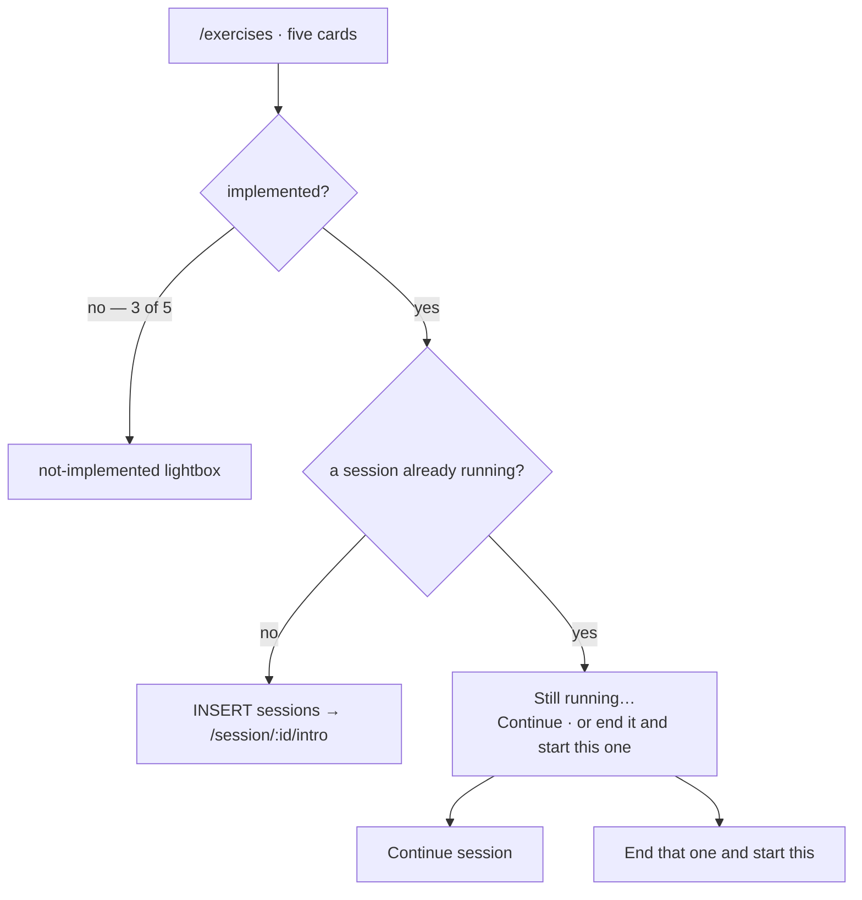

# The exercise library

`/exercises` — five exercises as cards, with a duration, what you need, and a
detail overlay. Two of them open; three say why they will not.



::: designers
## The card

Each exercise card carries its **name**, its **timeframe** as a range, and what
it **needs** ("You need: the Mindfulness Cards set"). A detail overlay explains
what the exercise is.

The timeframe is a **range** and not a label, and that is a decision with a
history: two fields used to say how long an exercise takes and **they
disagreed** — the range said *2–12 minutes* and a separate label said *about 15
minutes*, both on the same screen. The range won: it is structured, a number
needs no translation, and it cannot drift from itself. Found on the first
walk-through of the hosted app.

## Three of five are provisional, not disabled

They are drawn normally and say why they will not open when tapped. That is
Layer 3's rule about provisional states doing real work: a greyed-out card
invites the question "is this broken?", and a card that answers it does not.

## Starting while one is already running

Only one session can run at a time, enforced by the database. So tapping an
exercise while another session is live is a real, common state, and it is
answered with a choice rather than a refusal:

- **Continue session** — pick it up where you left it;
- **End that one and start this** — and the copy says plainly that *a session
  you end cannot be picked up again.*

## The exercises

| | Exercise | Takes | Needs | Built | Goals |
|---|---|---|---|---|---|
| 1 | Achtsame Pause · Mindful Pause | 2–12 min | the deck | **yes** | Achtsamer werden |
| 2 | Freie Bahn · Free Rein | 2–5 min | the deck | **yes** | kennenlernen · Aktivieren · Achtsamer werden |
| 3 | Achtsam Atmen · Mindful Breathing | 5–8 min | sound | no screens | kennenlernen · Entspannen · Aktivieren |
| 4 | Klangreise · Sound Journey | 12–15 min | sound | audio model built | Entspannen · Aktivieren · Achtsamer werden |
| 5 | Bodyscan · Body Scan | 10–12 min | sound | audio model built | kennenlernen · Entspannen |

The goal column is the whole of what decides which exercises you see. See
[Goals](/features/goals).

## The headline says how many, and it is not the number of cards

Since 2026-10-15 the `h1` reads *Drei Übungen zum Entspannen*, and the goal in
it is a link that opens the goal sheet. The number is written out through
twelve and set in figures above it.

**The count is the pile.** Every exercise the goal maps to is counted and
dealt, built or not — so the number above the deck is always the number of
cards in it.

It counted only the STARTABLE ones for half a day, which read *2 Übungen* over
a deck of three cards because Achtsam Atmen has no screens. Both numbers are
defensible in a document and only one of them is defensible on a page: the
count sits directly above the thing it counts. Ben reported it as a bug on
sight.

What has not changed is that **the unbuilt ones are still dealt and still
refuse** — filtering them out "would quietly show two exercises where the
product has five", which is the rule the screen has carried since the deck
shipped. *Such mir eine Übung aus* is the one thing that skips them, so the
shuffle can never start something that refuses.
:::

::: devs
## Files

| | |
|---|---|
| `routes/Exercises.tsx` | the library |
| `lib/content.ts`, `lib/useContent.ts` | the fetch, per locale |
| `lib/session.ts` | `startSession`, and the running-session branch |
| `lib/exerciseKind.ts` | which steps a kind of exercise runs |
| `lib/goals.ts` | the filter, and `startable()` — the shuffle's candidate set |
| `components/GoalSheet.tsx` | the goal sheet behind the headline |
| `i18n/slot.ts` | splitting the headline around its link |
| `components/NotImplementedLightbox.tsx` | the refusal |

## `exercises.kind` decides the step list, and the step list is code

One column, three legal values: `card_based`, `digital_interactive`,
`listening_only`.

**What each kind's run consists of is in `lib/exerciseKind.ts`, deliberately
not in the database.** A step is a React screen, so a step list in a content
table could promise a screen that does not exist, and a content edit could
empty a run.

> The database says which kind; this module says which screens a kind runs.

It is a `Record`, not a lookup with a fallback, **so a fourth kind fails the
typecheck** — a fourth value added to the check constraint is then a compile
error here, where the answer has to be written, instead of a run that silently
draws four steps because that is what the `??` said.

The values are snake_case because that is what the column holds. Translating to
camelCase was considered and rejected: unlike `needs_cards` → `needsCards`, the
**value** would move too, so a grep for `listening_only` would find the schema
or the app but never both.

## `needs_cards` is a mirror, not a second answer

```sql
constraint exercises_cards_match_kind check ((kind = 'card_based') = needs_cards)
```

Equality in both directions, so neither column can move alone. `needs_cards` is
kept for rule 9's sake — a column other branches already read — and is now
derived in fact if not in form.

## `listen_gate_seconds` lives on the exercise

Added 2026-09-20. It was a hardcoded 90 in the listen step, carried over from
the prototype, and Ben settled that it **varies** by exercise: a two-minute card
draw and a twenty-minute soundwalk do not earn the same wait.

In `exercises` rather than `exercise_i18n` because it is a number, not copy.
`not null default 90`, and the app caps it at the track's own duration so a gate
longer than the recording is satisfied by finishing it rather than being
unreachable.

**Only Mindful Pause's 90 is measured** — it is the prototype's figure, arrived
at against the real card tracks. Free Rein takes the same 90 because it plays
those same recordings. The other three are estimates proportional to their
timeframes (60s, 180s, 180s) and are flagged as such.

## `duration_label` was dropped

Migration `20260921120000`. Two fields said how long an exercise takes and they
disagreed. Where the detail lightbox had a *Duration* row it now reads the
timeframe through the key the card's fact chip already used — so the fact
survives and has one source.

## The ids are not the names

`body-scan-soundwalk` reads *Bodyscan* on screen. An id is a stable handle that
`sessions.exercise_id` and every diary row point at, so it does not move when
the copy does.
:::

---

**Source of truth:**
[`routes/Exercises.tsx`](https://github.com/product-ben/musie/blob/main/apps/web/src/routes/Exercises.tsx),
[`lib/exerciseKind.ts`](https://github.com/product-ben/musie/blob/main/apps/web/src/lib/exerciseKind.ts),
[`20261011100000_exercise_kinds.sql`](https://github.com/product-ben/musie/blob/main/supabase/migrations/20261011100000_exercise_kinds.sql),
[DOMAIN-MODEL.md](https://github.com/product-ben/musie/blob/main/DOMAIN-MODEL.md).
