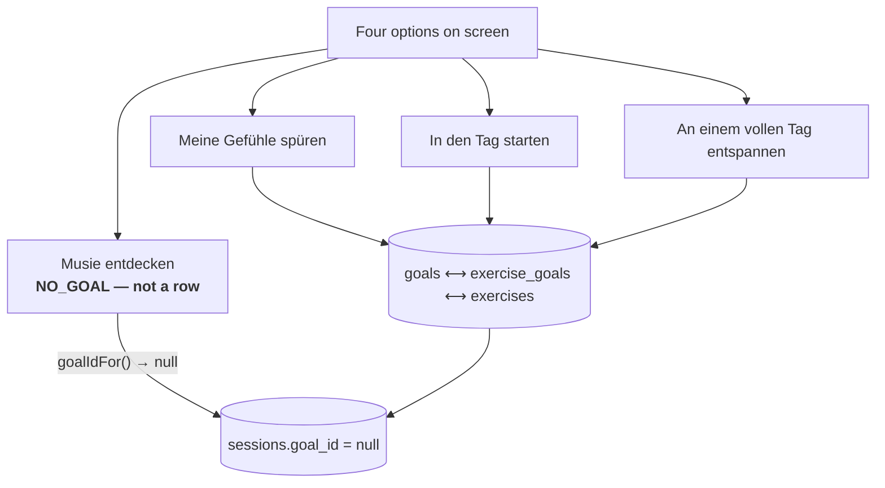

# Goals

Three goals, four options, and the fourth one is **the absence of a goal**
rather than a row. Modelled end to end; the entry screen that would ask is not
built.



::: designers
## What a goal is for

The reason somebody starts an exercise. Every exercise is mapped to one or more
goals, and every session records which goal it came from.

**Three goals are designed as the entry axis** — *feel my feelings · start the
day · unwind after a full one* — and the session remembers. What is missing is
the screen that asks.

So this is prepared segmentation of the offer, and it is the clearest thing in
the product that is finished in the data and absent from the interface.

## "Musie entdecken" is not a goal

The fourth option means *show me everything*, and it is modelled as **the lack
of a goal** rather than as a row mapped to every exercise.

Why that matters: a row would have to be re-mapped every time an exercise is
added — and the day somebody forgot, **the one option that promises everything
would quietly stop delivering it.** Absence cannot fall out of step with the
catalogue.

## Three states, not two

The screen draws three different things, and conflating two of them is the bug
this distinction exists to prevent:

| State | Means | Drawn as |
|---|---|---|
| not known yet | the goals are still in flight | nothing |
| *Musie entdecken* | show me everything | every exercise, the pile dealt |
| a goal | this one | the exercises mapped to it |

## There is a tool for the mapping

`/goal-mappings` — unlinked, typed by hand — shows which exercises each goal
offers, as a thing you can tick. It **writes nothing**: it emits the
configuration, which becomes the next migration. See
[Dev tools](/features/dev-tools).
:::

::: devs
## Files

| | |
|---|---|
| `lib/goals.ts` | what a choice **is**, where it is remembered, what it filters |
| `components/GoalPicker.tsx` | the control |
| `lib/content.ts` | the query |
| `routes/GoalMappings.tsx` | the unlinked editing tool |
| `goals`, `goal_i18n`, `exercise_goals` | the tables |

`lib/goals.ts` owns three facts and nothing else. The query is in
`content.ts`, the hook in `useContent.ts`, the picker is a component, and the
screen decides what to draw.

## `NO_GOAL` never reaches the database

It needs a value on screen regardless, because `RadioGroupText` identifies an
option by a string. `goalIdFor()` is **the one place** it turns back into
`null`.

```
null      → not known yet
NO_GOAL   → "Musie entdecken"  → goalIdFor() → null
an id     → a goal              → that id
```

## What `null` meant changed, and the file did not

It meant "nobody has chosen yet", and `/exercises` drew the question over an
empty list. On 2026-10-07 that stopped being true, and the comment in
`lib/goals.ts` carries the note — worth reading before touching the three-state
logic.

## The rename, in one migration

`situations` → `goals`, `situation_i18n` → `goal_i18n`, `exercise_situations` →
`exercise_goals`, and `sessions.situation_id` → `goal_id`. Plus every index and
every policy, in `20261007100000_goals_rename.sql`.

`db.security.db.test.ts` asserts the renamed tables **kept the access they
had** and that the old names **no longer answer** — which is the pair of checks
a rename needs and the second of which is easy to forget.

## `sessions.goal_id` is `on delete set null`

The goal is how the exercise was *found*, not what was done. Compare
`exercise_id`, which is `restrict`.
:::

---

**Source of truth:**
[`lib/goals.ts`](https://github.com/product-ben/musie/blob/main/apps/web/src/lib/goals.ts),
[`20261007100000_goals_rename.sql`](https://github.com/product-ben/musie/blob/main/supabase/migrations/20261007100000_goals_rename.sql),
[DOMAIN-MODEL.md](https://github.com/product-ben/musie/blob/main/DOMAIN-MODEL.md).
