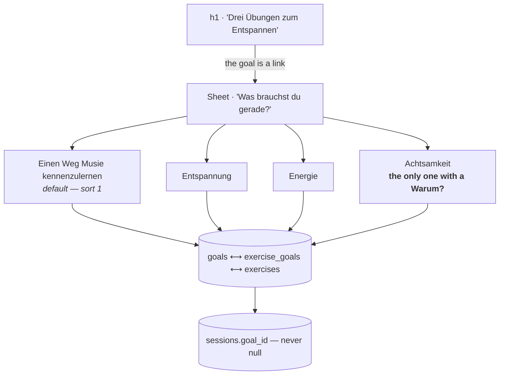

# Goals

Four goals, four rows, and the goal is the **headline** of `/exercises` rather
than a filter beside it. Picking one opens a sheet that says what each is for.



::: designers
## What a goal is for

The reason somebody starts an exercise. Every exercise is mapped to one or
more goals, every session records which goal it came from, and **the goal is
the only way an exercise is reachable** — there is no *show me everything*.

## The headline is the filter

User testing found people stalling at the door of a mindfulness exercise —
*warum sollte ich das machen?*, *was soll das bringen?* — and the filter,
which worked, named the goals without ever saying what any of them was for.

So the largest line on the screen stopped asking a question and started
carrying the offer:

| goal | German | English |
|---|---|---|
| `get-to-know-musie` | Drei Übungen zum **Musie kennenlernen** | Three exercises to **get to know Musie** |
| `relax` | Drei Übungen zum **Entspannen** | Three exercises to **relax** |
| `wake-up` | Drei Übungen zum **Aktivieren** | Three exercises to **get going** |
| `mindfulness` | Drei Übungen zum **Achtsamer werden** | Three exercises to **grow more mindful** |

The number is **written out** through twelve and set in figures above it —
the ordinary rule for prose, and a headline is prose.

The bold part is a link. Pressing it opens the sheet.

## A goal is said three ways

Not one string reused. The grammar differs, so no screen can derive one from
another:

| | German | where |
|---|---|---|
| `label` | *Entspannung* | the headline of its card in the sheet — it answers *Was brauchst du gerade?*, so it is a noun |
| `purpose` | *Entspannen* | the page's `h1`, after *zum* |
| `why` | two sentences | under a bold **Warum?** on the card |

English hides the difference well enough (*relax* against *Relaxation*) that
one column would have looked sufficient. German does not.

## Only one goal carries a *Warum?*

Ben, 2026-10-15: *"Musie kennenlernen", "Entspannung" und "Aktivierung"
brauchen keinen description text.*

*Entspannung* and *Energie* name a state you already know you want.
Explaining them is explaining the obvious. **Achtsamkeit is the abstract
one**, and it is the one the testing actually heard the question about — so
the explanation goes where the question was asked, and lands because it is
the only body text in the sheet.

`goal_i18n.why` is therefore **nullable, and null is data** rather than a
missing translation.

## "Musie kennenlernen" used to be the absence of a goal

It meant *show me everything*, and it was modelled as the LACK of a goal
rather than as a row — because a row mapped to every exercise falls out of
step the first time somebody adds an exercise and forgets to map it.

That argument was right and stopped applying on 2026-10-15, when it was given
three named exercises of its own. It is a row now, and two things follow:
**there is no show-everything option**, and **`sessions.goal_id` is never null
again**, which is better diary data than the old default of recording nothing.

## The mapping

| goal | exercises |
|---|---|
| Musie kennenlernen | Achtsam Atmen · Bodyscan · Freie Bahn |
| Entspannen | Klangreise · Bodyscan · Achtsam Atmen |
| Aktivieren | Klangreise · Achtsam Atmen · Freie Bahn |
| Achtsamer werden | Achtsame Pause · Freie Bahn · Klangreise |

Three each, and between them all five exercises are reachable. Two things
worth knowing:

- **Achtsame Pause appears under one goal only.** It is the exercise the paper
  deck exists for, so somebody who never picks *Achtsamer werden* never meets
  the deck. Deliberate, and logged.
- **Achtsam Atmen is in three of the four and is not built.** It is still
  counted and still dealt — the headline reports the pile — and pressing it
  opens the *not built yet* refusal. See
  [the exercise library](/features/exercises).

## The default is the first card

*Einen Weg Musie kennenzulernen*, because it is `sort = 1`. Not a hardcoded
id: the sheet renders in `sort` order and the default is the first of them, so
"the default goal" and "the first card" are one fact that cannot drift. Moving
it is a migration.

Whatever is chosen is remembered in `localStorage` and survives the browser
being closed.

## There is a tool for the mapping

`/goal-mappings` — unlinked, typed by hand — shows which exercises each goal
offers, as a thing you can tick. It **writes nothing**: it emits the
configuration, which becomes the next migration. See
[Dev tools](/features/dev-tools).
:::

::: devs
## Files

| | |
|---|---|
| `lib/goals.ts` | what a choice **is**, where it is remembered, what it filters, and which of the filtered can be started |
| `components/GoalSheet.tsx` | the sheet |
| `i18n/slot.ts` | splitting the headline around the link |
| `lib/content.ts` | the query |
| `routes/GoalMappings.tsx` | the unlinked editing tool |
| `goals`, `goal_i18n`, `exercise_goals` | the tables |

`lib/goals.ts` owns four facts and nothing else. The query is in `content.ts`,
the hook in `useContent.ts`, the sheet is a component, and the screen decides
what to draw.

## Two states, not three

`NO_GOAL` and `goalIdFor()` are **gone** (2026-10-15). A choice is always a
real goal id.

```
null     → not known yet, the goals are in flight
an id    → this goal
```

`null` keeps exactly one job: the window before the goals have landed, which
the screen waits out rather than draws. It has not meant "nobody has chosen"
since 2026-10-07, and now it cannot.

**A browser still holding `__none__`** from before the sentinel went falls back
for free: `readCachedGoal` validates the stored id against the goals that
actually exist, and no row can spell it. Asserted in `goals.test.ts`.

## `startable()` is the shuffle's candidate set

*Such mir eine Übung aus* draws from it, so the shuffle can never start an
exercise that would refuse. It is also what disables the button when a goal
offers nothing built.

**The headline does NOT count it** — it counts the pile. It counted
`startable()` for half a day and Ben reported it as a bug on sight: the
number sits directly above the cards it counts, so it has to be the number of
cards there, whatever the reasoning behind the smaller figure.

## The headline is one string per locale, split on `{goal}`

`translate()` leaves an unmatched slot verbatim, and `splitSlot()` cuts the
rendered sentence there so the screen can put an `InlineLink` in the gap.

Not a prefix key and a suffix key: the slot can sit anywhere a language puts
it, including first, and whoever translates reads a sentence rather than
three fragments. `parity.test.ts` asserts all six headline strings still
contain the slot — the ordinary slot-parity test cannot catch a locale that
dropped it from both forms.

## The rename, in one migration

`situations` → `goals`, `situation_i18n` → `goal_i18n`, `exercise_situations` →
`exercise_goals`, and `sessions.situation_id` → `goal_id`. Plus every index and
every policy, in `20261007100000_goals_rename.sql`.

`db.security.db.test.ts` asserts the renamed tables **kept the access they
had** and that the old names **no longer answer** — which is the pair of checks
a rename needs and the second of which is easy to forget.

## `sessions.goal_id` is `on delete set null`

The goal is how the exercise was *found*, not what was done. Compare
`exercise_id`, which is `restrict`.

## What the mapping is tested for

`db.content.db.test.ts`, because with no show-everything option the mapping is
the only thing making an exercise reachable, and a hole in it is silent:

- four goals, both locales, a non-empty `purpose` on each;
- `get-to-know-musie` is `sort = 1`, so the default is what it should be;
- every exercise has at least one goal — **nothing stranded**;
- every goal has at least one exercise;
- no goal offers only exercises that are not built.
:::

---

**Source of truth:**
[`lib/goals.ts`](https://github.com/product-ben/musie/blob/main/apps/web/src/lib/goals.ts),
[`20261015140000_the_headline_is_the_filter.sql`](https://github.com/product-ben/musie/blob/main/supabase/migrations/20261015140000_the_headline_is_the_filter.sql),
[GOAL-FILTER.md](https://github.com/product-ben/musie/blob/main/GOAL-FILTER.md),
[DOMAIN-MODEL.md](https://github.com/product-ben/musie/blob/main/DOMAIN-MODEL.md).
