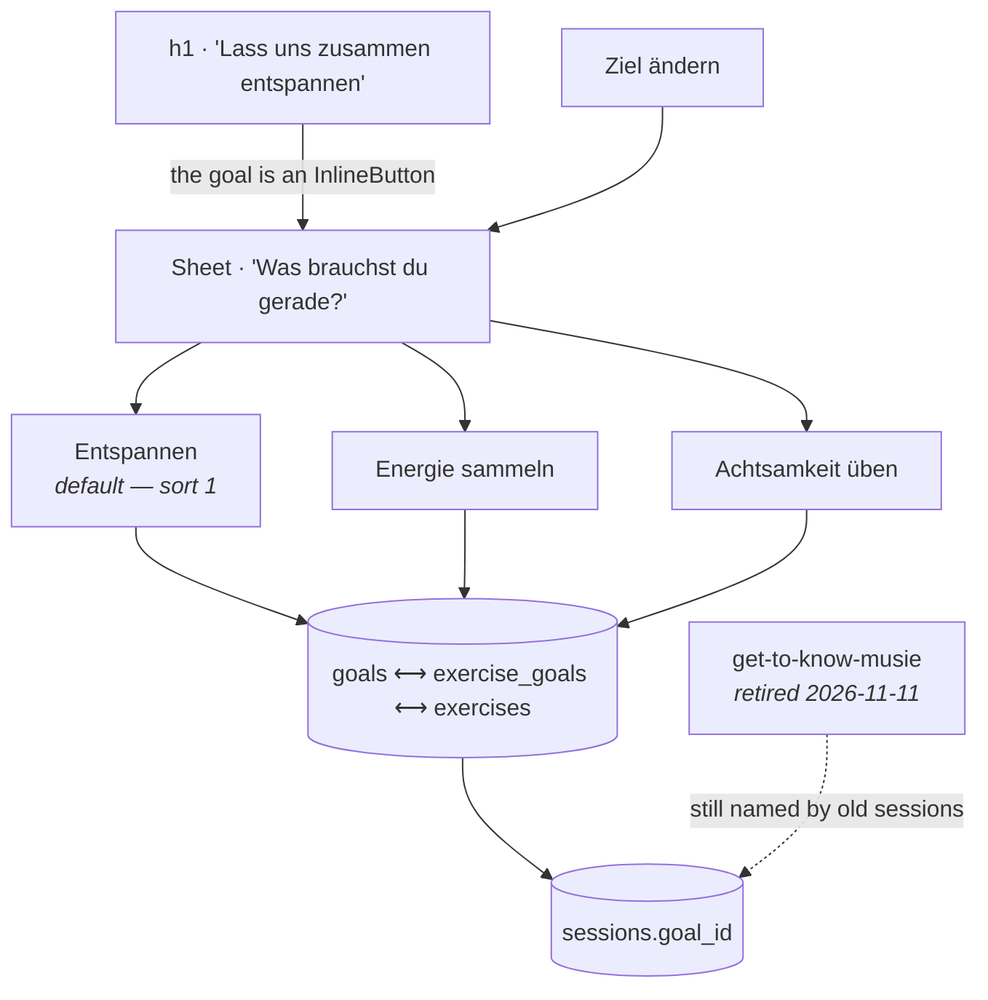

# Goals

Three goals, and the goal is the **headline** of `/exercises` rather than a
filter beside it: *Lass uns zusammen **entspannen***. Pressing the goal, or
*Ziel ändern*, opens a sheet that says what each is for.



::: designers
## What a goal is for

The reason somebody starts an exercise. Every exercise is mapped to one or
more goals, every session records which goal it came from, and **the goal is
the only way an exercise is reachable** — there is no *show me everything*.

## The headline is the filter

User testing found people stalling at the door of a mindfulness exercise —
*warum sollte ich das machen?*, *was soll das bringen?* — and the filter,
which worked, named the goals without ever saying what any of them was for.

So the largest line on the screen stopped asking a question and started
carrying the offer. Since 2026-11-11 it is an invitation rather than a count:

| goal | German | English |
|---|---|---|
| `relax` | Lass uns zusammen **entspannen** | Let's **relax** together |
| `wake-up` | Lass uns zusammen **Energie sammeln** | Let's **recharge** together |
| `mindfulness` | Lass uns zusammen **Achtsamkeit üben** | Let's **practise mindfulness** together |

A time-of-day greeting goes in front of it, in the same `h1` and in muted
ink: *Guten Tag. Lass uns zusammen entspannen*.

The bold part is an **`InlineButton`**: the heading's own ink, a filter glyph,
and a standing 2px underline in `--border-strong`, which is the cue that it is
a control. Pressing it opens the sheet. *Ziel ändern*, a labelled button, opens
the same sheet — in the toolbar from `--bp-md`, below the cards on a phone —
for anybody who reads a word in a sentence as a word.

The number left the headline on the same day. It is on the onboarding card
now — see [the exercise library](/features/exercises).

## A goal is said three ways

Three columns, because the three places need different words:

| | German | where |
|---|---|---|
| `label` | *Entspannen* | the headline of its card in the sheet |
| `purpose` | *entspannen* | the end of *Lass uns zusammen …* — a verb phrase, so lower case where German is lower case |
| `why` | two sentences | under a bold **Warum?** on the card |

Until 2026-11-11 the label was a noun answering *Was brauchst du gerade?*
(*Entspannung*) and the purpose a phrase after *zum* (*zum Entspannen*). Now
the label is the purpose capitalised as a heading, so the card you press and
the sentence that reports it say the same words.

## Every goal carries a *Warum?*

On 2026-10-15 only Achtsamkeit did: Ben ruled the others named a state you
already know you want. With three cards side by side and one of them
explaining itself, the other two read as unfinished, so since 2026-11-11 each
has two sentences of its own — relax about the body letting go, wake-up about
attention when you are flat, mindfulness about staying calm under stress.

`goal_i18n.why` stays **nullable, and null is data**: a card without one is a
headline alone, not a missing translation.

## *Musie kennenlernen* is retired

It started as the absence of a goal — *show me everything* — and became a row
(`get-to-know-musie`) with three named exercises on 2026-10-15, and the default.

On 2026-11-11 it left the offer. It is **retired, not deleted**:
`sessions.goal_id` points at it from every session started while it was the
default, and `on delete set null` would have quietly blanked the goal on all of
those diary entries. So the row stays, with both of its translations so old
entries keep their name, parked at `sort = 1001` and flagged `retired`. It
serves no exercise any more, and nothing offers it.

## The mapping

| goal | exercises, in order |
|---|---|
| Entspannen | Achtsam Atmen · Klangreise · Bodyscan · *Kalimba · Marimba · Harfe* |
| Energie sammeln | Freie Bahn · Achtsam Atmen · Klangreise |
| Achtsamkeit üben | Achtsame Pause · Freie Bahn · Klangreise |

The order is `exercises.sort`. The screen shows **at most three** of a goal's
exercises — the first three — and *Alle Übungen zeigen* shows the rest. Today
only *Entspannen* has more than three, so it is the only goal with that switch;
the instruments are behind it. Things worth knowing:

- **Achtsame Pause appears under one goal only.** It is the exercise the paper
  deck exists for, so somebody who never picks *Achtsamkeit üben* never meets
  the deck. Deliberate, and logged.
- **Achtsam Atmen is under two goals and is not built** — and it is the first
  card under the default. It is still dealt, and pressing it opens the *not
  built yet* refusal. See [the exercise library](/features/exercises).

## The default is the first card

*Entspannen*, because it is `sort = 1`. Not a hardcoded id: the sheet renders
in `sort` order and the default is the first of them, so "the default goal" and
"the first card" are one fact that cannot drift. It moved from *Musie
kennenlernen* on 2026-11-11 by exactly that: a migration, and no code change.

Whatever is chosen is remembered in `localStorage` and survives the browser
being closed. A browser that remembered *Musie kennenlernen* opens on the
default.

## There is a tool for the mapping

`/goal-mappings` — unlinked, typed by hand — shows which exercises each goal
offers, as a thing you can tick. It **writes nothing**: it emits the
configuration, which becomes the next migration. See
[Dev tools](/features/dev-tools).
:::

::: devs
## Files

| | |
|---|---|
| `lib/goals.ts` | what a choice **is**, where it is remembered, what it filters, and which of the filtered can be started |
| `components/GoalSheet.tsx` | the sheet |
| `i18n/slot.ts` | splitting the headline around the `InlineButton` |
| `lib/content.ts` | the query — `getGoals()` reads `retired = false` |
| `routes/GoalMappings.tsx` | the unlinked editing tool |
| `goals`, `goal_i18n`, `exercise_goals` | the tables |

`lib/goals.ts` owns four facts and nothing else. The query is in `content.ts`,
the hook in `useContent.ts`, the sheet is a component, and the screen decides
what to draw.

## Two states, not three

`NO_GOAL` and `goalIdFor()` are **gone** (2026-10-15). A choice is always a
real goal id.

```
null     → not known yet, the goals are in flight
an id    → this goal
```

`null` keeps exactly one job: the window before the goals have landed, which
the screen waits out rather than draws. It has not meant "nobody has chosen"
since 2026-10-07, and now it cannot.

**A browser still holding `__none__`** from before the sentinel went, or
`get-to-know-musie` from before it was retired, falls back for free:
`readCachedGoal` validates the stored id against the goals `getGoals()`
offers, and neither is among them. Asserted in `goals.test.ts`.

## Retired is a flag, filtered in the query

`goals.retired boolean not null default false`, and `getGoals()` asks for
`retired = false` in the same change — a flag nothing reads would be a comment
with a column type. The RLS policy stays `using (true)`: retirement decides
what is OFFERED, not who may READ, and an old diary entry must still be able to
name its goal. Both grants on `goals` are table-level, so the new column needed
none (rule 2).

## `startable()` is the shuffle's candidate set

*Such mir eine Übung aus* draws from it, so the shuffle can never start an
exercise that would refuse. Since 2026-11-11 it draws from what is **shown** —
the first three, or all of them with the switch on — so it never deals a card
the pile is not showing. It is also what disables the button when nothing shown
is built.

## The headline is one string per locale, split on `{goal}`

`translate()` leaves an unmatched slot verbatim, and `splitSlot()` cuts the
rendered sentence there so the screen can put an `InlineButton` in the gap.

Not a prefix key and a suffix key: the slot can sit anywhere a language puts
it — mid-sentence in English, last in German — and whoever translates reads a
sentence rather than three fragments. `parity.test.ts` asserts both headline
forms (`exercises.headline.together` and `.none`) still contain the slot in
both locales — the ordinary slot-parity test cannot catch a locale that dropped
it from both forms — and that neither carries `{count}`, which belongs to the
onboarding card's `exercises.guide.count`.

## The rename, in one migration

`situations` → `goals`, `situation_i18n` → `goal_i18n`, `exercise_situations` →
`exercise_goals`, and `sessions.situation_id` → `goal_id`. Plus every index and
every policy, in `20261007100000_goals_rename.sql`.

`db.security.db.test.ts` asserts the renamed tables **kept the access they
had** and that the old names **no longer answer** — which is the pair of checks
a rename needs and the second of which is easy to forget.

## `sessions.goal_id` is `on delete set null`

The goal is how the exercise was *found*, not what was done. Compare
`exercise_id`, which is `restrict`. It is also why a goal is retired rather
than deleted.

## What the mapping is tested for

`db.content.db.test.ts`, because with no show-everything option the mapping is
the only thing making an exercise reachable, and a hole in it is silent:

- three goals offered — relax, wake-up, mindfulness — each in both locales with
  a non-empty `purpose`;
- `relax` is `sort = 1`, so the default is what it should be;
- `get-to-know-musie` is still a row, retired, with both translations, parked
  above 1000, and never offered;
- every exercise is under at least one **offered** goal — **nothing stranded**;
- every offered goal has at least one exercise, and a retired one has none;
- no goal offers only exercises that are not built.
:::

---

**Source of truth:**
[`lib/goals.ts`](https://github.com/product-ben/musie/blob/main/apps/web/src/lib/goals.ts),
[`20261111120000_three_goals.sql`](https://github.com/product-ben/musie/blob/main/supabase/migrations/20261111120000_three_goals.sql),
[`20261015140000_the_headline_is_the_filter.sql`](https://github.com/product-ben/musie/blob/main/supabase/migrations/20261015140000_the_headline_is_the_filter.sql),
[GOAL-FILTER.md](https://github.com/product-ben/musie/blob/main/GOAL-FILTER.md),
[DOMAIN-MODEL.md](https://github.com/product-ben/musie/blob/main/DOMAIN-MODEL.md).
