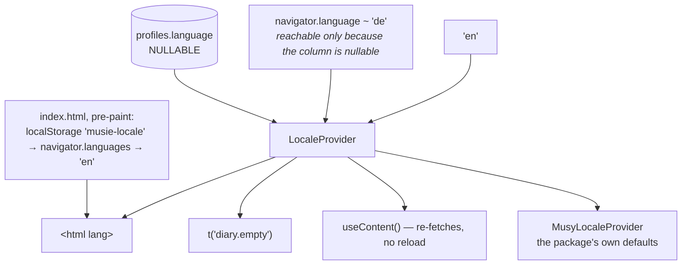

# Two languages

German and English, complete, switchable with **no reload**. No i18n library —
two locales and a flat catalogue do not need one.



::: designers
## The resolution order

1. **`profiles.language`** — an explicit choice, and it follows the user to any
   device.
2. **What the browser asks for**, consulted only when no choice has been
   recorded.
3. **English.**

The cached locale in the browser is **not** part of that order. It is a
first-paint guess so the chrome is not briefly wrong, and the profile always
wins once it arrives.

## Language and theme are mirrored, not parallel

This is the pair worth understanding, because they look symmetrical and are
not:

| | Source of truth | Why |
|---|---|---|
| **Language** | `profiles.language` | there is no flash-of-wrong-language to solve — nothing is painted before React runs except `<html lang>`, and correcting that costs nothing visible |
| **Theme** | `localStorage` | a flash of the wrong theme **is** the whole problem, and it has to be decided before the first stylesheet loads |

## `<html lang>` is not cosmetic

The tokens set `hyphens: auto`, which twelve rules consume — and `hyphens:
auto` hyphenates by the element's **declared** language.

German copy under `lang="en"` does not fail loudly. **It breaks German
compounds at English hyphenation points**, which is worse than no hyphenation
and invisible until somebody reads it.

So it is set before the first paint and kept in step after.

## The language names are in their own language

A German speaker looking for German looks for **Deutsch**, not *German*. So the
picker shows endonyms, and they deliberately do **not** go through the
translation function — translating them is the bug.

## Switching does not reload

Pick the other language and the chrome changes and the content **re-fetches**.
Nothing is lost, no page reloads, and the session you are in continues.

## The copy is in two places with two lifespans

See [Content and copy](/product/content). Chrome is ours and permanent; content
comes from the spreadsheet and is provisional.

## Dates are formatted for the right region

`'en'` alone resolves to **en-US** in a browser, which renders "September 19,
2026 at 2:32 PM" — American month-first dates and a 12-hour clock, to a user
who asked for English in Germany. The locale id and the formatting tag are
therefore not the same string.
:::

::: devs
## Files

| | |
|---|---|
| `i18n/en.ts` | the catalogue **and the type** — 394 keys |
| `i18n/de.ts` | typed against `en.ts` |
| `i18n/index.ts` | `translate()`, `useT()`, `LOCALES`, `LOCALE_LABELS`, the Intl tag |
| `i18n/localeContext.ts` | the context |
| `i18n/parity.test.ts` | the two catalogues agree |
| `LocaleProvider.tsx` | the active locale, and `<html lang>` |
| `PublicLocaleProvider.tsx` | the same context for `/beta`, without a profile |
| `index.html` | the pre-paint script |

## No library, deliberately

German plurals follow the same one/other rule as English, so there is nothing
for ICU message format to do. **If a third locale or real plural rules arrive,
that is the moment to add a library** — deliberately, rather than by default.

## Nothing in `i18n/index.ts` holds state

The active locale lives in `LocaleProvider`, because it can change at runtime
and the UI has to re-render when it does. An earlier version resolved it once at
import time, which was correct while there was no way to change it and wrong the
moment there was.

## `MessageKey` is the enforcement

```ts
export type MessageKey = keyof typeof en;
```

So an unknown key is a **typecheck error**, not a runtime fallback. And `de.ts`
is typed against `en.ts`, so **a key added in English without German fails
`pnpm check`.**

That is the whole mechanism for chrome parity. `parity.test.ts` is the belt to
that braces.

## `profiles.language` is nullable, and that is load-bearing

While it was `not null default 'en'` the browser-language branch was **dead
code**: there was never a row without a language, so step 2 could not be
reached. `20260918153000_profiles_language_nullable.sql` made null mean *no
choice recorded*.

## The pre-paint script duplicates one constant

`index.html` cannot import from `src/i18n/index.ts`, so the `'musie-locale'`
storage key exists in both. **The two must agree** — it says so in both places.

Two sources in the same order the app uses: the cached choice, then what the
browser asks for, so a German browser's **first** paint is already German
rather than one frame of English.

## The design system's own words follow the app

`MusyLocaleProvider`, mounted inside `LocaleProvider` in `main.tsx`. Every
component default the package ships — including ones with no prop at all, like
`Badge`'s and `Message`'s screen-reader status word — reads from the package
catalogue through it.

Unmounted, that set speaks German, so an English session would announce
*"Fehler: …"* to exactly the users who cannot see the colour.

It is a **component rather than a value** because the locale changes at runtime
with no reload: a module-level setter would not re-render anything.

**It does not soften rule 7.** The app still passes every user-visible string
explicitly; the catalogue is the floor under the strings a screen cannot pass.

## Content falls back and warns

`pickTranslation()` in `lib/content.ts` falls back to English **and warns**.
There is a unit test that turns red if the fallback is deleted — and
`lib/diary.ts` **imports** it rather than copying it, because a second copy is a
second place for the warning to be deleted from.

## Finding holes

```sql
select * from public.missing_translations;
```

Do **not** translate `tracks`: a title and an artist name are not translated,
which is why that table has no `_i18n` sibling.
:::

---

**Source of truth:**
[`apps/web/src/i18n/`](https://github.com/product-ben/musie/tree/main/apps/web/src/i18n),
[`LocaleProvider.tsx`](https://github.com/product-ben/musie/blob/main/apps/web/src/LocaleProvider.tsx),
[`apps/web/index.html`](https://github.com/product-ben/musie/blob/main/apps/web/index.html),
[CLAUDE.md](https://github.com/product-ben/musie/blob/main/CLAUDE.md) rules 5, 6 and 7.
