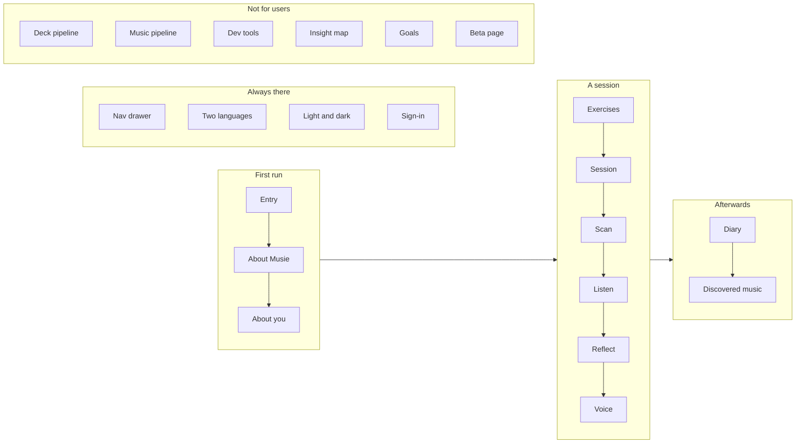

# Features at a glance

Twenty-one surfaces, one page each. The table is the map; the diagram is the
order a person meets them in.

::: designers
## The twenty-one

| | What it is | Built |
|---|---|---|
| [Entry](/features/entry) | where `/` sends you | yes |
| [About Musie](/features/about-musie) | the explainer, in a chat rhythm | yes |
| [About you](/features/about-you) | one question, four answers, one built | partly |
| [The exercise library](/features/exercises) | five exercises as cards | yes |
| [A session](/features/session) | four steps, one at a time | yes |
| [Scanning a card](/features/scan) | three ways to name a card | yes |
| [Listening](/features/listen) | the gate, and the reveal | yes |
| [Reflecting](/features/reflect) | write · speak · photograph | 2 of 3 |
| [Voice capture](/features/voice) | live transcription, nothing stored | yes |
| [The diary](/features/diary) | a list of moments, and a graph | yes |
| [Discovered music](/features/discovered-music) | what you have actually played | yes |
| [Goals](/features/goals) | modelled; nothing asks | data only |
| [The nav drawer](/features/nav-drawer) | one overlay, action first | yes |
| [Signing in](/features/sign-in) | the gate that keeps the beta closed | yes |
| [The closed beta](/features/beta) | the one public page | yes |
| [Two languages](/features/i18n) | DE + EN, no reload | yes |
| [Light and dark](/features/theming) | manual, pre-paint | yes |
| [The paper deck](/features/deck-pipeline) | one file → a migration and a PDF | yes |
| [The music pipeline](/features/music-pipeline) | pieces and cuts | yes |
| [The insight map](/features/insight-map) | the org, as a canvas | first step |
| [Dev tools](/features/dev-tools) | four unlinked screens | yes |

## What is NOT built, collected in one place

Worth reading as a list, because each one is answered separately on its own
page and the shape only shows up together:

- **Three of five exercises.** Mindful Breathing has no screens; the two
  listening exercises have their audio model built and no step UI.
- **Three of the four "Here as" answers.** Each is a different business.
- **The photo reflection.** The surface exists; the handwriting recognition is
  undecided.
- **The goal question.** Every exercise is mapped, every session records it,
  nothing asks.
- **Five of nine recordings**, and the music for the three sound exercises.
- **Per-card artwork.** The print falls back to the feeling in type; no screen
  renders a card image at all.
- **Self-service sign-up and password reset.** Both need a sending domain.
- **A dedicated accessibility pass.**
:::

::: devs
## Where each one lives

| Feature | Entry point |
|---|---|
| Entry | `lib/entry.ts` · `routes/Entry.tsx` |
| About Musie | `routes/AboutMusie.tsx` |
| About you | `routes/AboutYou.tsx` |
| Exercises | `routes/Exercises.tsx` · `lib/exerciseKind.ts` |
| Session | `lib/sessionMachine.ts` · `routes/Session.tsx` |
| Scan | `lib/scanCode.ts` · `lib/useCardScanner.ts` · `routes/ScanLink.tsx` |
| Listen | `components/SessionListen.tsx` · `lib/audio.ts` · `lib/reveal.ts` |
| Reflect | `components/SessionReflect.tsx` · `lib/reflect.ts` · `lib/statements.ts` |
| Voice | `features/voice/` (its own package) |
| Diary | `lib/diary.ts` · `components/DiaryGraph.tsx` |
| Discovered music | `lib/discovered.ts` |
| Goals | `lib/goals.ts` |
| Nav drawer | `components/NavDrawer.tsx` · `components/MenuPreferences.tsx` |
| Sign-in | `components/SignInGate.tsx` · `lib/signIn.ts` |
| Beta | `components/BetaSignup.tsx` · `lib/publicRoute.ts` |
| i18n | `apps/web/src/i18n/` · `LocaleProvider.tsx` |
| Theming | `tokens/theme-init.js` (inlined in `index.html`) |
| Deck | `supabase/content/deck.json` · `scripts/deck-*.mjs` |
| Music | `supabase/content/music.json` · `scripts/music-*.mjs` |
| Insight map | `routes/InsightMap.tsx` · `lib/org*.ts` |
| Dev tools | `routes/DevQrSheet.tsx` · `routes/DevExperimentMixer.tsx` |

## The two edge functions, and who uses them

| | Used by |
|---|---|
| `reveal-track` | [Listening](/features/listen), [Discovered music](/features/discovered-music) |
| `realtime-token` | [Voice capture](/features/voice) |

## Patterns worth copying, with the page that explains each

| Pattern | Where it is argued |
|---|---|
| Split a module into a pure half and an effectful half; test the pure half | [Scan](/features/scan), [Entry](/features/entry) |
| Make the risky mapping a pure export rather than reaching for a mock | [Sign-in](/features/sign-in) |
| A `Record` instead of a lookup with a fallback, so a new case fails the typecheck | [Exercises](/features/exercises) |
| Hold facts that change together in one reducer, and return the same object to refuse | [Session](/features/session) |
| A picture that is really a list is built as a list — and when it is not, say why | [Diary](/features/diary), [Insight map](/features/insight-map) |
| State the whole desired state in a generated migration, never the diff | [Deck pipeline](/features/deck-pipeline) |
| An absence modelled as an absence, so it cannot fall out of step | [Goals](/features/goals) |
:::

---

**Source of truth:**
[`apps/web/src/`](https://github.com/product-ben/musie/tree/main/apps/web/src),
[BUILD-PLAN.md](https://github.com/product-ben/musie/blob/main/BUILD-PLAN.md),
[DOMAIN-MODEL.md](https://github.com/product-ben/musie/blob/main/DOMAIN-MODEL.md).
