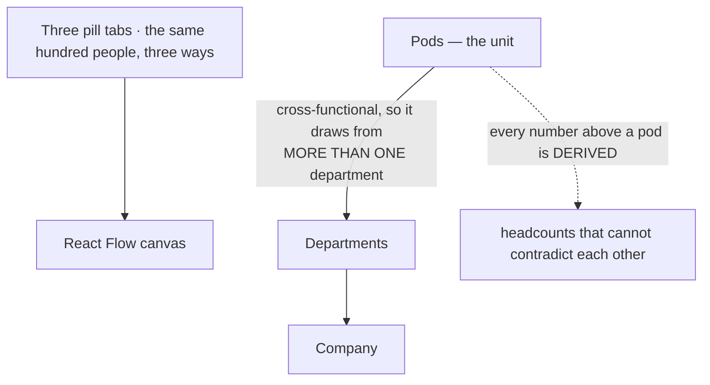

# The insight map

`/insight-map` — the organisation as a canvas you can pan and zoom. A team
tool: linked from nowhere, reachable only by typing the path, and lazily
loaded so nobody else pays for it.

::: designers
## What it is for

Looking at the organisation and moving around in it. Three levels — company,
departments, pods — with pill tabs that switch which one the canvas draws.

**Nothing is clickable yet.** That is the next step and is deliberately not
reached for.

## The pod is the unit, and it belongs to several departments

A pod is cross-functional, so it draws people from more than one department.
**The org is therefore a graph, not a tree** — and that single fact is what the
whole screen is arranged around.

## Why this one is a canvas when the diary graph is a list

The diary graph argues — correctly — that a picture which is really a list
should be **built** as a list of links. That argument holds while the picture is
a *picture*.

This one is a **surface you pan and zoom**, and will shortly be one you drag
teams around on. That is a different object: the viewport has state, the nodes
have positions that change, and what a reader does with it is **explore** rather
than read.

So it takes a canvas library, and the cost is paid where it is visible: the
nodes are groups with readable accessible names rather than links, the library
handles tab order and arrow-key movement, and nothing here is yet a navigation
target that a list would have to carry instead.

That pair — diary graph and this — is the clearest worked example in the repo of
*when a chart may be a chart.*

## Every number above a pod is derived

A department's headcount is computed from the pods that draw on it, and the
company's from the pods. **Neither is authored anywhere**, so neither can
contradict the other.

That matters here more than usual, because the three tabs show the same hundred
people three different ways and a reader will add them up.
:::

::: devs
## Files

| | |
|---|---|
| `routes/InsightMap.tsx` | the screen, the tabs, the canvas |
| `lib/orgFixture.ts` | the data, and the argument for its shape |
| `lib/orgModel.ts` | **the arithmetic.** Pure |
| `lib/orgLayout.ts` | positions |
| `lib/orgCard.ts`, `lib/orgProse.ts` | the node contents and the copy |

## `lazy` is load-bearing, not tidy

This screen is the **only** importer of React Flow (`@xyflow/react`) and the
two d3 packages (`d3-force`, `d3-hierarchy`). A visitor who never types the
path should download none of it.

Same arrangement as `/goal-mappings` and `/dev/qr`.

## The pure parts are in `lib/` for a mechanical reason

`vitest.config.ts` includes `src/**/*.test.ts` only, in a node environment with
no jsdom — **so a `.test.tsx` would never run.** The screen holds JSX; `lib/`
holds the sums, and the sums are what the tests reach.

`orgModel.test.ts`, `orgLayout.test.ts`, `orgCard.test.ts`, `orgProse.test.ts`
— four test files for one unlinked screen, which is what that split buys.

## Rule exemptions, on the same footing as the other tools

Linked from nowhere and opened only by the team, so it carries the same rule 6
and rule 7 exemptions as `/dev/qr` and `/goal-mappings`. That is a stated
exemption rather than an oversight — see [Dev tools](/features/dev-tools).

## History

`insight-board` was the earlier provocation and is **superseded** — deleted,
SHA `2f4b1fa`, 86 files, recoverable by name. `insight-map` merged as PR #20
(M17).
:::

---

**Source of truth:**
[`routes/InsightMap.tsx`](https://github.com/product-ben/musie/blob/main/apps/web/src/routes/InsightMap.tsx),
[`lib/orgModel.ts`](https://github.com/product-ben/musie/blob/main/apps/web/src/lib/orgModel.ts),
[DECISIONS.md](https://github.com/product-ben/musie/blob/main/DECISIONS.md) M17.
