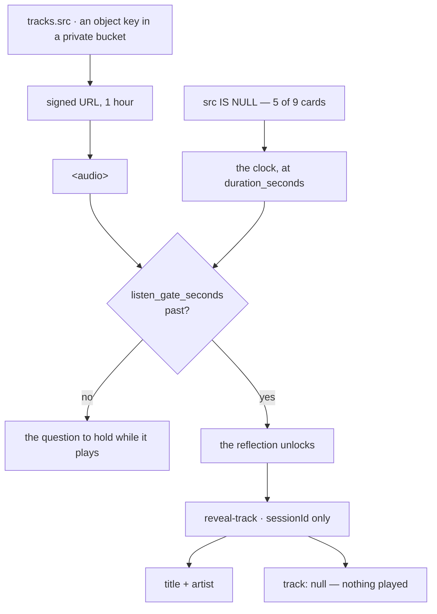

# Listening

The step the whole product is built around: you hear a piece **without being
told what it is**, and the title is released afterwards by a server that checks
you were the one who heard it.



::: designers
## What is on screen

The copy, the transport, the question to hold while it plays, and the way on.
**Not the track's name.**

The control is labelled with the verb. Its accessible name is *"Your track"* —
which is not a title standing in for one, it is what the control **is**.

## The gate

The reflection unlocks after `listen_gate_seconds`, which **varies by
exercise**: a two-minute card draw and a twenty-minute soundwalk do not earn
the same wait. It is capped at the track's own length, so a gate longer than the
recording is satisfied by finishing it.

Only Mindful Pause's 90 seconds is measured against real audio. The rest are
proportional estimates and are flagged as such.

## Four cards have audio and five do not, so both paths are live

For the four, a real file really plays. For the other five the database says
`src` is **null** — the schema saying *there is no recording*, rather than
pointing at a file that was never there — and a **clock** takes over at the
track's own duration, which the seed carries precisely so a countdown can
render before anything has loaded.

So the clock is not a fallback for a loading failure; it is what a session
without a recording looks like.

## The reveal

After the gate, Musie says what you heard. Three outcomes, and the middle one
is the interesting one:

| | What the person sees |
|---|---|
| A recording played | the title and the artist |
| **Nothing played** | that there was nothing to name |
| Something failed | an error, not a fabricated title |

**Naming a piece somebody did not hear, in the moment the product promises to
tell them what they heard, is the one thing the whole mechanism exists to
prevent.** Five of the nine cards still carry an invented title and artist in
the seed, and the server refuses to hand those over.

## Why the title cannot simply be hidden on screen

Because then it would be in the browser, and anybody could read it out of the
network tab. The columns are not readable by the app at all — asking for them
fails the request. So "hide it visually" was never an option, and the reveal had
to be built as a separate server call.

A knock-on: the recordings have **meaningless ids** (`trk-01`, never
`morgenlicht`), because the id *is* readable, and a descriptive id would give
the answer away through the back door.
:::

::: devs
## Files

| | |
|---|---|
| `components/SessionListen.tsx` | the step |
| `lib/audio.ts` | the signed URL, and `useMix` |
| `lib/reveal.ts` | the client half of the reveal |
| `lib/mixer.ts` | the two-stream mix (listening exercises) |
| `supabase/functions/reveal-track/` | the server half |
| `e2e/listen.spec.ts`, `e2e/reveal.spec.ts` | the walks |

## `TrackButton`, not `MusicPlayer`, and the column grant decided it

`MusicPlayer.title` is required **and visible**. This step cannot name the
track, so the only things it could pass are a fabricated title or the action
word twice.

`TrackButton` is built for exactly this: its `label` is announced and never
shown, and the visible label is the verb.

## The files are in a private bucket, which makes the URL asynchronous

`tracks.src` holds an **object key** — `trk-01.mp3`, the id and nothing else,
because `mc-01-joy.mp3` names the card and the feeling.

A private bucket has no permanent URL. The client asks for a signed one and
gets back something that expires, so what used to be a pure string function
called inline in JSX is now a request — and the `<audio>` elements that consume
it have to wait.

**One hour.** Long enough that no session outlives its own URL — Sound Journey
runs 12–15 minutes and somebody may pause in the middle — and short enough that
a URL pasted out of a network tab stops working the same afternoon.

**A signed URL is a cache key, so it is minted once per page.** It said "minted
per mount, so a returning listener gets a fresh one" until 2026-10-11, and that
was the single worst loading decision in the app: a new URL is a new cache
entry, so every remount re-downloaded the file.

`useMix` exists so that each caller does not invent its own loading state — and
the one in the listen step is load-bearing: **starting the simulated clock
because a URL had not arrived yet would be indistinguishable from starting it
because there is no file.**

## `reveal-track`: three checks, each refusing a different person

| | Refuses |
|---|---|
| a valid JWT | the open internet |
| the session is **yours** | another signed-in user with a session id — which is a uuid but not a secret: it is in your own URL bar |
| the session reached `listen` or `reflect` | your own session at `intro` or `scan` |

**A session id goes up, never a track id.** An endpoint accepting a track id
would let anyone signed in walk `trk-01`…`trk-09` and collect all nine titles
without listening to anything — the column grant undone by the thing meant to
complete it. `lib/reveal.ts` does not accept a track id either: there is
nowhere to put one.

**The third check is the weakest, and it is worth being honest about it.**
`step` says which screen the session reached, not that anyone listened. The
gate on the listen step is client state and is not stored, so the server cannot
check it. Somebody determined can reach `listen`, call this, and learn the name
without waiting. It still removes the cheap attack — enumeration — and it is
the strongest check available against what the schema actually records.

Storing "listened" to close it would be a column and a write on a hot path, for
a product whose premise is that people want the exercise to work.

## `null` is an answer, not a failure

```ts
export type RevealOutcome =
  | { kind: 'revealed'; track: RevealedTrack }
  | { kind: 'nothing' }      // nothing played — ordinary
  | /* …and a failure */;
```

## What is not built here yet

The prototype's listen step is three stacked viewports: this stage, a "do not
get influenced by the track name" interstitial, and a details view with the full
player and the track's identity. The second and third are **scroll targets
below this one** and nothing here has to be undone when they arrive.

`MOCKUPS.md` files it under *A track's title and artist are withheld,
deliberately* — named rather than numbered, because that file's numbering shifts
when an entry is deleted, and it has twice.
:::

---

**Source of truth:**
[`components/SessionListen.tsx`](https://github.com/product-ben/musie/blob/main/apps/web/src/components/SessionListen.tsx),
[`lib/audio.ts`](https://github.com/product-ben/musie/blob/main/apps/web/src/lib/audio.ts),
[`lib/reveal.ts`](https://github.com/product-ben/musie/blob/main/apps/web/src/lib/reveal.ts),
[`supabase/functions/reveal-track/index.ts`](https://github.com/product-ben/musie/blob/main/supabase/functions/reveal-track/index.ts),
[MOCKUPS.md](https://github.com/product-ben/musie/blob/main/MOCKUPS.md).
