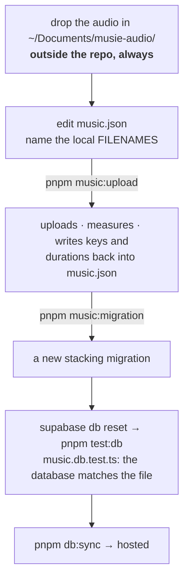

# The music pipeline

`music.json` is the music library — every licensed **piece** and every produced
**cut** of a listening exercise. It owns `tracks` and `exercise_cuts`, and
nothing else.



::: designers
## Two different things live in one file

**A piece** is music as released: a title, an artist, a licence reference, and
the unducked original file. That is what a card plays.

**A cut** is a produced recording of a *listening exercise*: guidance over
music, plus the same cut with the music removed. That is what Bodyscan and
Klangreise play.

| | A piece | A cut |
|---|---|---|
| Used by | the nine cards | the two listening exercises |
| Has a title shown to the user | yes, after the reveal | no |
| Has a "mute the music" switch | no | if a voice-only export exists |

## The address of a cut has four parts, and two may be blank

Exercise, **locale**, posture, ending.

**Locale is required. Nothing ever crosses locales** — an English session does
not play German guidance; it plays nothing.

**Posture and ending may be omitted, and that means "this recording serves any
answer"** — which is the usual case. Bodyscan is **one** recording for every
combination. Klangreise is two that differ by ending and say nothing about
posture.

Writing eight entries for four files would be the same fact four times over,
and a lie about how specific the audio is.

**A more specific entry always wins**, so a posture-specific cut can be added
later without deleting anything.

## The mute-the-music switch

A cut can carry a second file: the same recording with the music removed. The
switch hands over between them.

**Its absence is a decision, not a gap.** Klangreise "makes no sense with one of
the stems muted, so there is no adaptation possible" — so where there is no
voice-only export, **the control simply does not render.** Nothing warns about
it.

## The two files must be the same length

The switch reads the position off whichever file is sounding and writes it to
the other, **so a pair that differs hands over to the wrong moment — and the
further in, the worse it gets.** The upload refuses a pair more than 250 ms
apart.

## When there is no recording for a combination

The listen step runs its **simulated clock** — a countdown with no audio, which
is what it already does for the five silent cards.

```sql
select * from public.missing_cuts;
```

That view reads a blank posture or ending as covering every one of them.

## Licensing, which is the real constraint

Four of the nine card pieces are licensed, through **Epidemic Sound as a
subscription** rather than per-track clearance — which for a commercial run
needs checking separately. The remaining pieces and the music for the three
sound exercises are outstanding.

Audio masters live **outside the repository**, always. They were never
committed, which the decision log calls *luck, not design* — and the repository
is public.
:::

::: devs
## Files

| | |
|---|---|
| `supabase/content/music.json` | the library |
| `apps/web/scripts/music-upload.mjs` | uploads, measures, writes back |
| `apps/web/scripts/music-migration.mjs` | → a migration |
| `lib/music.test.ts`, `lib/music.db.test.ts` | the rules, and the database |
| `lib/mixer.ts`, `lib/mixer.test.ts` | the two-stream playback |

## It does not own `exercise_tracks`

> The deck says which piece a card plays; this file says what the pieces are
> and how the exercises are rendered.

Neither generator writes a row the other owns, **so neither can delete the
other's work.**

## `tracks.id` is opaque on purpose

`trk-01`, never a title slug. It reaches the client through `exercise_cuts` and
`exercise_tracks`, so a title-derived id would hand over the answer the column
grant on `title` exists to withhold.

`licence_ref` was withheld from the client too, from 21 September — **it named
the track.**

## `durationSeconds` is written, never typed

By `music:upload`. `not null` and positive: it is what the simulated clock
counts down from, and the seed carries it precisely so a countdown can render
before anything has loaded.

## `mixedSource` / `voiceSource` are local filenames, not keys

A studio's file is called `BodyScan - mit Hintergrund.mp3`; a key is lower case
with a content hash. **The upload bridges the two and removes these fields once
it has.**

So the filenames stay the studio's business — drop the files anywhere, name
them, run the two commands.

## `track_id` on a cut

The music credited **inside** the mix, once we hold its own unducked file.
`null` until that export lands — and until then **nothing of the cut reaches
`/discovered-music`**, because there is no piece to name.

The day a piece has its own unducked original, that also becomes the better
fallback for a missing cut: real music with no guidance.

## Removal is refused twice

`pnpm music:migration` refuses without `--allow-removal`, and **Postgres
refuses anyway** if a session ever played it: both tables are referenced by
`sessions` with `on delete restrict`.

> A journal does not lose what it says you did.

## One thing to know about re-keying

The four existing masters keep their unhashed keys (`trk-01.mp3`) because they
are already in the bucket and not in the drop folder. **Put one of them in the
folder and it is re-uploaded under a hashed key**, `tracks.src` moves with it,
and the old object is left behind — harmless, and worth knowing before you
wonder where the duplicate came from.

## The two-stream playback

`lib/mixer.ts`. Two `<audio>` elements, one position. iOS keeps both playing
with the screen locked — confirmed on a real iPhone, which is what
`/dev/experiment-mixer` was built to answer (M16).

**The open bug:** pressing pause in iOS's own lock-screen widget stops the
foreground track and leaves the background bed playing. iOS binds its Media
Session to one element and nothing claims that session deliberately.
[Backlog](/work/backlog) B2; the fix lands in `lib/mixer.ts`.
:::

---

**Source of truth:**
[supabase/content/README.md](https://github.com/product-ben/musie/blob/main/supabase/content/README.md),
[`supabase/content/music.json`](https://github.com/product-ben/musie/blob/main/supabase/content/music.json),
[`20261011110000_exercise_cuts.sql`](https://github.com/product-ben/musie/blob/main/supabase/migrations/20261011110000_exercise_cuts.sql),
[BACKLOG.md](https://github.com/product-ben/musie/blob/main/BACKLOG.md) B2.
