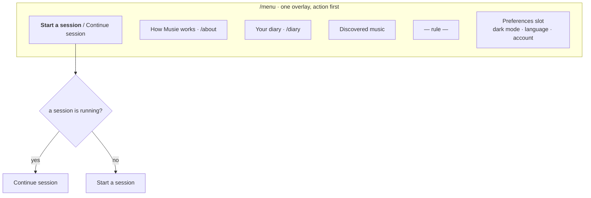

# The nav drawer

`/menu` — a left drawer that **is a route**, so Back closes it and the URL is
linkable. Since `/settings` was deleted it also holds the three preferences and
the account.



::: designers
## What it is, and what it is made of

A permitted custom pattern. **The design system has no Drawer**, so this
composes existing components — Logo, IconButton, CtaButton, and whatever the
preferences slot holds — inside a hand-built shell.

Order is **action first**: the thing you came to do sits at the top, then the
places you might go, then a rule, then the preferences.

Separators are **rules, not gaps**. A gap would say "these are unrelated"; a
rule says "a new kind of thing starts here", which is what is actually true.

## It is the only sheet now

`.musie-sheet` used to be parameterised by which edge it anchored to, because
`/settings` came from the other one. That route is gone and the `--end`
modifier with it — so the recurrence that made this a component request has
stopped recurring. The request stands as history rather than as a live ask.

## The top row changes with state

While a session is running the drawer offers **Continue session** and hides
**Start a session**. That is not a special case anyone has to maintain: only one
session can be running at a time, enforced by the database, so the two states
are exhaustive.

## There is no entrance animation, deliberately

Layer 1 has durations and eases, but **no sheet-entry duration**, and none of
the existing ones is obviously right for a 62ch panel travelling in from an
edge.

Rather than pick one, there is none. Whenever a duration *is* chosen,
`prefers-reduced-motion` needs no special handling: Layer 1 already collapses
every duration to 1ms and the travel distance to 0.

## What came in from /settings

Three preferences and the account: **dark mode**, **language**, and **the
account with its sign-out**. *Here as* did **not** come — `/about-you` already
asks it.

The result: one overlay to find instead of two, and one fewer icon in the
header.

## The account row, and the two decisions in it

**It renders only for a user with an email address.** An anonymous user has
none, and the whole section is hidden from them — because their account lives
in that browser and nowhere else, so *Sign out* would be a button that strands
an entire diary on an id nobody can sign in as again. There is no confirmation
dialog that makes that a reasonable thing to offer.

**The address is shown, deliberately.** These accounts are handed out and a
workshop phone gets passed between people. "Which of us is this?" has to be
answerable without signing out to find out — which, for the person who was not
supposed to sign out, is the expensive way to ask.

**And there is no confirm step**, unlike the diary's delete-everything. Signing
out is reversible: the credentials still work and the diary is untouched. A
confirmation for a reversible act is noise that teaches people to tap through
the ones that are not.
:::

::: devs
## Files

| | |
|---|---|
| `routes/MenuDrawer.tsx` | the route, `handle.overlay` |
| `components/NavDrawer.tsx` | presentational, small API |
| `components/MenuPreferences.tsx` | owns the three controls |
| `components/AccountSection.tsx` | the account, and sign-out |
| `shell.css` | `.musie-sheet` and the rest of the `musie-` patterns |

## The API, and why preferences are a slot

```
open · onClose · currentPage · onNavigate · pages (DATA) · preferences (SLOT)
```

It owns no state and knows nothing about the router beyond the `href` it is
handed, so it can be driven by a route (as it is), by a Storybook story, or by
anything else.

**Preferences are a slot rather than more data**, decided 2026-09-24. A row is
a label and a destination, which is why `pages` can be data. A switch, a radio
group and a sign-out button are three different controls wired to three
different stores, and expressing them as data would mean inventing a
settings-form language for one caller. So the drawer says **where** they go and
nothing about **what** they are.

## base-ui's Dialog does the dangerous parts

Focus moves in on open and is **restored to the trigger** on close, the
background goes inert, page scroll locks, Escape closes, and the popup is
portaled clear of any ancestor's overflow.

None of that is hand-rolled, and none of it is assumed — it is **verified** in
the overlay suite: 12 Tabs forward and 6 Shift+Tabs back never escape, and
focus returns to the exact trigger.

## L14's conditions, checked

| | |
|---|---|
| no component exists | there is no Drawer in the system |
| every declaration resolves to a token | `shell.css`, verified |
| prefixed `musie-`, never `musy-` | so a screen file cannot be mistaken for a system file |
| a recurring pattern is a component request | it was one; the recurrence ended with `/settings` |

## `aria-current` sits on the page beneath

The drawer is an overlay, so the page it was opened from stays mounted. The row
that leads to the current page carries `aria-current`.

The drawer itself has **no heading** — it is named by `aria-label`, because a
drawer whose visible top is a logo has no title to make a heading of. That is
why `AccountSection` is an `h2`: it is the first heading inside.
:::

---

**Source of truth:**
[`components/NavDrawer.tsx`](https://github.com/product-ben/musie/blob/main/apps/web/src/components/NavDrawer.tsx),
[`components/AccountSection.tsx`](https://github.com/product-ben/musie/blob/main/apps/web/src/components/AccountSection.tsx),
[docs/10-layout.md](https://github.com/product-ben/musie/blob/main/packages/design-system/docs/10-layout.md) L14.
