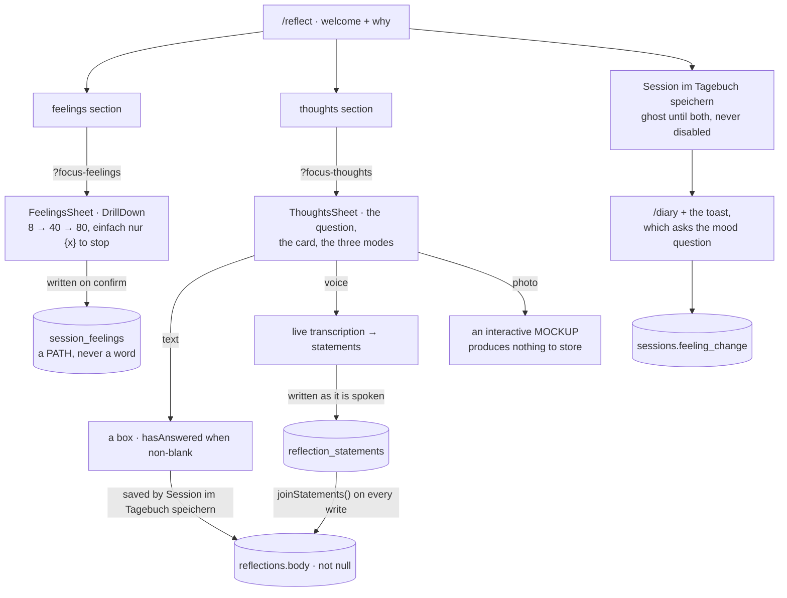

# Reflecting

Step 4. A welcome, a reason, and two doors — and behind the doors, a
vocabulary for naming a feeling and the three ways to answer in words.

Rules this page is downstream of: `components/SessionReflect.tsx`,
`components/FeelingsSheet.tsx`, `components/ThoughtsSheet.tsx`,
`lib/feelings.ts`, `lib/reflect.ts` and
`supabase/migrations/20261016100000_a_feeling_is_a_path_not_a_word.sql`.



**The mood scale is not on this step any more.** *Wie ist deine Stimmung
jetzt?* moved to the success toast on `/diary` on 2026-10-16. The column and
`saveFeelingChange` are unchanged; only the screen that asks has moved. See
[Diary](./diary.md).

::: designers
## Three doors, and two of them open

| Mode | State |
|---|---|
| **Write** | works |
| **Speak** | works — live transcription, editable afterwards |
| **Photograph** | an interactive mockup. It says so where the answer would go |

**Each mode announces its own limit**, which is honest rather than
obstructive. The alternative was hiding what the product has already decided
on, which would make the screen look finished and be less true.

## Photo and voice are one feature with two front doors

**Both produce words; neither produces a file.** That is why there is no column
for media anywhere, no storage bucket for it, and why the database already
allows all three mode values although one is unbuilt.

**The absence is the design.** "We never keep your recording" is a fact about
the schema, not a promise about behaviour.

## Declining is an answer, and it sits in the action row

*Skip reflection* is **not a fourth segment** next to the three modes. Three
ways to answer and one way not to answer are different kinds of choice, and a
fourth segment would make refusal look like a method of answering.

It is not under the group either, which is where it started. *Skip reflection*
is a way **out** of the step, and the step's ways out are the action row: it
sits beside *Finish session* as the alternative to it, which is what it
actually is.

## A declined reflection still finishes the session

Decided 2026-09-19. The row is `finished` with **no reflection beside it**,
which the schema already allows: the body cannot be empty, so "no answer" can
only be expressed as *no row*.

You did the exercise. Whether you wrote anything down is a separate fact, and
the diary already reports it on its own.

## The privacy copy sits at the control it is about

Not collected on one page. Three promises, three placements:

- beside the record button — *Musie keeps the text, never your voice*;
- on the written mode;
- on the photo mode.

That placement is what user testing argued for. A single page stating all of it
at once existed and was deleted on 2026-10-13, copy included — if it comes back
it is a screen, not a string.

## What user testing said about the spoken mode

**All five participants** said the automatic splitting of speech into separate
statements was unwanted and jarring, and that plain text would be fine. **Two**
loved the drag-to-combine gesture — which only exists *because* of the
splitting, since combining is the repair for a split nobody asked for.

That is scoped work, not done: see [Backlog](/work/backlog) B1.
:::

::: devs
## Files

| | |
|---|---|
| `components/SessionReflect.tsx` | the default step: a welcome, and two doors |
| `components/FeelingsSheet.tsx` | `?focus-feelings` — the wheel, narrowed |
| `components/ThoughtsSheet.tsx` | `?focus-thoughts` — the question and the three modes |
| `components/VoiceTranscript.tsx` | the transcript editor, and the write |
| `lib/feelings.ts` | the wheel ⇄ the table, and `useSessionFeelings` |
| `lib/reflect.ts` | `hasAnswered`, and the two sheet tokens. Pure |
| `lib/statements.ts` | `saveStatements`, `joinStatements` |
| `lib/voiceScreen.ts`, `lib/voiceMessages.ts` | the screen's own state and copy |
| `@musie/voice` | the capture and transcription core |
| `DrillDown`, `RadioGroupText.drillDown`, `ButtonGroup purpose` | the design system's half |

## A feeling is a path, not a word

`content/emotionWheel.ts` is emphatic that a label cannot be a key: *Powerful*
appears twice in the wheel and *Delighted* appears twice. So
`session_feelings` stores the ROUTE — `(emotion_id, detailed_id, specific_i)`
— and no label at all; the word is resolved in the active locale at read time,
which is also what keeps one dataset serving both languages.

A path can stop at any level, because the sheet offers *einfach nur
{parent}* from level 2 down. A shorter path is nulls from where it stopped,
and `session_feelings_path_ordered` refuses one with a hole in it.

`NULLS NOT DISTINCT` on the unique constraint is the easy thing to miss: under
the SQL default two rows of `('happy', null, null)` do not conflict, which
would make the level-1 stop the one feeling in the wheel you could hold twice.

## Feelings are written on confirm; thoughts are not

The one place this step is inconsistent, deliberately.

A feeling is written the moment it is confirmed in the sheet, and its × is a
delete. The session row already exists, so nothing blocks it, and a closed tab
keeps what somebody named. A half-written paragraph is not a discrete fact
with a stable identity, so the thoughts stay in `Session.tsx` and are written
by *Session im Tagebuch speichern*, as before.

The consequence worth knowing: **that button does not save the feelings**,
because they are already saved. A session abandoned after naming a feeling
keeps it and stays unfinished.

## `hasAnswered` is its own module, and that is not fussiness

```ts
export function hasAnswered(mode: ReflectMode, text: string, spokenWords = false): boolean {
  if (mode === 'voice') return spokenWords;
  return mode === 'text' && text.trim().length > 0;
}
```

The rule is needed in **two** places: the reflect step decides what to draw,
and `Session.tsx` decides whether *Finish session* is enabled — because the
action row belongs to `WizardPanel` and is filled by the session rather than by
the step.

Exporting it from the component's own file made that file export a component
**and** a function, which is the react-refresh warning and, more usefully, a
real smell: this is a rule about the session's data, not about a rendered thing.

**Voice is asked about separately**, through `spokenWords`, because the typed
box is empty in voice mode — the statements live in the transcript editor.

The mode values are the column's values verbatim: `text` | `voice` | `photo`.
The column is the vocabulary, and a second set of names here would be a mapping
nobody asked for.

## Why rows are written before the person finishes

Not for the editing. **A statement is finalised the moment somebody stops
speaking, and a reflection can run for minutes** — so a tab closed, a socket
dropped or a phone that rang loses everything if the answer is only assembled
at the end. Rows written as they arrive lose the last sentence at worst.

## One call makes the whole list true

`@musie/voice` hands over the **entire list** after any change rather than the
one statement that moved. So `saveStatements` upserts every row and deletes
what is no longer in it.

That is **idempotent by construction rather than by care** — it fires on four
paths — and it is also the only shape that can express a *merge*, which ends
one statement, and a *move*, which changes no text at all and would otherwise
never be written.

## `reflections.body` stays the answer

`body` is `not null` and is what the diary, the end-to-end walks and the
privacy check all read. It is **assembled from the statements on every write**,
so it is never stale and nothing downstream has to learn about a second table.

> The rows are the editing surface; the body is the answer.

This is text, exactly as a typed reflection is text. No audio is stored at any
point.

## A stale comment, found while writing this page

`components/SessionReflect.tsx`'s header still says voice *"cannot SAVE …
`Finish` stays disabled here and the step says why"*. That was true before F.6.
`VoiceTranscript` now calls `saveStatements`, and `lib/reflect.ts` says plainly
**"VOICE COUNTS SINCE F.6"**.

So the two files disagree, and the one that is wrong is the one a reader meets
first. Logged in `apps/web/OPEN-QUESTIONS.md` rather than edited from here —
this site is a derived view and does not fix the code it describes.
:::

---

**Source of truth:**
[`components/SessionReflect.tsx`](https://github.com/product-ben/musie/blob/main/apps/web/src/components/SessionReflect.tsx),
[`lib/reflect.ts`](https://github.com/product-ben/musie/blob/main/apps/web/src/lib/reflect.ts),
[`lib/statements.ts`](https://github.com/product-ben/musie/blob/main/apps/web/src/lib/statements.ts),
[BACKLOG.md](https://github.com/product-ben/musie/blob/main/BACKLOG.md) B1.
