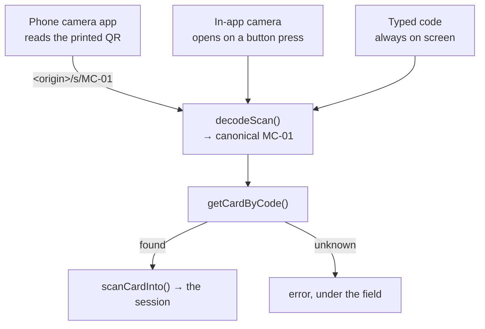

# Scanning a card

Three ways to name a card — the phone's own camera app, the in-app camera, and
a typed code — and all three arrive at the same decoder. There is no domain in
the product, and this is the file that makes that cost nothing.



::: designers
## Three ways in, and the common one is not the app

The common path is **the phone's own camera app** following
`<origin>/s/MC-01`. Somebody holding a printed card points their phone at it the
way they point it at any QR code — Musie does not have to be open.

The in-app camera is the **least used** of the three. The typed field is always
on screen.

## The camera does not start itself, and that is the main decision

Arriving at the scan step does not open a camera.

**A permission prompt that appears because you walked into a room is a demand**,
and the answer people give a demand they did not expect is *no* —
permanently, in Chrome, for the origin. So the camera opens when somebody asks
for it, and the prompt arrives as the answer to a button they pressed.

## The code that was read is visible

When the camera reads a card it stops and puts the code **in the field**, then
submits it. So the answer is visible, and an unknown-card error appears under
the code it is about.

That also means the camera, the typed field and the deep link all arrive at the
same place by the same door.

## The second QR code on the front of the card is a product decision

Each card carries a QR code on the back **and** bottom-left on the front.

**Turning a card over is the one movement that gives away which card it is,
before the music is allowed to.** So it can be scanned lying face up.

## The card's own accessibility path

The typed code is the accessible alternative to pointing a camera: `MC-01`
through `MC-09`, printed on the card.
:::

::: devs
## Files

| | |
|---|---|
| `lib/scanCode.ts` | the decoder. **Pure**, and where the tests are |
| `lib/scan.ts` | the half that talks to the database |
| `lib/camera.ts` | what the scanner decides. Pure |
| `lib/useCardScanner.ts` | the `MediaStream`, the `<video>`, the teardown |
| `lib/qrDetector.ts`, `lib/qrWasm.ts` | `zxing-wasm`, and its loading |
| `components/CardScanner.tsx` | the camera UI |
| `components/SessionScan.tsx` | the step |
| `routes/ScanLink.tsx` | `/s/:code` |

## The decoder never compares a host

The payload is a URL — `https://<wherever>/s/MC-01` — because a URL is what a
phone camera can act on without the app being open. But a URL payload does
**not** mean the app needs to know its own address:

```
https://musie.app/s/MC-01       →  MC-01
http://192.168.0.4:5173/s/MC-01 →  MC-01
MC-01                            →  MC-01
```

It takes the **last path segment** and validates its **shape**.

**A host check would buy nothing and cost something real:** it would reject the
LAN address the phone actually scans during development, and it would reject
every code already printed on the day the domain changes. *The card is paper.
It cannot be reprinted.*

`/s/:code` is same-origin, so it resolves on localhost, on a branch preview URL
and on the real domain, unchanged.

**Only the printed code needs an origin**, which is why `scanLink` takes one as
an argument rather than holding one. The dev sheet passes
`window.location.origin` and is therefore self-hosting; print day passes
`--base-url` to `scripts/qr-codes.mjs`. Neither needs a config entry.

## The pure/effectful split

`scanCode.ts` has no DOM, no network, no Supabase, no `window` — so it is the
half with the tests. `scan.ts` next door is the half that talks to the
database. Same split again in `camera.ts` (decisions, tested) versus
`useCardScanner.ts` (the stream, the timer, the teardown).

Everything in the hook that could have been a decision was moved next door
rather than hidden in an effect.

## Stopping the stream is not optional

A `MediaStream` whose tracks are never stopped keeps the camera light on after
the step has gone. **Every exit stops them**: the control, a successful read, a
step change that unmounts the component, and the effect's own cleanup.

## Testing a camera

`e2e/fakeCamera.ts` plus `camera.spec.ts` and `capture.webkit.spec.ts`.
Measuring beats reasoning here: a fake capture path driven by Playwright is how
the scanner's thresholds were settled rather than argued about.

`lib/fakeCamera.test.ts` keeps the fake honest.
:::

---

**Source of truth:**
[`lib/scanCode.ts`](https://github.com/product-ben/musie/blob/main/apps/web/src/lib/scanCode.ts),
[`lib/useCardScanner.ts`](https://github.com/product-ben/musie/blob/main/apps/web/src/lib/useCardScanner.ts),
[`routes/ScanLink.tsx`](https://github.com/product-ben/musie/blob/main/apps/web/src/routes/ScanLink.tsx),
[supabase/content/README.md](https://github.com/product-ben/musie/blob/main/supabase/content/README.md).
