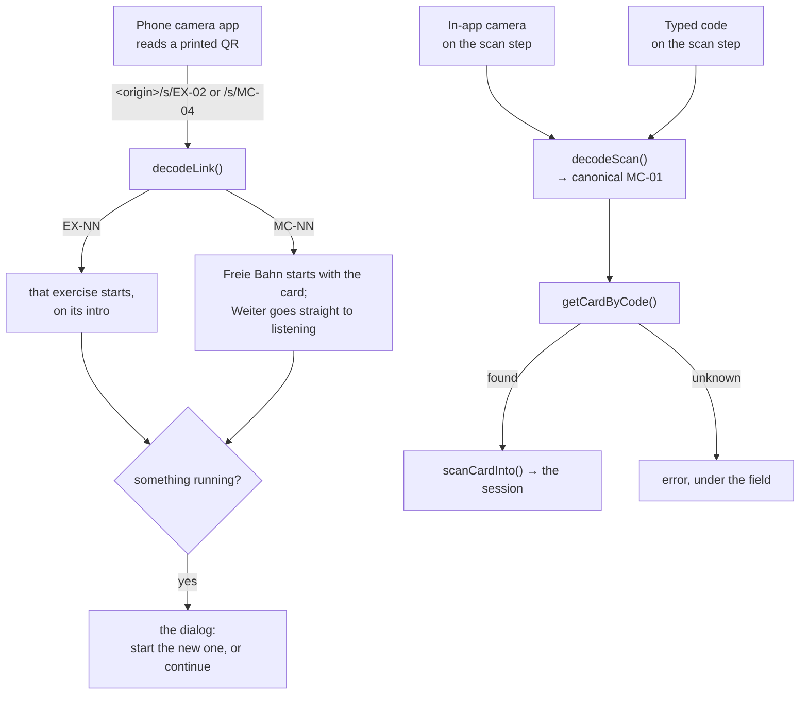

# Scanning a card

Two kinds of printed card carry a QR code: the **deck** (`MC-01` … ) and, since
2026-11-23, the **exercise cards** (`EX-01` … `EX-08`). Scanned with the
phone's own camera app, either one **starts** something. Inside a running card
exercise, the in-app camera and the typed code name a deck card for that run.
There is no domain in the decoder, and this is the file that makes that cost
nothing.



::: designers
## A printed card starts a run — 2026-11-23

The PRD „Übungskarten mit QR-Code" changed what the phone's camera app does.

- **An exercise card** opens its exercise on the **intro**. A card exercise
  started this way asks **„Was brauchst du gerade?"** there — the goal sheet's
  question and goals, with the goal last chosen in the library preselected —
  and the answer decides which of the card's two pieces plays. From the
  library the question is not asked: the goal was chosen there.
- **A deck card** starts **Freie Bahn** with that card. Its picture stands where
  the exercise's would, the cards switch and the sentence about the stack are
  not shown, and „Weiter" writes the card and goes straight to listening.
- **Something already running** — even the same exercise — brings up the
  dialog „Neue Übung starten?": starting the new one is the primary answer and
  ends the old one; „… fortsetzen" goes back to it. The library shows the same
  dialog, except that pressing the running exercise again simply continues it.

Until that day a deck card was written into the running session, a scan with
nothing running was held for the scan step, and a scan into a digital run
switched it to paper. All three are gone: the camera app starts, and the scan
step's copy names only the scanner in Musie.
:::

::: designers
## There is a run where nothing is scanned at all

Since 2026-10-14 the card exercises also run **without the physical deck**, and
then there is no QR code to read: the second step is `view` or `select` instead
of `scan`, the camera is **not mounted** — not hidden, not mounted, because a
`display: none` camera still asks for a permission on somebody's phone — and
everything on this page simply does not happen.

What the two paths share is the row they write. A card dealt digitally and a
card scanned from the table leave the same `card_id` and `track_id`, so the
diary, the reveal and the discovered-music listing cannot tell them apart. See
[a session](/features/session) for which run has which second step.

## Starting from paper, naming a card inside the app

The phone's own camera app follows `<origin>/s/EX-02` or `<origin>/s/MC-04` —
Musie does not have to be open — and starts a run. Inside a running card
exercise, the scan step names the card with the in-app camera or the typed
field; it no longer suggests the camera app, which would start Freie Bahn
instead.

## The camera does not start itself, and that is the main decision

Arriving at the scan step does not open a camera.

**A permission prompt that appears because you walked into a room is a demand**,
and the answer people give a demand they did not expect is *no* —
permanently, in Chrome, for the origin. So the camera opens when somebody asks
for it, and the prompt arrives as the answer to a button they pressed.

## The code that was read is visible

When the camera reads a card it stops and puts the code **in the field**, then
submits it. So the answer is visible, and an unknown-card error appears under
the code it is about.

That also means the camera, the typed field and the deep link all arrive at the
same place by the same door.

## The second QR code on the front of the card is a product decision

Each card carries a QR code on the back **and** bottom-left on the front.

**Turning a card over is the one movement that gives away which card it is,
before the music is allowed to.** So it can be scanned lying face up.

## The card's own accessibility path

The typed code is the accessible alternative to pointing a camera: `MC-01`
through `MC-09`, printed on the card.
:::

::: devs
## Files

| | |
|---|---|
| `lib/scanCode.ts` | the decoder. **Pure**, and where the tests are |
| `lib/scan.ts` | the half that talks to the database |
| `lib/camera.ts` | what the scanner decides. Pure |
| `lib/useCardScanner.ts` | the `MediaStream`, the `<video>`, the teardown |
| `lib/qrDetector.ts`, `lib/qrWasm.ts` | `zxing-wasm`, and its loading |
| `components/CardScanner.tsx` | the camera UI |
| `components/SessionScan.tsx` | the step |
| `routes/ScanLink.tsx` | `/s/:code` |

## The decoder never compares a host

The payload is a URL — `https://<wherever>/s/MC-01` — because a URL is what a
phone camera can act on without the app being open. But a URL payload does
**not** mean the app needs to know its own address:

```
https://musie.app/s/MC-01       →  MC-01
http://192.168.0.4:5173/s/MC-01 →  MC-01
MC-01                            →  MC-01
```

It takes the **last path segment** and validates its **shape**.

**A host check would buy nothing and cost something real:** it would reject the
LAN address the phone actually scans during development, and it would reject
every code already printed on the day the domain changes. *The card is paper.
It cannot be reprinted.*

`/s/:code` is same-origin, so it resolves on localhost, on a branch preview URL
and on the real domain, unchanged.

**Only the printed code needs an origin**, which is why `scanLink` takes one as
an argument rather than holding one. The dev sheet passes
`window.location.origin` and is therefore self-hosting; print day passes
`--base-url` to `scripts/qr-codes.mjs`. Neither needs a config entry.

## The pure/effectful split

`scanCode.ts` has no DOM, no network, no Supabase, no `window` — so it is the
half with the tests. `scan.ts` next door is the half that talks to the
database. Same split again in `camera.ts` (decisions, tested) versus
`useCardScanner.ts` (the stream, the timer, the teardown).

Everything in the hook that could have been a decision was moved next door
rather than hidden in an effect.

## Stopping the stream is not optional

A `MediaStream` whose tracks are never stopped keeps the camera light on after
the step has gone. **Every exit stops them**: the control, a successful read, a
step change that unmounts the component, and the effect's own cleanup.

## Testing a camera

`e2e/fakeCamera.ts` plus `camera.spec.ts` and `capture.webkit.spec.ts`.
Measuring beats reasoning here: a fake capture path driven by Playwright is how
the scanner's thresholds were settled rather than argued about.

`lib/fakeCamera.test.ts` keeps the fake honest.
:::

---

**Source of truth:**
[`lib/scanCode.ts`](https://github.com/product-ben/musie/blob/main/apps/web/src/lib/scanCode.ts),
[`lib/useCardScanner.ts`](https://github.com/product-ben/musie/blob/main/apps/web/src/lib/useCardScanner.ts),
[`routes/ScanLink.tsx`](https://github.com/product-ben/musie/blob/main/apps/web/src/routes/ScanLink.tsx),
[supabase/content/README.md](https://github.com/product-ben/musie/blob/main/supabase/content/README.md).
