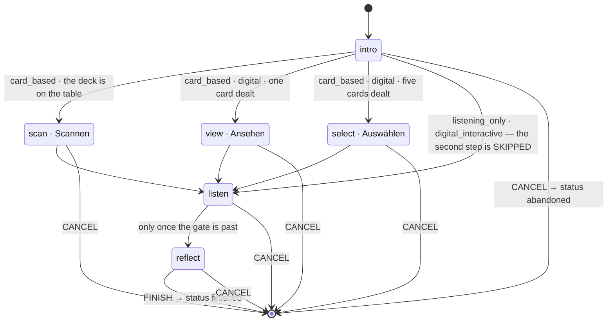
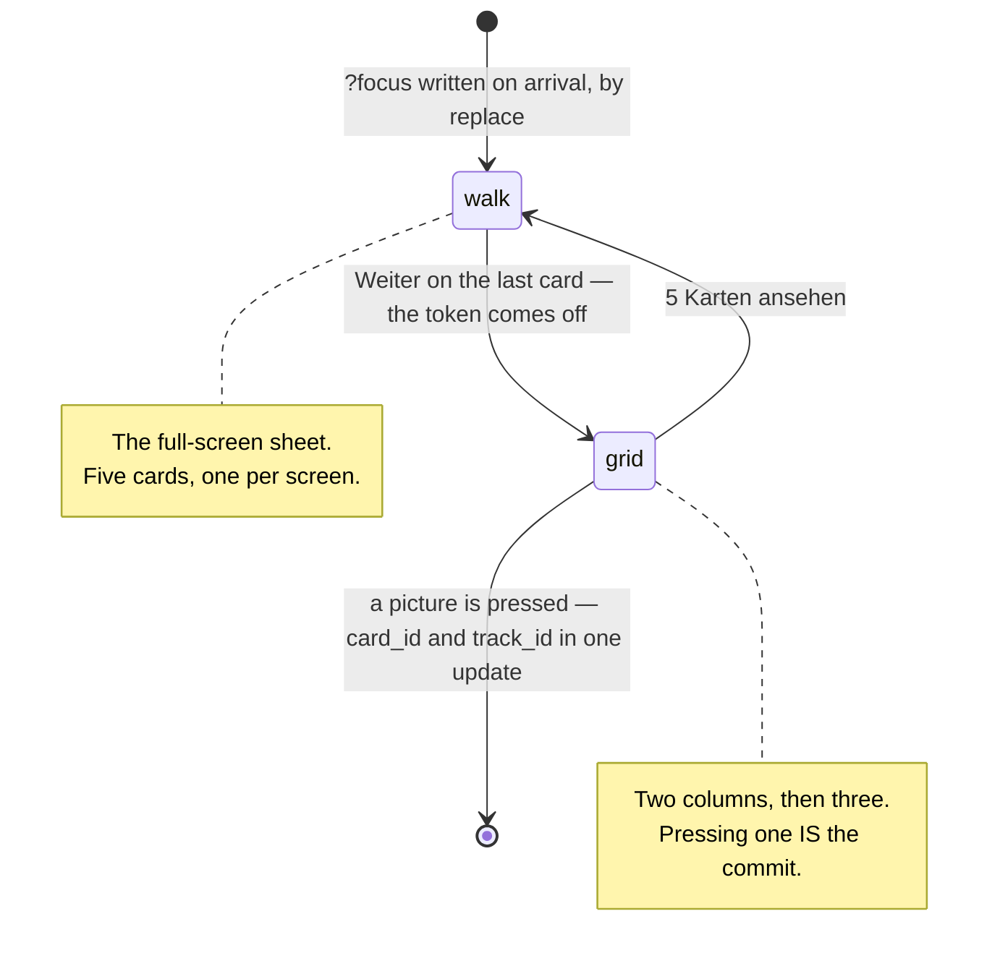

# A session

`/session/:id/:step` — one run through one exercise. Four steps, one reducer,
and a row in the database that outlives the tab.

**Four steps, six names.** Since 2026-10-14 the second step is one of three —
`scan`, `view` or `select` — and a run has exactly one of them. Which one is a
property of the run, not of the screen.



::: designers
## The four steps

**intro → (scan · view · select) → listen → reflect.** The step names are fixed
in the database, so a sixth name is a schema change rather than a prop.

Not every run has all four: three of the five exercises draw no card, so for
them **the second step is skipped** rather than shown-and-skippable. Without
that the run would be unfinishable — the wizard wants every earlier step
completed, and a step with no screen never completes.

## The second step is three steps, and only one of them scans

A card exercise run **without the physical deck** does not scan anything, so
`scan` is the wrong name for what happens. There are two other shapes, and
which one a run has follows from how many cards the exercise deals:

| | | |
|---|---|---|
| **Scannen** | `scan` | the deck is on the table: the camera, or the code typed in |
| **Ansehen** | `view` | one card, dealt by the step itself. Nothing is chosen — Freie Bahn gives you a picture and asks what you see |
| **Auswählen** | `select` | five cards, looked at and then chosen between. Achtsame Pause |

**The rail is four markers long in every one of them.** Flipping *Die analogen
Karten liegen vor mir* on Einsteigen changes the second marker's name, never the
count — that was Ben's rule, and it is now a property of the step list rather
than a label somebody remembered to override.

## The sheet is a phase of a step, not a step

The easy thing to get wrong. On `select` the five cards open full screen on
arrival, and *Weiter* on the last one collapses the sheet onto the grid where
the choice is made. That is **one step with two phases**, and the phase is in
the address so a reload keeps it and the browser's Back closes it.



## One at a time, and it is a database rule

Only one session can be running per person, enforced by a constraint. Two tabs
cannot produce two.

That single fact decides several screens: the drawer's top row, the library's
"still running" choice, and what a deep link into a live session does.

## Walking out is a real outcome

`abandoned`, not a failure. **Somebody who stops halfway has still had the
session**, and a diary that only records completions is a diary that flatters.

So there are three end states, and the diary shows two of them differently:
`finished` and `abandoned` are kept apart so a session someone walked out of is
not shown as one they completed.

## Finishing means reaching the end, not leaving words

This was corrected on 2026-09-20. Declining to answer the reflection **still
finishes the session** — you did the exercise, and whether you wrote anything
down is a separate fact the diary already reports on its own.

What the rule actually enforces is that you must be on the **last step** to
finish.

## Coming back

Close the tab mid-session and it is still there. What comes back is the step,
the status and which steps are done — **not the Back stack.**

That is deliberate: the back stack is where this *browsing* session has been,
not what the session **is**. Persisting it would promise a returning user a Back
button that walks through a history they no longer remember.

## Deep-linking a running session

Opening `/diary/:id` for a session that is still running sends you **into the
session**, not to "this entry does not exist". The diary is for sessions that
have ended.
:::

::: devs
## Files

| | |
|---|---|
| `routes/Session.tsx` | the shell, and the reducer's host |
| `lib/sessionMachine.ts` | **the rules.** Pure |
| `lib/sessionMachine.test.ts` | every transition and every refusal |
| `lib/session.ts` | the writes |
| `lib/exerciseKind.ts` | **which steps this run has.** `stepsForRun(kind, shape)` |
| `components/SessionIntro/Scan/Listen/Reflect.tsx` | the paper run's four steps |
| `components/SessionView.tsx`, `SessionSelect.tsx` | the two digital second steps |
| `components/CardSheet.tsx` | the full-screen walk both of them open |
| `lib/digitalCards.ts` | the deal, derived from the session id. Pure |
| `components/SessionRunningLightbox.tsx` | the library's choice |

## Why a reducer and not several `useState`s

The step on screen, the completed-steps list, the back stack and the status are
**four facts that only ever change together.** Advancing appends to `completed`,
replaces `step` and pushes onto `history`; cancelling writes a status and a
timestamp and touches neither of the first two.

Held in separate `useState` calls, every one of those is a chance to update
three of four and ship a session that is reachable but not completed, or
completed twice. One reducer makes each a single, named, testable transition —
which is also why **this module is where the rules live and the screen is where
they are merely rendered.**

## The machine is pure, and the clock is an input

No supabase, no react-router, no i18n, **no `Date.now()`**. `FINISH` and
`CANCEL` carry `at`, because a reducer that reads the clock cannot be tested
twice with the same answer — and because `sessions.ended_at` is a fact about
the world rather than about the state machine.

It holds no React state either: the screen calls `useReducer` with
`sessionReducer` and `startSession()` or `resumeSession()`, and the module never
learns that it happened.

One import is not pure by inspection and is worth naming: the reachability rule
comes from `@musie/design-system`'s `isWizardStepReachable`. That is the package
barrel, so React arrives transitively — but `wizardSteps` itself has no imports
at all, and the alternative is keeping a second copy of a rule the wizard also
enforces. **One shared rule beats a shorter import graph.**

## Refusal is returning the same object

Every guard returns `state` **itself**, not a copy. A refused transition is then
referentially identical, so `useReducer` skips the re-render and a test can
assert `toBe(state)` — a stronger claim than `toEqual`, and one that a
"helpfully" spread return value would quietly break.

## What persists, exactly

```ts
interface PersistedSession {
  step: StepId;
  status: SessionStatus;
  completed: readonly StepId[];
  endedAt?: string | null;
}
```

Exactly the `sessions` row's own columns. The back stack is deliberately absent
— see the designer tab.

## Skipped steps, and which steps a run has at all

`SessionState` carries the steps this run does **not** include (D14). Three of
the five exercises draw no card, so their second step has no screen; without the
skip the reachability rule waits forever for a step that never completes.

**The step list is computed, and it depends on two facts rather than one.**
`stepsForRun(kind, shape)` takes the exercise's `kind` and the run's shape —
`{ digital, cardsDealt }` — and swaps `scan` for `view` or `select`. The count
never changes; only the second name does.

Both facts are columns, and `sessions.digital_cards` is a column for one
specific reason: **the reachability rule computes from the step list.** A
session resumed from the drawer has to be able to read which list it has, or the
rule refuses the step the row is actually sitting on. A query parameter — which
is what it was for a day — cannot answer that after the tab is closed.

`exercises.cards_dealt` is the other: 5 for Achtsame Pause, 1 for Freie Bahn,
null where no card is drawn. One number that decides both the size of a digital
hand and which of the two digital steps the run has.

## The reducer learns the run through its own action

`{ type: 'RUN', skipped }`. `useReducer`'s initialiser runs **once**, so
flipping the switch on Einsteigen relabelled the rail while the reachability
rule still refused `select` — the rail and the rule disagreed about the same
run. The action refuses by identity when the run has not actually changed, and
it is the one action exempt from the terminal-state guard.

## The status vocabulary is the database's, verbatim

`started` | `finished` | `abandoned`, and `intro` | `scan` | `view` | `select` |
`listen` | `reflect`. English in the column, German through the catalogue —
translating them would put the schema's vocabulary in two languages and make
every query a lookup.

Six legal names and four used per row: `sessions_step_known` lists all six, and
no session will ever hold two of the three second steps.

The constraints are in the database rather than only in the machine, because
**the machine lives in one client** and a second client, a repair script or a
future edge function would each have to be told again.

## Step validation is a loader redirect

`sessionLoader` in `router.tsx` validates `:step` and redirects an unknown one
to `intro` before anything renders — so a bad step never paints, and a typed
`/session/x/banana` behaves exactly like one reached by clicking.
:::

---

**Source of truth:**
[`lib/sessionMachine.ts`](https://github.com/product-ben/musie/blob/main/apps/web/src/lib/sessionMachine.ts),
[`lib/session.ts`](https://github.com/product-ben/musie/blob/main/apps/web/src/lib/session.ts),
[`lib/exerciseKind.ts`](https://github.com/product-ben/musie/blob/main/apps/web/src/lib/exerciseKind.ts),
[`20260919120000_sessions.sql`](https://github.com/product-ben/musie/blob/main/supabase/migrations/20260919120000_sessions.sql),
[`20261014113500_view_and_select_are_steps.sql`](https://github.com/product-ben/musie/blob/main/supabase/migrations/20261014113500_view_and_select_are_steps.sql),
[DIGITAL-CARDS.md](https://github.com/product-ben/musie/blob/main/DIGITAL-CARDS.md),
[DOMAIN-MODEL.md](https://github.com/product-ben/musie/blob/main/DOMAIN-MODEL.md).
