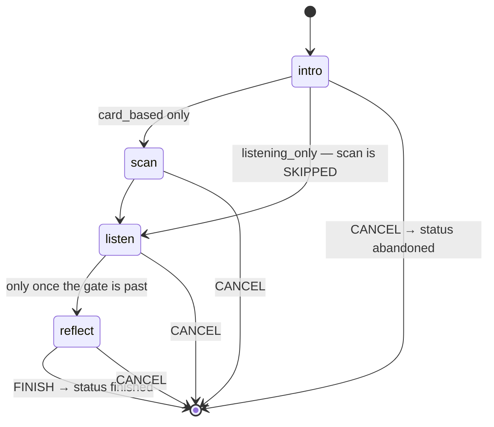

# A session

`/session/:id/:step` — one run through one exercise. Four steps, one reducer,
and a row in the database that outlives the tab.



::: designers
## The four steps

**intro → scan → listen → reflect.** The step names are fixed in the database,
so a fifth step is a schema change rather than a prop.

Not every run has all four: three of the five exercises draw no card, so for
them **scan is skipped** rather than shown-and-skippable. Without that the run
would be unfinishable — the wizard wants every earlier step completed, and a
step with no screen never completes.

## One at a time, and it is a database rule

Only one session can be running per person, enforced by a constraint. Two tabs
cannot produce two.

That single fact decides several screens: the drawer's top row, the library's
"still running" choice, and what a deep link into a live session does.

## Walking out is a real outcome

`abandoned`, not a failure. **Somebody who stops halfway has still had the
session**, and a diary that only records completions is a diary that flatters.

So there are three end states, and the diary shows two of them differently:
`finished` and `abandoned` are kept apart so a session someone walked out of is
not shown as one they completed.

## Finishing means reaching the end, not leaving words

This was corrected on 2026-09-20. Declining to answer the reflection **still
finishes the session** — you did the exercise, and whether you wrote anything
down is a separate fact the diary already reports on its own.

What the rule actually enforces is that you must be on the **last step** to
finish.

## Coming back

Close the tab mid-session and it is still there. What comes back is the step,
the status and which steps are done — **not the Back stack.**

That is deliberate: the back stack is where this *browsing* session has been,
not what the session **is**. Persisting it would promise a returning user a Back
button that walks through a history they no longer remember.

## Deep-linking a running session

Opening `/diary/:id` for a session that is still running sends you **into the
session**, not to "this entry does not exist". The diary is for sessions that
have ended.
:::

::: devs
## Files

| | |
|---|---|
| `routes/Session.tsx` | the shell, and the reducer's host |
| `lib/sessionMachine.ts` | **the rules.** Pure |
| `lib/sessionMachine.test.ts` | every transition and every refusal |
| `lib/session.ts` | the writes |
| `lib/exerciseKind.ts` | which steps this kind runs |
| `components/SessionIntro/Scan/Listen/Reflect.tsx` | the four steps |
| `components/SessionRunningLightbox.tsx` | the library's choice |

## Why a reducer and not several `useState`s

The step on screen, the completed-steps list, the back stack and the status are
**four facts that only ever change together.** Advancing appends to `completed`,
replaces `step` and pushes onto `history`; cancelling writes a status and a
timestamp and touches neither of the first two.

Held in separate `useState` calls, every one of those is a chance to update
three of four and ship a session that is reachable but not completed, or
completed twice. One reducer makes each a single, named, testable transition —
which is also why **this module is where the rules live and the screen is where
they are merely rendered.**

## The machine is pure, and the clock is an input

No supabase, no react-router, no i18n, **no `Date.now()`**. `FINISH` and
`CANCEL` carry `at`, because a reducer that reads the clock cannot be tested
twice with the same answer — and because `sessions.ended_at` is a fact about
the world rather than about the state machine.

It holds no React state either: the screen calls `useReducer` with
`sessionReducer` and `startSession()` or `resumeSession()`, and the module never
learns that it happened.

One import is not pure by inspection and is worth naming: the reachability rule
comes from `@musie/design-system`'s `isWizardStepReachable`. That is the package
barrel, so React arrives transitively — but `wizardSteps` itself has no imports
at all, and the alternative is keeping a second copy of a rule the wizard also
enforces. **One shared rule beats a shorter import graph.**

## Refusal is returning the same object

Every guard returns `state` **itself**, not a copy. A refused transition is then
referentially identical, so `useReducer` skips the re-render and a test can
assert `toBe(state)` — a stronger claim than `toEqual`, and one that a
"helpfully" spread return value would quietly break.

## What persists, exactly

```ts
interface PersistedSession {
  step: StepId;
  status: SessionStatus;
  completed: readonly StepId[];
  endedAt?: string | null;
}
```

Exactly the `sessions` row's own columns. The back stack is deliberately absent
— see the designer tab.

## Skipped steps

`SessionState` carries the steps this run does **not** include (D14). Three of
the five exercises have `needs_cards = false`, so `scan` has no screen; without
the skip the reachability rule waits forever for a step that never completes.

## The status vocabulary is the database's, verbatim

`started` | `finished` | `abandoned`, and `intro` | `scan` | `listen` |
`reflect`. English in the column, German through the catalogue — translating
them would put the schema's vocabulary in two languages and make every query a
lookup.

The constraints are in the database rather than only in the machine, because
**the machine lives in one client** and a second client, a repair script or a
future edge function would each have to be told again.

## Step validation is a loader redirect

`sessionLoader` in `router.tsx` validates `:step` and redirects an unknown one
to `intro` before anything renders — so a bad step never paints, and a typed
`/session/x/banana` behaves exactly like one reached by clicking.
:::

---

**Source of truth:**
[`lib/sessionMachine.ts`](https://github.com/product-ben/musie/blob/main/apps/web/src/lib/sessionMachine.ts),
[`lib/session.ts`](https://github.com/product-ben/musie/blob/main/apps/web/src/lib/session.ts),
[`20260919120000_sessions.sql`](https://github.com/product-ben/musie/blob/main/supabase/migrations/20260919120000_sessions.sql),
[DOMAIN-MODEL.md](https://github.com/product-ben/musie/blob/main/DOMAIN-MODEL.md).
