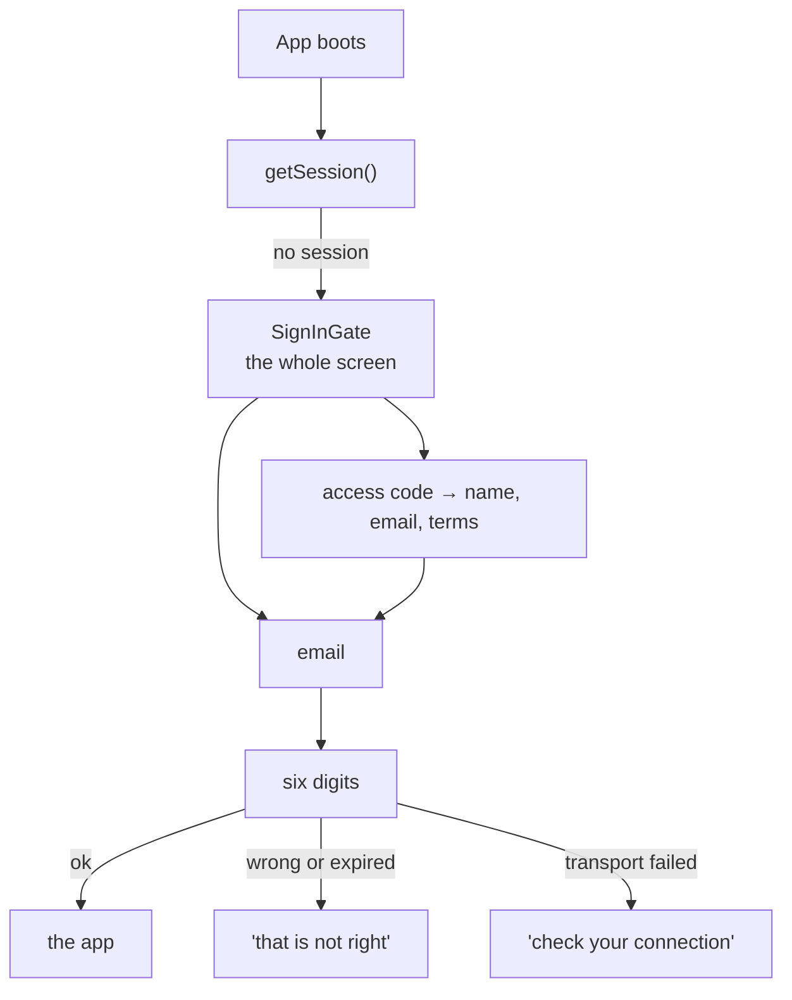

# Signing in

The gate that keeps the beta closed. One screen, two fields, no way past it —
and four failures that are written as four different sentences.



::: designers
## What it is

The whole screen, not a link in a corner. The gate is what keeps the beta
**closed**, and a closed beta is what keeps subscription-licensed music and a
provisional content set off the open internet while the app sits on a real URL.
One tester who never finds the sign-in control is that argument undone.

## What it does not have, and why

| Missing | Because |
|---|---|
| Sign-up | needs email delivery, which needs a sending domain, which is undecided |
| Password reset | same |
| Magic link | same |
| OAuth | same |

A forgotten password is reset in the Supabase dashboard. Fine at twenty
testers, and also the ceiling.

**Accounts are created by hand and handed out.**

## The errors are two different sentences, and that is the point

A wrong password and an unreachable server need different copy: retyping fixes
the first and cannot touch the second. **Telling somebody on a train that their
password is wrong is a support request that ends in "it was the wifi".**

## The copy is ours, even though the failure is not

Supabase's own messages are English and untranslated. *Invalid login
credentials* inside a German form is exactly the half-German UI the copy rules
exist to prevent — and it would arrive through the one path no catalogue covers.

So every failure resolves to a key in our own catalogue, and the screen renders
copy that exists in both languages.

## One page is open without signing in

`/beta` — [the closed-beta sign-up](/features/beta). Reading it creates no
account.
:::

::: devs
## Files

| | |
|---|---|
| `components/SignInGate.tsx` | the screen |
| `lib/signIn.ts` | `signIn()`, `signOut()`, the error map |
| `lib/signIn.db.test.ts` | the codes **this stack** actually returns |
| `lib/signIn.test.ts` | the map, as a pure table |
| `lib/signUp.ts` | the two sign-up calls and the code round trip |
| `lib/auth.ts` | `ensureSession()`, `resetSessionCache()` |

## It is mounted below `LocaleProvider`, not in `AuthProvider`

BUILD-PLAN H.0b put the gate in `AuthProvider`, which is mounted above
everything — deliberately, since signing in needs no routing. **That is the
wrong place for a screen**, and not marginally: `useT()` reads
`LocaleProvider`, and the design system's own defaults read
`MusyLocaleProvider`, and both are below it.

A gate rendered from `AuthProvider` would therefore throw on the app's first
`t(...)` call, and every design-system label on it would fall back to the
package catalogue's German whatever the locale said — on the first screen a
tester ever sees.

So `AuthProvider` keeps its job of **publishing** the state, including
`signedOut`, and the decision about what to render moved down into
`SessionGate`.

**Checked rather than assumed:** with `status: 'signedOut'`,
`ProfileProvider`'s effect returns before fetching (it needs a user) and stays
`pending`, and `LocaleProvider` still resolves a locale, because its initial
state is the cached locale or `navigator.language` and it only *overrides* that
from `profiles.language` once a profile arrives. So the gate is in the right
language for a returning tester and in the browser's language for a new one.

## Error mapping is on `code`, not on text

```ts
// GoTrue's own codes → MessageKey
```

Matched on `code` because the text is English prose Supabase is free to reword
in any release, and a match against prose **fails by showing the wrong
sentence** rather than by failing to compile.

The two classes arrive differently: supabase-js **throws** for a transport
failure and **returns** an error for a rejected credential. Both are handled;
they are not one branch.

## `resetSessionCache()` is load-bearing

`ensureSession()` is a promise singleton that caches success as well as
failure. `{ kind: 'gate' }` goes stale the instant somebody signs in — after
which every remount would be served the cached gate and the app would sit
behind a form it had already passed.

So `signIn()` and `signOut()` both reset it. **Without it, signing in appears
to do nothing at all.** The anonymous path never needed this, which is exactly
why the hazard arrives with the gate rather than before it.

## The flag parse is deliberately asymmetric

See [Auth](/architecture/auth). `true` / `1` / `on` / `yes`, case-insensitive;
anything else non-empty is off **and warned about**, because a flag meant to be
on that silently reads as off is the failure that matters.

## No mocks

`vi.mock` appears in no test in this repo. The error-code table is exported and
unit-tested directly; the codes the real stack returns are asserted in
`signIn.db.test.ts`. A hand-built `from().select()` chain would be a fake to
maintain forever.
:::

---

**Source of truth:**
[`components/SignInGate.tsx`](https://github.com/product-ben/musie/blob/main/apps/web/src/components/SignInGate.tsx),
[`lib/signIn.ts`](https://github.com/product-ben/musie/blob/main/apps/web/src/lib/signIn.ts),
[`apps/web/src/main.tsx`](https://github.com/product-ben/musie/blob/main/apps/web/src/main.tsx),
[docs/MUSIE-SETUP.md](https://github.com/product-ben/musie/blob/main/docs/MUSIE-SETUP.md) §2.
