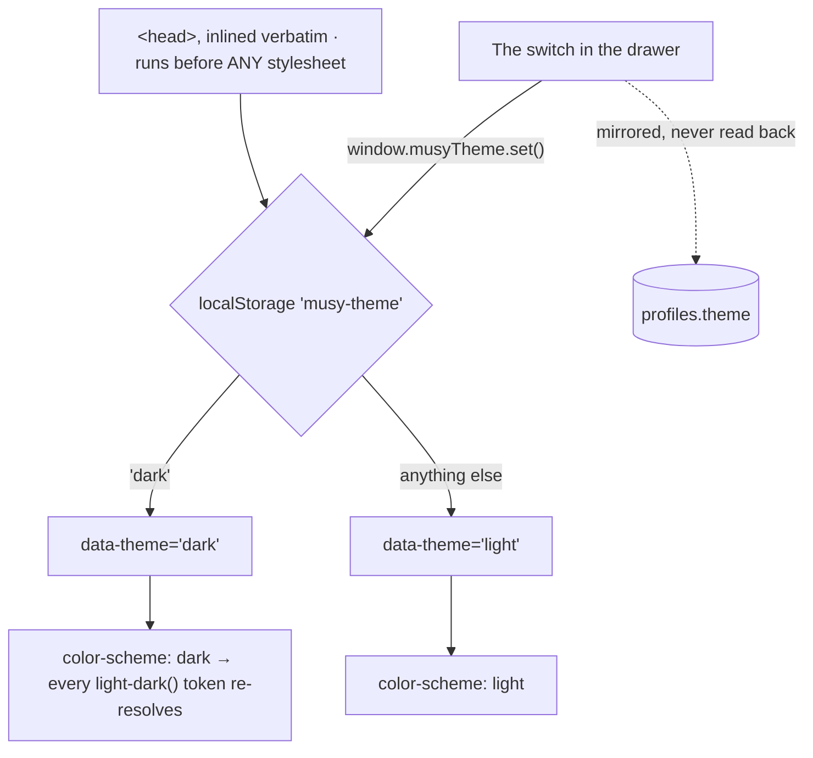

# Light and dark

A manual toggle, persisted in the browser, resolved **before the first
stylesheet loads**. The system preference is deliberately not consulted.



::: designers
## Why there is no "follow the system" option

The system preference is **not consulted**, and that is a stated decision
rather than an omission. The toggle is the whole model: light or dark, chosen,
remembered.

## No flash, ever

The script that decides the theme is **inlined in the HTML head** and runs
before any stylesheet exists. So the first paint is already in the right theme
— there is no white frame on the way to dark.

That is also why the theme's source of truth is the browser and not the
profile: a profile needs a network round trip, and the decision has to be made
before one could finish.

`profiles.theme` exists and is **written but never read** — a mirror, so the
value is visible server-side, not an input.

## Both themes are real, not derived

Every themed token carries both values in one declaration, and the dark values
are **contrast-solved separately** — not computed from the light ones by
inversion. So dark mode is designed, not generated.

Storybook shows light and dark **side by side** on every component page, which
is the fastest way to catch a value that only works in one.

## Nested overrides work

Putting the theme attribute on any element re-themes that subtree, because
every token is re-declared at that level. Useful for a preview of one theme
inside the other — which is exactly what Storybook does.

## The measured viewport, which lives in the same script

A second thing is decided pre-paint, and it matters on a phone: the real
viewport height, written as a number.

None of the three CSS units is the answer:

| Unit | Problem |
|---|---|
| `100vh` | the **large** viewport on iOS — a view sized to it puts its own buttons underneath Safari's toolbar, which is exactly where a thumb goes looking for them |
| `100dvh` | tracks the chrome sliding away, so a full-height view **resizes under the reader** while they scroll |
| `100svh` | stable and always visible — the fallback — but also the *smallest* it ever gets, so on a desktop it leaves a band of the window unused |

So the script measures and writes the real number before first paint, and a
full-height view never renders at a guessed size and then jumps.
:::

::: devs
## Files

| | |
|---|---|
| `packages/design-system/tokens/theme-init.js` | the source |
| `apps/web/index.html` | **a verbatim copy**, inlined |
| `components/MenuPreferences.tsx` | `ThemeSwitch` |
| `lib/profile.ts` | the mirror write |

## It is inlined rather than linked, and it is a copy

> Inlined rather than linked so there is no request between parsing this and
> the first paint: the file's whole job is to set `data-theme` before anything
> is painted, and a linked script — even a synchronous one — is a round trip
> during which the wrong theme can render.

Vite appends the bundle's stylesheet link to the **end** of `<head>`, so this
still runs first in production; in development there is no stylesheet until the
module graph loads, so it runs first there too.

**`index.html` says `DO NOT EDIT HERE. It is a copy. Change the package file
and re-copy.`** That duplication is the cost of the no-flash guarantee and it
is written down in both files.

## The API it leaves on `window`

```js
window.musyTheme.get()      // 'light' | 'dark'
window.musyTheme.set('dark')
window.musyTheme.toggle()
```

Storage key `musy-theme`. Every read and write is wrapped — a private window
throws rather than returning null.

## Why `light-dark()` and not two class blocks

```css
--sand-2: light-dark(#F3EEE4, #191D1A);
```

One declaration carries both themes, and `[data-theme]` sets `color-scheme`,
which is what `light-dark()` resolves against.

Tokens are declared on `:root, [data-theme]` **so a nested subtree
re-declares the whole set** and re-resolves against that element's
`color-scheme` — rather than inheriting an already-resolved value.

Baseline for this is evergreen browsers plus iOS Safari 18+, with no fallback,
and that is recorded in the token file's header.

## `profiles.theme` is a write-only mirror

`not null default 'light'`. Written when the switch moves, never read.
DOMAIN-MODEL.md says so explicitly. It exists so the value is visible
server-side; `localStorage` is authoritative because of the pre-paint
requirement.

**Do not "fix" this into a read.** The read is what would reintroduce the
flash.

## The viewport script

`--viewport-block` is declared in the foundations as `100svh` — a floor — and
replaced with the measured number. It is rAF-coalesced and re-measures on
`resize`, `orientationchange` and `visualViewport.resize`, all passive.
:::

---

**Source of truth:**
[`tokens/theme-init.js`](https://github.com/product-ben/musie/blob/main/packages/design-system/tokens/theme-init.js),
[`apps/web/index.html`](https://github.com/product-ben/musie/blob/main/apps/web/index.html),
[`tokens/musy-foundations.css`](https://github.com/product-ben/musie/blob/main/packages/design-system/tokens/musy-foundations.css).
