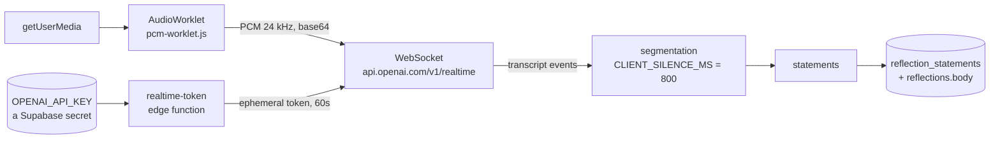

# Voice capture

`@musie/voice` — its own workspace package. A microphone, a WebSocket, a
transcription session, and fifteen named failure codes. **No recording is ever
stored.**



::: designers
## What it does on screen

You speak; the words appear about a second behind your voice, while you are
still speaking. When you stop, that sentence is finalised and becomes a
**statement** — an editable box. Afterwards you can edit, reorder, join and
delete them.

Then it is text, exactly as a typed reflection is text.

## The recording is never stored

Not "deleted afterwards" — never written. There is no column for it, no storage
bucket, and nothing in the pipeline that writes a file. The audio exists as
PCM frames travelling to a transcription service and nowhere else.

The promise sits beside the record button: *Musie keeps the text, never your
voice.*

## Fifteen failures, each with its own sentence

This is the part worth knowing as a designer, because the temptation is one
"something went wrong":

| Code | Means |
|---|---|
| `micDenied` | you said no to the permission |
| `micNotFound` | there is no microphone |
| `micUnavailable` | something else has it |
| `micInterrupted` | a call came in |
| `silence` | the microphone is open and hearing nothing |
| `connectionFailed` / `connectionClosed` / `connectionRejected` | three different network stories |
| `rateLimited` | too many requests |
| `noCredits` | **the budget is spent** |
| `providerError` | their side |
| `recorderFailed` | ours |
| `segmentationRejected` | the model refused the setting |
| `combined` / `deleted` | not failures — confirmations after an edit |

`rateLimited` and `noCredits` exist as separate codes for a specific reason:
*"you have run out of budget"* and *"the connection dropped"* look identical
from inside a browser and are completely different problems.

## The finding from user testing

**All five participants** said the automatic splitting into separate statements
was unwanted and jarring, and that plain text would be fine. **Two** loved the
drag-to-combine gesture — which exists only *because* of the splitting.

Five beats two. Removing it is scoped and deliberately not started: see
[Backlog](/work/backlog) B1. What is not wanted is *better-timed boxes* —
nobody asked for those.
:::

::: devs
## The package

```
features/voice/src/
  config.ts               EVERY tunable. Change these, not the code
  useTranscription.ts     the hook the app consumes
  useSentences.ts         statements, and the edits
  segmentation.ts         where a sentence ends
  onSentenceFinal.ts
  messages.ts             the fifteen codes
  audio/recorder.ts       getUserMedia + the worklet
  audio/pcm-worklet.js    runs in AudioWorkletGlobalScope
  capture/health.ts       is the microphone actually producing audio
  realtime/connection.ts  the socket
  transcript/fillers.ts
```

It is a **workspace package rather than a folder in `apps/web`** so that
`pnpm -r run typecheck|lint|test` reaches it on its own terms: the feature has
to hold up before a screen consumes it.

51 unit tests.

## The key never reaches the browser

`features/voice/src/realtime/connection.ts` says it plainly:

> A browser WebSocket cannot set an `Authorization` header, so the credential
> travels in the subprotocol list instead. Hence the name: anyone with the page
> can read it.

`openai-insecure-api-key.<key>` is **the protocol's own name** for handing your
API key to everyone who loads the page. The proof-of-concept did that with a key
typed into a field — correct for a demo, unshippable.

So the key is a **Supabase secret**, read only by the `realtime-token` edge
function, and what reaches the browser is an **ephemeral token minted per
session**. It still travels in the subprotocol — that part cannot change — but a
token that expires in a minute and can only open a transcription session is a
very different thing to leak.

**It is still your key being spent**, so the caller is checked: a JWT gets you a
token. That is a deliberately weak boundary and worth saying out loud —
anonymous sign-in is one unauthenticated request away — so the real defences are
the project spend limit and the per-model rate limit, which are provider-side.
Ben's project has a $50 cap that fails requests hard.

## No user-visible strings in the package

The proof-of-concept's `config.ts` also held option lists with English `label`
and `note` fields written to be rendered in a settings panel. **None of it came
across.** A user-visible string here could never satisfy rule 6 and rule 7.

What stayed is the facts the code reads — whether a model has server-side turn
detection, which language field it accepts. Those are not copy.

`messages.ts` emits **codes**; `apps/web/src/lib/voiceMessages.ts` maps them to
catalogue keys in both languages.

## The real splitter is one constant

```ts
export const CLIENT_SILENCE_MS = 800;
```

`gpt-live-transcribe` runs with `serverVad: false`, so **the browser commits the
turn** — which means `SILENCE_DURATION_MS` and `SegmentationMode` are both
ignored. Raising `CLIENT_SILENCE_MS` to 1500–2000 makes splits clause-shaped
instead of mid-clause.

That satisfies "the breaks were in the wrong places" and **not** "we did not
want boxes". Named in the backlog so it can be rejected knowingly.

## The models carry facts, not comparisons

```ts
export type TranscriptionModel = 'gpt-live-transcribe' | 'gpt-4o-transcribe';
```

Each one carries `serverVad`, `languageField`, `delay`, `usdPerMinute` and a
retirement date where announced — rather than being compared against a string
literal in four places. Measured against the live API on 15 Sep 2026 with the
same 10s of German.

`languageField` exists because the GA API is inconsistent: newer models take
`languages: []`, older ones `language: ""`.

## The worklet is not linted as browser code

`audio/pcm-worklet.js` runs in `AudioWorkletGlobalScope`, where
`AudioWorkletProcessor`, `registerProcessor` and `sampleRate` are globals that
exist in no other environment. `eslint.config.js` gives it its own block.

## Capture health

`capture/health.ts` answers a question the browser will not: **is the
microphone open and actually producing audio?** A granted permission with a
muted device looks identical to a working one, which is why `silence` is one of
the fifteen codes rather than an absence of events.

`CAPTURE_PROOF_MS = 1500` is how long it waits for proof; `CAPTURE_LOST_MS` is
how long before it says the capture died.

## Measuring beats reasoning here

The thresholds in `config.ts` were settled with a fake capture path driven by
Playwright, not by argument. `docs/VOICE-CAPTURE-FIX.md` §7 is the one
measurement still marked **unmeasured on a phone**: a hand run logging nine
stop-time numbers.
:::

---

**Source of truth:**
[`features/voice/src/config.ts`](https://github.com/product-ben/musie/blob/main/features/voice/src/config.ts),
[`features/voice/src/realtime/connection.ts`](https://github.com/product-ben/musie/blob/main/features/voice/src/realtime/connection.ts),
[`supabase/functions/realtime-token/index.ts`](https://github.com/product-ben/musie/blob/main/supabase/functions/realtime-token/index.ts),
[docs/VOICE-CAPTURE-FIX.md](https://github.com/product-ben/musie/blob/main/docs/VOICE-CAPTURE-FIX.md),
[docs/VOICE-MEMO.md](https://github.com/product-ben/musie/blob/main/docs/VOICE-MEMO.md).
