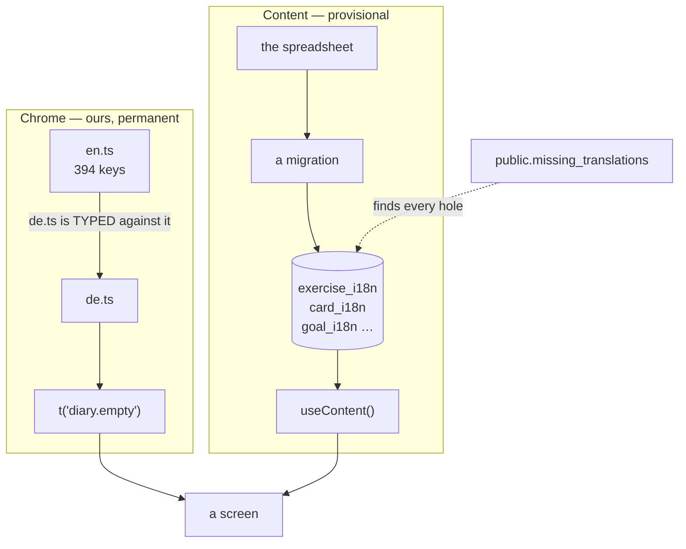

# Content and copy

Two kinds of copy, in two places, with two different lifespans. Confusing them
is the mistake this page exists to prevent.

| | Chrome | Content |
|---|---|---|
| Lives in | `apps/web/src/i18n/en.ts` + `de.ts` | the content tables |
| Comes from | us | the Mindfulness Cards spreadsheet |
| Lifespan | **permanent** | **provisional — it will be overwritten** |
| Changed by | editing a TypeScript file | a new migration |
| Count | 394 keys × 2 | 5 exercises, 9 cards, 3 goals, 4 user types |



::: designers
## The rule that matters most

**A missing or placeholder German string is written, not reported.** There is a
written standard for it, and leaving a `[DE]` placeholder with a note is not an
outcome.

## The tone, as rules you can hold a string against

- **du**, lower-case, throughout. Not *Sie*, not capitalised *Du* — that reads
  as correspondence, not as an interface. This is closed, not open.
- **Imperative singular** for instructions: *Prüfe*, *Scanne*. Not *Prüfen
  Sie*, and not the infinitive-as-instruction (*Verbindung prüfen*) when you
  are addressing the reader rather than labelling a button.
- **Sentence case** on headings, labels, buttons and menu items — capital on
  the first word, then only what German capitalises anyway. No capitals as
  emphasis.
- **Consistency outranks the choice.** A single *Bitte wählen Sie* in a du-app
  is a bug report.

| ✗ | ✓ |
|---|---|
| Prüfen Sie Ihre Verbindung | Prüfe deine Verbindung |
| Ihr Tagebuch | Dein Tagebuch |
| Session Starten | Session starten |

**Where du does not apply:** copy in the *user's own* voice. The "Here as …"
answers are the user speaking, so they are first person — *Mit meiner
Partnerin oder meinem Partner*, not *mit deiner*. The alt text describing that
same option is Musie speaking about the reader, so it is du: *Musie mit deiner
Partnerin oder deinem Partner nutzen*.

## What never gets translated

**Track titles and artist names.** That is why the `tracks` table has no
`_i18n` sibling — a title is not a translation problem, it is a name.

## The thing to be careful of in a design review

**Every user-visible string in a screen is passed in explicitly.** The design
system's own components ship defaults, and those defaults are a *mix* of German
and English — a close button that says `Schließen`, an empty state that says
`Keine Optionen verfügbar`, a record button that says `Record Now`.

So if you see one German word on an otherwise English screen, the cause is
almost always a component default leaking through because a screen did not pass
that prop. It is a bug with a known shape, not a translation gap.

## Where to find a hole

Ask the database:

```sql
select * from public.missing_translations;
```

It lists every content row missing a locale. For chrome there is nothing to
ask: a key added in English without German fails the build.
:::

::: devs
## Chrome: `apps/web/src/i18n/`

```
en.ts              the catalogue, and the type
de.ts              typed against en.ts
index.ts           translate(), useT()
localeContext.ts   the provider's context
parity.test.ts     asserts the two catalogues agree
```

**`MessageKey` is `keyof typeof en`**, so an unknown key is a typecheck error
rather than a runtime fallback. And `de.ts` is typed against `en.ts`, so **a
key added in English without German fails `pnpm check`.** That is the whole
enforcement mechanism and it needs no process around it.

Nothing user-visible is written inline in `apps/web` — placeholder route titles
included.

## Content: the `_i18n` sibling tables

Every content table with copy has a sibling keyed `(id, locale)` with
`check (locale in ('de','en'))`. Content is read through `lib/content.ts` and
`useContent()`, which re-fetches in the new language with no reload.

`pickTranslation()` falls back to English **and warns**. There is a unit test
that turns red if the fallback is deleted.

`public.missing_translations` is a `security_invoker` view over every `_i18n`
table, so it answers as the caller.

## Rule 7, and why it is absolute

> Every user-visible string is passed explicitly. Never let a design-system
> default through.

The defaults are a mix of languages, and that is on purpose in the package:

| Component | Prop | Ships as |
|---|---|---|
| `Lightbox` | `closeLabel` | `'Schließen'` |
| `RadioGroupText` / `RadioCards` / `RadioGroupImage` | `emptyLabel` | `'Keine Optionen verfügbar'` |
| `ContentList` | `emptyLabel` | `'Noch keine Einträge'` |
| `RecordButton` | `readyLabel` | `'Record Now'` |

One leaked default makes the UI half-German whatever the locale says. **Grep
`packages/design-system/src/` before assuming a prop has a safe default.**

There is a floor under this: `MusyLocaleProvider` in `main.tsx` makes the
package's own catalogue follow the app's locale, which covers the labels a
screen *cannot* pass — like `Message`'s visually hidden status word. It does
not soften rule 7; it catches what rule 7 cannot reach.

## Content changes are migrations, and they stack

A content change is a **new migration with `alter table` / `update`**, never an
edit to an applied one. Rule 4 inverted on 2026-09-21 when the hosted project
was linked: Supabase records an applied migration **by timestamp, not by
content**, so editing a pushed file changes nothing on the remote and is
skipped in silence.

Content lives in a migration rather than `supabase/seed.sql` because
**`supabase db push` does not run `seed.sql`**.

Run `pnpm test:db` after any change under `supabase/migrations/`.

## The deck is generated, not written twice

`supabase/content/deck.json` is one file — cards, codes, feelings in both
languages, alt texts, and which recording plays in which exercise. Everything
else is produced from it:

```
deck.json ──► pnpm deck:migration ──► a new stacking migration
          ──► pnpm deck:pdf       ──► the print-ready PDF
```

See [The paper deck](/features/deck-pipeline).
:::

---

**Source of truth:**
[docs/GERMAN-UI-WRITING.md](https://github.com/product-ben/musie/blob/main/docs/GERMAN-UI-WRITING.md),
[`apps/web/src/i18n/en.ts`](https://github.com/product-ben/musie/blob/main/apps/web/src/i18n/en.ts),
[CLAUDE.md](https://github.com/product-ben/musie/blob/main/CLAUDE.md) rules 6 and 7,
[supabase/content/README.md](https://github.com/product-ben/musie/blob/main/supabase/content/README.md).
