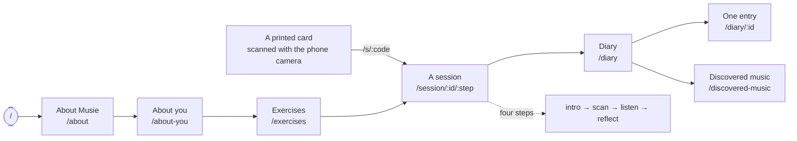

# The user journey

Five surfaces in order, plus one shortcut that starts on paper.



::: designers
## The five surfaces

| | Surface | What happens |
|---|---|---|
| 1 | **About Musie** (`/about`) | Musie introduces itself in a chat rhythm — greeting, typing dots, then a carousel in three images: *choose an exercise · Musie guides you through exercise and reflection · feel and understand yourself better* |
| 2 | **About you** (`/about-you`) | A single question: *Here as …* — by myself, with a group, with my partner, with a patient. No name, no email, no age |
| 3 | **Exercises** (`/exercises`) | The library: five exercises as cards, with duration, needs ("You need: the Mindfulness Cards set") and a detail overlay |
| 4 | **A session** (`/session/:id/:step`) | Four steps: **intro → scan the card → listen → reflect.** Only ever one session at a time, enforced by the database rather than by hope |
| 5 | **Diary** (`/diary`) | Every finished session, newest first, grouped by day — with a graph above it: one week per view, each day a stack of the images of the exercises you did |

## The shortcut that is the point

A scanned QR code leads via `/s/:code` **straight into the session** — so you
can start with the phone's own camera app and land in Musie at exactly the card
you drew. The card is therefore an advertisement that redeems itself.

## `/` is a decision, not a page

The root paints nothing. It decides where opening Musie takes you.

`/` **was** the explainer itself until 2026-10-02, on the argument that a root
which only redirects costs a round trip and leaves the site with no home. User
testing replaced that with a plainer argument: the explainer is a page people
are *sent* to, come back to, and talk about — and a page like that has a name.
So `/about` is the page, and `/` is the decision.

The explainer is now **unconditional**: every skip it used to perform moved to
the root. It shows the explainer to whoever asks for it, every time, which is
what the drawer's *How Musie works* row has always promised.

## Overlays are routes

`/menu` presents as a drawer but **is** a route, so Back closes it and the URL
is linkable. `/diary/:id` — a lightbox over the diary — arrives the same way.
The page beneath stays rendered.

So there is no modal-only navigation anywhere in the product. If you can see
it, you can link to it.

## `/settings` is gone, and it is worth knowing why

It was the third overlay. Its three preferences moved into the drawer,
delete-everything moved onto the diary, and *Here as* went entirely —
`/about-you` already asks it. One overlay to find instead of two, and one fewer
icon in the header.

Nothing redirects `/settings` anywhere: it was two weeks old, linked from one
icon in our own header, and never printed or sent anywhere. A stale URL lands
on the not-found route like any other typo.

## The diary is a list of moments, not of exercises

A card's heading is "Session from …", not the name of the exercise — three
sittings of the same exercise were previously three cards with one heading.

On each card the exercise's **question** sits above your own answer, so the
answer reads as an answer. Everything factual — exercise, when it stopped,
status — is folded away behind *Session details*. **Deleting is not folded
away**: a destructive action behind a flap is harder to find when you want it,
and no harder to hit when you do not.
:::

::: devs
## The route table

`apps/web/src/router.tsx` — a `createBrowserRouter`. Every screen is a real
route.

| Path | Screen | Notes |
|---|---|---|
| `/` | `Entry` | paints nothing; `lib/entry.ts` decides |
| `/about` | `AboutMusie` | unconditional since 2026-10-02 |
| `/about-you` | `AboutYou` | `user_type_id` + goals |
| `/exercises` | `Exercises` | the library |
| `/session/:id/:step` | `Session` | `:step` validated in a loader |
| `/s/:code` | `ScanLink` | the printed QR's target |
| `/diary` | `Diary` | |
| `/diary/:id` | `DiaryEntry` | `overlay: true`, `beneath: /diary` |
| `/discovered-music` | `DiscoveredMusic` | |
| `/menu` | `MenuDrawer` | `overlay: true` |
| `/insight-map` | `InsightMap` | team tool |
| `/goal-mappings` | `GoalMappings` | team tool |
| `/dev/qr` | `DevQrSheet` | team tool, lazy |
| `/dev/experiment-mixer` | `DevExperimentMixer` | the two-stream bench (M16) |
| `*` | `Placeholder` | not found |

## `handle` carries the two facts the shell needs

```ts
handle({ titleKey: 'route.diary.title', overlay: true, beneath: {...} })
```

`titleKey` is a `MessageKey`, so an unknown one is a typecheck error rather
than a runtime fallback. `overlay` changes **where** the element is rendered:
`AppShell` keeps the last non-overlay page mounted beneath it.

`overlay` changes nothing about fetching — the overlay screen still reads its
own data.

## `sessionLoader`, and why it is a loader

```ts
function sessionLoader({ params }) {
  if (!isStepId(params.step)) {
    return redirect(`/session/${encodeURIComponent(params.id ?? '')}/intro`);
  }
  return null;
}
```

**In a loader, not in the component.** A loader redirect resolves before
anything renders, so a bad step never paints — where a `<Navigate>` would mount
the wrong step first and flash it. It also means a directly typed
`/session/x/banana` behaves identically to one reached by clicking.

`:id` is carried, not looked up — the redirect preserves it so the carry is
observable in the address bar.

## `/diary/:id` deliberately has **no** loader

The screen reads `:id` through the same hook every other screen uses, so
loading, failure and a missing entry are one set of states written once. A
loader would move the 404 into the router and leave the other two in the
component.

That survived the screen gaining a redirect: deep-linking a session that is
still running sends you into the session rather than to "this entry does not
exist" — which is exactly what a loader is ordinarily for. It stays out of one
because **the redirect needs the row**: only the session's own status and step
can say whether to redirect and where. A loader would read it, and the screen
would read it again to draw it — two fetches of one row, and two places holding
the locale fallback and the status narrowing.

## `/about` and `/about-you` sit beside each other on purpose

The comment used to read "`about-you`, not `about`: one spelling per route" —
written when the explainer had no path of its own. 2026-10-02 gave it `/about`,
so the pair is deliberate: `/about` is about the product, `/about-you` is about
the reader. Logged in `apps/web/OPEN-QUESTIONS.md`, because retiring the old
rule outright is Ben's call.
:::

---

**Source of truth:**
[`apps/web/src/router.tsx`](https://github.com/product-ben/musie/blob/main/apps/web/src/router.tsx),
[`apps/web/src/routeHandle.ts`](https://github.com/product-ben/musie/blob/main/apps/web/src/routeHandle.ts),
[`apps/web/src/lib/entry.ts`](https://github.com/product-ben/musie/blob/main/apps/web/src/lib/entry.ts).
