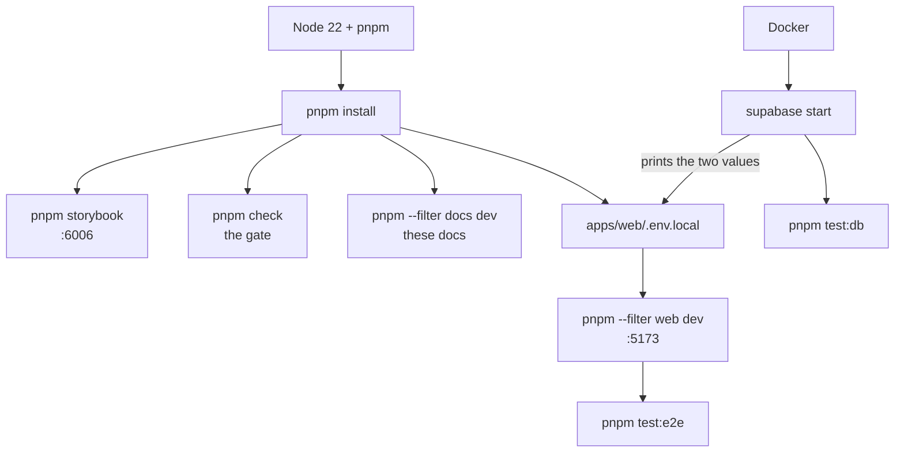

# Get started

Node 22, pnpm, Docker. Fifteen minutes from clone to a running app with a
database behind it.

```bash
git clone https://github.com/product-ben/musie.git
cd musie
pnpm install
cp apps/web/.env.example apps/web/.env.local   # then fill in two values, below
supabase start                                  # Docker; prints the two values
pnpm --filter web dev                           # http://localhost:5173
```



Everything on the top row needs **nothing but `pnpm install`**. Only the
bottom row needs Docker.

## The four things you can run

| Command | What it is | Needs |
|---|---|---|
| `pnpm --filter web dev` | the app, on `:5173` | `.env.local`, and a database if you want content |
| `pnpm storybook` | the design system, on `:6006` | nothing |
| `pnpm check` | **the gate** — typecheck, lint, unit tests | nothing |
| `pnpm --filter docs dev` | these docs | nothing |

Two more suites exist and are deliberately **not** in `pnpm check`, because CI
has no Supabase and a suite that silently skips is worse than no suite:

```bash
pnpm test:db     # database security + parity, against the local stack
pnpm test:e2e    # one Playwright walk of a whole session, per locale
```

::: designers
## You do not need the database to do design work

Storybook is the whole design system and it needs no account, no Docker and no
environment file:

```bash
pnpm install
pnpm storybook
```

That gives you 32 components and 358 stories on `localhost:6006`, in light and
dark, with the token reference and the layout rules as pages. It is also
published, so you can look without cloning anything:
[product-ben.github.io/musie/storybook](https://product-ben.github.io/musie/storybook/).

## If you do want the real app

The app is where the components are assembled into screens, and seeing a screen
means having content — the exercises, the cards, the copy — which lives in a
database. So there are two extra steps: Docker, and two values in a file.

1. **Install Docker Desktop** and start it. The database, the auth server and
   the file storage all run as containers on your machine.
2. **`supabase start`.** The first run downloads a few hundred MB. When it
   finishes it prints a block including `API URL` and `anon key`.
3. **Put those two into `apps/web/.env.local`** — copy
   `apps/web/.env.example` first, which explains each line.
4. **`pnpm --filter web dev`** and open `localhost:5173`.

## What you are looking at, and what it is not

The content in the database is the **Mindfulness Cards spreadsheet's**, and it
is provisional — it will be overwritten. The German is real German written to a
standard; the English is a working translation. Track titles and artists are
withheld from the browser on purpose, so an exercise plays `trk-07` and the
title appears only after the reflection.

## Two things to know before you file a bug

- **The app's own copy is not inline anywhere.** Every string comes from
  `apps/web/src/i18n/en.ts` and `de.ts`, or from the content tables. A typo is
  a one-line change in one of four places, never a hunt.
- **A component's geometry is never overridden by a screen.** If a screen needs
  a button aligned differently, the prop goes on the component. So "this is
  spaced wrong here" is usually a component change, which means it changes
  everywhere — which is the point.
:::

::: devs
## Prerequisites, exactly

| | Why this one |
|---|---|
| **Node 22** | `packageManager` pins pnpm; the workflows use `node-version: 22` |
| **pnpm** | the version comes from `packageManager` in the root `package.json` — do not pin it anywhere else |
| **Docker** | the Supabase CLI runs the whole stack in containers |
| **Supabase CLI** | `brew install supabase/tap/supabase` |

## `.env.local`, and the one trap in it

`supabase start` prints `API URL` and `anon key`. They go in as:

```ini
VITE_SUPABASE_URL=http://127.0.0.1:54321
VITE_SUPABASE_ANON_KEY=<the anon key supabase start printed>
VITE_REQUIRE_ACCOUNT=false
```

Only `VITE_`-prefixed variables reach browser code. The anon key is public by
design and constrained by row level security. **Never put a service-role or
`sb_secret_…` key here** — `apps/web/src/lib/supabase.ts` refuses to start if it
finds one, but that guard is a backstop, not a permission slip.

**The trap:** `.env.local` also decides what `getSupabase()` returns *inside
tests*. A `*.db.test.ts` that called `getSupabase()` would test whichever
project this file names, while `pnpm test:db` is aimed wherever `supabase
status` or the `SUPABASE_TEST_*` variables point. The two can differ, and when
they do a suite passes while testing nothing. Database tests use
`anonClient()` from `db.support.ts`, never `getSupabase()`.

## The stack is shared, and that is the one thing to internalise

`supabase/config.toml` declares `project_id = "musie"` and fixed ports — 54321
api, 54322 db, 54323 studio. **Every worktree's `supabase` command drives the
same containers.** A `db reset` run from one branch re-applies *that branch's*
migrations over whatever another session is testing against.

`supabase db reset`, `supabase db push` and `pnpm gen:types` are denied in
`.claude/settings.json` for that reason. Run them yourself, from one session,
knowing the others are affected. See
[Local stack and worktrees](/architecture/local-stack).

## The gate

```bash
pnpm check      # typecheck + lint across every package, unit tests in two of three
```

CI runs the same command plus both bundle builds, because `tsc --noEmit`
resolves neither CSS imports nor the font-pinning Vite plugin. Nothing is
"done" until `pnpm check` passes — and verify against `supabase start` and
`pnpm --filter web dev`, not against a URL.

After any change under `supabase/migrations/`, run `pnpm test:db`.

## Working on these docs

```bash
pnpm --filter docs dev       # :5173 is the app; VitePress picks its own port
pnpm --filter docs build     # fails on a dead link — that is the gate
pnpm --filter docs test      # the audience containers and the mermaid fence
```
:::

---

**Source of truth:**
[README.md](https://github.com/product-ben/musie/blob/main/README.md),
[apps/web/.env.example](https://github.com/product-ben/musie/blob/main/apps/web/.env.example),
[docs/MUSIE-SETUP.md](https://github.com/product-ben/musie/blob/main/docs/MUSIE-SETUP.md).
