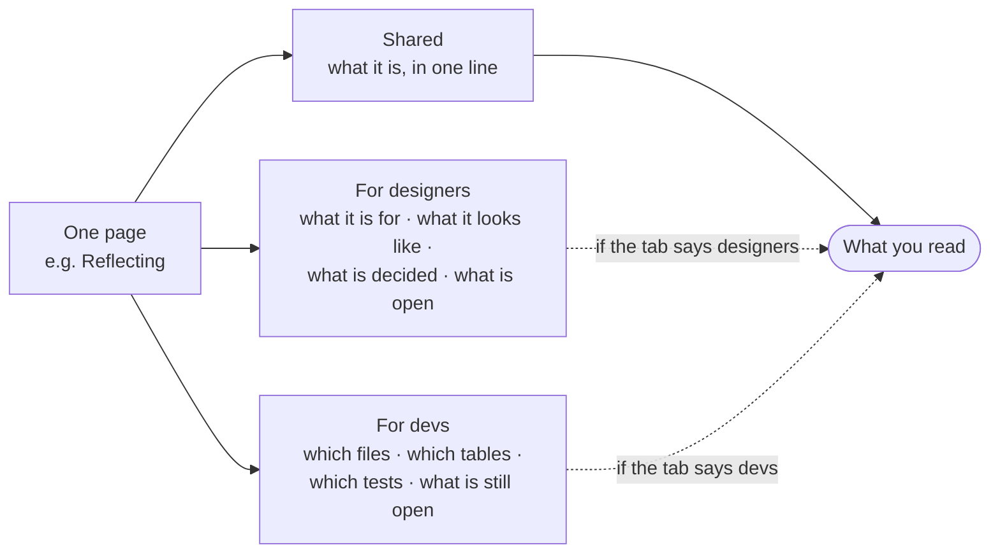

# How to read these docs

Every page is written twice. The switch in the header decides which half you
see.

## The two tabs

| | For designers | For devs |
|---|---|---|
| Answers | what is this for, what does it look like, what was decided | which file, which table, which command, which test |
| Names | screens, steps, states, copy | routes, columns, props, policies |
| Skips | file paths, SQL, build config | nothing — it is the long half |

The choice is remembered in your browser. A first-time visitor lands on **For
designers**, because the designer half explains the product, which reads better
for anyone new to Musie — including a developer on day one.

## Sharing a link to one tab

Clicking the switch writes it into the address bar as `?for=devs` or
`?for=designers`, so the URL you copy carries the tab you were reading. Paste
that link and the reader lands on the same half.

The query disappears again as soon as you navigate inside the site. That is
deliberate: the browser, not the URL, is what remembers your choice, so URLs do
not stay noisy.

## What the markers mean

A block with a green rule and a **FOR DEVS** chip is the developer half. A
terracotta rule and **FOR DESIGNERS** is the other one. Text with no rule
beside it is shared and both audiences read it.

::: designers
### Why you can still find developer text

Search and your browser's own Find-in-page reach both halves, including the one
you are not reading. That is on purpose: if you search for a table name a
developer mentioned in a ticket, you should find the page that explains it,
whichever tab you had open.
:::

::: devs
### The mechanism, in three lines

`::: devs` and `::: designers` are markdown-it containers that compile to
`
`. An inline script in `<head>` resolves the
audience — URL, then `localStorage`, then the default — and writes it onto
`<html data-audience>` **before the first paint**, which is the same trick the
app uses for `data-theme` and for `<html lang>` (CLAUDE.md rule 5). One CSS
rule does the hiding.

It is CSS rather than `v-if` for three reasons, and the third decides it: no
flash, both halves stay searchable, and with JavaScript off the page reads as
both halves end to end — which is also what a crawler sees.

The cost, stated so it is not discovered: the right-hand outline is built from
the markdown at build time and lists the headings of **both** halves, so
`theme/outline.ts` hides the ones whose heading sits inside a hidden block.

Source: [`apps/docs/.vitepress/markdown/audience.ts`](https://github.com/product-ben/musie/blob/main/apps/docs/.vitepress/markdown/audience.ts).
:::

## What these docs are not

- **Not the source of truth.** Every page ends by naming the file that rules.
  Where a page and the repository disagree, the repository wins and the page is
  a bug.
- **Not the plan.** What is coming lives in
  [BUILD-PLAN.md](https://github.com/product-ben/musie/blob/main/BUILD-PLAN.md);
  what is scoped and deliberately not started lives in
  [Backlog](/work/backlog).
- **Not the decision log.** Decisions are append-only in the repository. The
  [Decisions](/work/decisions) page is a readable index of them, not a
  replacement.

---

**Source of truth:** this site's own
[`apps/docs/`](https://github.com/product-ben/musie/tree/main/apps/docs).
