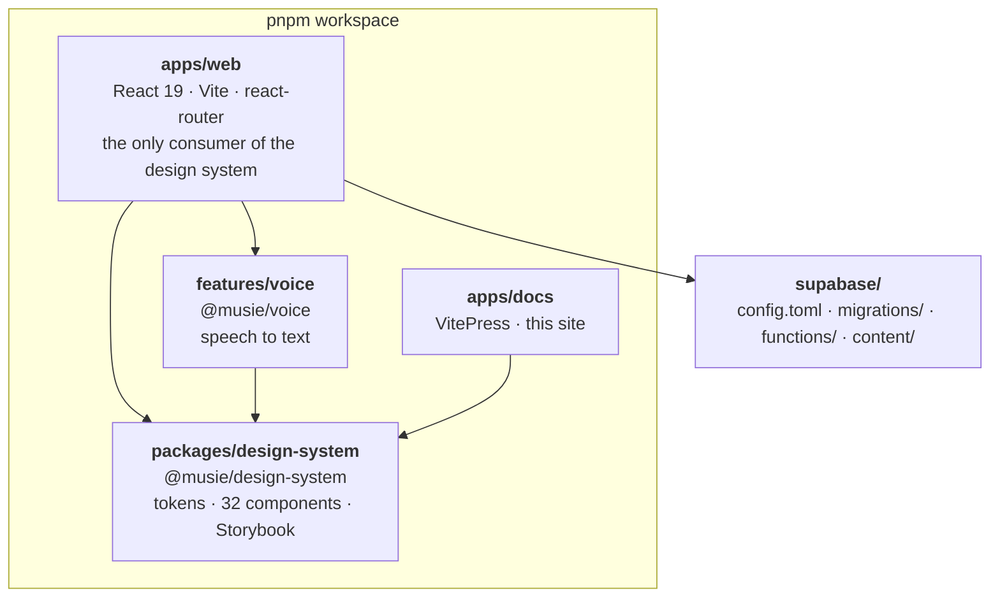

# Repo map

A pnpm workspace, Node 22, four packages, and about thirty markdown files that
are load-bearing rather than decorative.



::: designers
## The four packages

| | What it is |
|---|---|
| **`apps/web`** | the app. The only thing that consumes the design system |
| **`apps/docs`** | this site |
| **`packages/design-system`** | tokens, 32 components, the layout rules, Storybook |
| **`features/voice`** | speech-to-text. Its own package so it has to hold up before a screen consumes it |

## The documents that matter, and what each one is for

| File | Answers |
|---|---|
| `docs/MUSIE-BRIEFING.md` | **what Musie is**, for market and strategy work. In German |
| `MOCKUPS.md` | the screens as designed, and which parts are not built |
| `BUILD-PLAN.md` | the phases, and what "done" means for each |
| `DOMAIN-MODEL.md` | the entities, and which questions are still open |
| `DECISIONS.md` | what was ruled, and why |
| `BACKLOG.md` | scoped, deliberately not started |
| `docs/GERMAN-UI-WRITING.md` | the standard the German is written to |
| `packages/design-system/docs/10-layout.md` | the sixteen layout rules |
| `supabase/content/README.md` | the deck and the music: one file each, and the loop |
| `apps/web/OPEN-QUESTIONS.md` | why things are the way they are |

## The iteration documents

Several files record one screen being worked out. They are the closest thing to
a design history:

```
docs/START-PAGE-ITERATION.md
docs/LISTENING-QUESTION-ITERATION.md
ITERATION-1ST-WEEK-OCT.md
LISTENING-EXERCISES.md  ·  LISTENING-EXERCISES-PLAN.md
docs/VOICE-MEMO.md      ·  docs/VOICE-CAPTURE-FIX.md
```

## Where the assets are

**Source masters live outside the repository**, in `~/Documents/musie-assets/` —
print masters, audio masters, delivered graphics. **Web renditions live in it**,
under `apps/web/public/assets/web/`.

The reason is in [Decisions](/work/decisions) M1, and the third of its three
arguments is the one that decides it: **the repository is public.**
:::

::: devs
## The tree

```
apps/web/                 the app
  src/
    components/           17 app components
    routes/               15 screens
    lib/                  ~90 modules + their tests
    i18n/                 en.ts, de.ts, and the resolution
    content/
  e2e/                    7 Playwright specs + the fakes
  scripts/                deck-migration, deck-pdf, music-upload, music-migration, qr-codes
  docs/assets/
apps/docs/                this site
packages/design-system/
  tokens/                 Layer 1 + fonts + theme-init.js
  src/                    Layer 2 — 32 components + musy-components.css
  docs/                   Layer 3
  stories/                358 stories, CONVENTIONS.md, OPEN-QUESTIONS.md
  scripts/                verify-tokens, verify-layout, verify-coverage
features/voice/           @musie/voice
supabase/
  config.toml             project_id "musie", ports 54321/54322/54323
  migrations/             41 files, append-only
  functions/              reveal-track, realtime-token
  content/                deck.json, music.json, README.md
scripts/                  db-status.mjs, db-sync.mjs, db-warn.mjs
reference/                the inherited design-system docs + INVENTORY.md
.github/workflows/        ci.yml, pages.yml, db-push.yml
wrangler.jsonc            the whole host configuration
```

## The commands, in one place

| | |
|---|---|
| `pnpm check` | **the gate** — typecheck + lint + unit tests |
| `pnpm test:db` | database security + parity, against the local stack |
| `pnpm test:e2e` | one Playwright walk per locale |
| `pnpm --filter web dev` | the app on :5173 |
| `pnpm storybook` | the design system on :6006 |
| `pnpm --filter docs dev` | this site |
| `supabase start` | the one local stack |
| `pnpm db:status` | do the files and hosted agree? Read-only |
| `pnpm db:sync` | push merged migrations to hosted. Guarded |
| `pnpm deck:migration` · `pnpm deck:pdf` | the deck |
| `pnpm music:upload` · `pnpm music:migration` | the music |
| `pnpm gen:types` | regenerate `database.types.ts` — **denied**, see rule 9 |

## `reference/` is inherited, not current

`reference/design_system/docs/` is the **original** design-system
documentation — 1,471 lines on components alone — plus the conflict report, the
contrast audit and the token gaps. `reference/INVENTORY.md` records what was
moved in and what was left.

It is history. `packages/design-system/` is the live system, and where the two
disagree, the package wins.

## Two files are generated and committed

| | By |
|---|---|
| `apps/web/src/lib/database.types.ts` | `pnpm gen:types` — **denied** because it reads the shared stack and writes into whichever branch is checked out |
| `pnpm-lock.yaml` | pnpm. `--frozen-lockfile` in CI fails if it disagrees with `package.json` |

## And two directories are generated and NOT committed

`deck-print/` and `qr-codes/`. A printed thing that cannot be regenerated is one
nobody can check.
:::

---

**Source of truth:**
[the repository root](https://github.com/product-ben/musie),
[CLAUDE.md](https://github.com/product-ben/musie/blob/main/CLAUDE.md) (Orientation),
[pnpm-workspace.yaml](https://github.com/product-ben/musie/blob/main/pnpm-workspace.yaml),
[reference/INVENTORY.md](https://github.com/product-ben/musie/blob/main/reference/INVENTORY.md).
