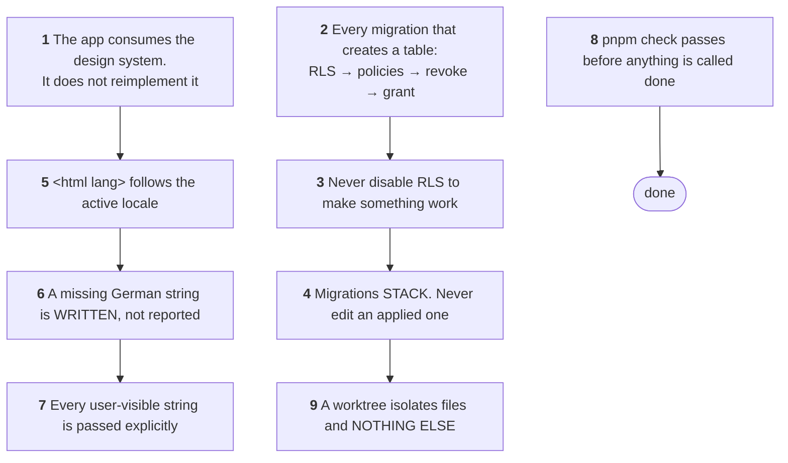

# Agent guidelines

`CLAUDE.md` is nine rules, and every one of them cites the file that proves it.
**Read the file before arguing with the rule.**



::: designers
## Why a repository has rules written for a machine

Most of these nine exist because something went wrong once, and the rule records
the shape of the failure rather than the fix. Four of them are directly about
design and copy:

**Rule 1 — the app consumes the design system; it does not reimplement it.** No
screen may reach into a component's geometry. When a component cannot do what a
screen needs, **the fix goes into the component** — which is why a button has an
alignment prop instead of one screen overriding its layout.

A custom pattern is allowed **only where the system has no component.** Then
every value resolves to a token, the class carries the app's own prefix, and **a
pattern that recurs is a component request, not a second copy.**

**Rule 5 — the page's declared language follows the locale.** Not cosmetic:
German under `lang="en"` breaks German compounds at English hyphenation points,
silently.

**Rule 6 — a missing or placeholder German string is written, not reported.**
To a written standard. Leaving a placeholder and flagging it is not an outcome.

**Rule 7 — every user-visible string is passed explicitly.** The design
system's own defaults are a *mix* of German and English, so one leaked default
makes the UI half-German whatever the locale says.

## The rule about the rules

> **Log what you could not resolve.** An empty log is a failure signal.

A brief whose premise is wrong about the repository, or a fix belonging in the
design system rather than the app, goes into the append-only log in that file's
format **rather than being quietly worked around.**

That is why the log is 8,730 lines long, and why it is the most useful document
in the repository.

## What this means when you brief someone

**A subagent inherits the directory, not the conversation.** Its whole world is
its prompt plus `CLAUDE.md`. So a constraint established by talking — which
thing is half-finished, which package to leave alone — **does not exist unless
the prompt restates it.**
:::

::: devs
## The nine, with what each one actually costs you

| | Rule | The failure it records |
|---|---|---|
| **1** | import from the design system; never a raw scale token | zero raw-scale references today; keep it so |
| **2** | RLS → policies → **revoke → grant**, to `authenticated` **and `service_role`** | the `service_role` hole: 23 db tests failed in three files for one cause |
| **3** | never disable RLS to make something work | an empty result is a missing **policy**; a permission error is a missing **grant** |
| **4** | migrations stack; never edit an applied one | Supabase records an applied migration **by timestamp, not content** — an edit is skipped in silence |
| **5** | `<html lang>` follows the locale | `hyphens: auto` hyphenates by **declared** language |
| **6** | write the German | `de.ts` is typed against `en.ts`, so the typecheck enforces chrome parity |
| **7** | pass every string | grep `packages/design-system/src/` before assuming a prop has a safe default |
| **8** | `pnpm check` passes | and **three of four** packages run unit tests — know which |
| **9** | a worktree isolates files and nothing else | one Supabase stack, one port 5173, one wall clock |

## Rule 4 inverted once, which is the most important thing to know

Until 2026-09-21 a content change **edited the existing migration** as though it
had always said that. Every earlier file's history was rewritten that way, which
is why their timestamps say September 18 and their contents do not.

**That freedom is gone.** Every change is now its own new migration with
`alter table`.

**And the two databases drift silently, which is the trap.** `pnpm check` never
touches a database, so typecheck, lint, tests and CI are all green while the
migration files and the hosted database disagree — and the failure surfaces
later, elsewhere, looking unrelated.

## The denied commands, and the three different reasons

| | Denied because |
|---|---|
| `supabase db reset` | it touches the **shared local** database every worktree drives |
| `pnpm gen:types` | it reads that shared database and **writes into whichever branch is checked out** |
| `supabase db push` | it touches **hosted**, where no worktree is involved at all |

Three commands were denied as one rule until 2026-10-13, and **reading them as
one rule is what hid the real problem**: phrased as *who* may push rather than
*when* a push is correct, it never protected the one person who was allowed to.
`pnpm db:sync` is the guard that replaces it.

## Fan-out

> Prefer `Explore` and `Plan` for fan-out: neither can write, so neither can
> collide. Do the writing in one session, where a single context holds the whole
> tree.

## Before trusting a worktree

```bash
git rev-list --left-right --count main...HEAD
```

A worktree 76 commits behind reports a file missing that exists on `main`,
re-implements what already landed, and applies an older copy of `CLAUDE.md`.

## Verification, matched to the change

Rule 8 says verify against `supabase start` and `pnpm --filter web dev`, never a
URL. The corollary worth internalising: **match the verification to the size of
the change.** A locale string needs the typecheck, not a browser harness. A
threshold needs a measurement, not an argument.

And after any change under `supabase/migrations/`: `pnpm test:db`.

## This site is subject to rule 1's spirit

`apps/docs` is a **derived view**. Where a page and the repository disagree, the
repository wins and the page is the bug. A page does not fix the code it
describes — it logs the discrepancy, in the format the log requires.
:::

---

**Source of truth:**
[CLAUDE.md](https://github.com/product-ben/musie/blob/main/CLAUDE.md),
[`.claude/settings.json`](https://github.com/product-ben/musie/blob/main/.claude/settings.json),
[apps/web/OPEN-QUESTIONS.md](https://github.com/product-ben/musie/blob/main/apps/web/OPEN-QUESTIONS.md).
