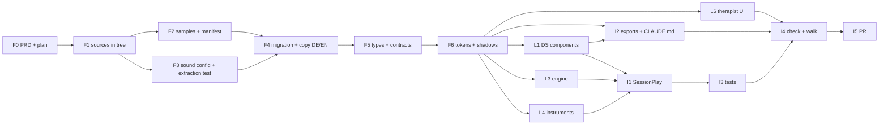

# Instruments · implementation plan

Three exercises of a new kind `instruments` — Kalimba, Marimba, Harfe — under
*Entspannen*, from the three experiments. **This file is the current state**:
updated after every task and every subagent result.

- PRD (the argument, the data model, every decision): `docs/plans/instruments-prd.md`,
  readable copy at https://claude.ai/artifact/3Eeyp413QwRHfmi3piW85h
- Branch: `feature/instruments-exercises`, cut from `origin/main` at `5c70a57`
- Decisions (Ben, 2026-11-09): only each experiment's DEFAULT sound; samples
  stay static (Cloudflare), the database indexes them by path, size and
  SHA-256; motion sensor 1:1, permission asked on the intro step with its
  state shown; play time = first own note → *Weiter zum Reflektieren*; Kalimba
  gets the marimba's timer and answer. PRD §Widersprüche 1, 6–12: proposal stands.

Status words: **offen** · **in Arbeit** · **erledigt** · **blockiert**.

## Sources, pinned

| Instrument | Version | Commit | Where it is on this branch |
| --- | --- | --- | --- |
| Harfe | `harp/261109-0920` (sound = `261104-1443`) | `d0e88ac` (PR #72) | merged in, task F1 |
| Kalimba | `kalimba/261106-1121` | `cd962d3` (on `main`) | already in the tree |
| Marimba | `marimba/261108-1740` | `5590e20` (PR #71) | merged in, task F1 |

CI checks out shallow (`ci.yml`, `actions/checkout@v4` with no depth), so a
test cannot `git show` a commit. The comparison "database = experiment" reads
the experiment files **in the tree**, which is why F1 brings #71 and #72 in.

## Tasks

### Foundation — serial, one session (rule 9: one writer for schema and shared files)

| # | Task | Status | Depends on | Files |
| --- | --- | --- | --- | --- |
| F0 | PRD (artifact) and this plan. The repo copy `docs/plans/instruments-prd.md` is exported from the final doc in I5 | erledigt | – | `docs/plans/*` |
| F1 | Merge PR #71 (marimba) and PR #72 (answering harp) into the branch, so every source is in the tree | erledigt (`ca1de81`, `93443c3`) | – | `apps/web/public/experiments/{marimba,harp/261109-0920}/**` |
| F2 | Copy the DEFAULT samples byte-identically to `apps/web/public/instruments/<id>/`; harp decoded from its base64. Manifest with path, bytes, SHA-256 | erledigt (`73b81f8`): 32 files, 6 harp · 16 kalimba · 10 marimba, 4.9 MB | F1 | `apps/web/public/instruments/**`, `supabase/content/instruments/samples.json`, `tools/instruments/extract-samples.mjs` |
| F3 | Sound + answer config per instrument as JSON, transcribed from the experiment; extraction test that reads the experiment HTML and compares | erledigt (`73b81f8`): 48 checks green | F1 | `supabase/content/instruments/{answer,harp,kalimba,marimba}.json`, `apps/web/src/instruments/sources.test.ts` |
| F4 | Migration: `instruments` kind, `play` step, `sessions.play_mode`/`play_seconds`, `instruments` / `instrument_sounds` / `instrument_samples` / `exercise_instruments` (RLS, revoke, grant to authenticated AND service_role), new `exercise_i18n` columns, **the three exercises and their copy DE/EN**, `missing_translations` extended | erledigt: applies cleanly on an isolated stack | F2, F3 | `supabase/migrations/20261109100000_instruments.sql`, `tools/instruments/sound-sql.mjs` |
| F5 | Types and pure contracts: `database.types.ts` (generated against the isolated stack — additions only), `STEP_IDS` + `play`, `STEPS.instruments`, `STEP_ICON`, step label keys, `Exercise.instrument`, `getInstrument`, the `InstrumentAdapter` / `InstrumentHost` contract | erledigt: typecheck green | F4 | `routeHandle.ts`, `lib/exerciseKind.ts`, `lib/stepIcons.ts`, `lib/chromeCopy.ts`, `lib/exerciseConfig.ts` (`STEP_FEATURES.play`), `i18n/{en,de}.ts` (two keys), `lib/content.ts`, `lib/instruments.ts`, `lib/database.types.ts`, `instruments/types.ts` |
| F6 | Tokens + instrument shadows — **moved forward from lane L2**: the engine's host and the harp both draw the shadow, so it had to exist before they are built in parallel. Tokens as amendment gap G5 (Layer 1 is `[LOCKED]`), `instrumentShadow.ts` as a pure function, foundations page „Instrument shadows“, a test that runs the harp experiment's own `shadowLayers` beside it | erledigt: `verify-tokens` green, 5 checks green | F5 | `packages/design-system/{tokens/musy-foundations-amendments.css,TOKEN-DRIFT.md,src/instrumentShadow.ts,src/index.ts,stories/foundations/InstrumentShadows.mdx,stories/foundations/_pages/Instruments.tsx}`, `apps/web/src/instruments/shadow.test.ts` |

### Lanes — parallel after F5, one worktree each, no file shared between lanes

| # | Lane | Status | Files (exclusive) | Definition of done |
| --- | --- | --- | --- | --- |
| L1 | DS components: **`DialogueNonModal`** — Storybook „Dialogue (non modal)“, generic, the settings are its first use (Ben, 2026-11-09) —, `Countdown`, `SegmentedControl` + `description`, `Switch` + `size="sm"` | in Arbeit — `../musie.worktrees/instr-l1-components`, branch `instruments/l1-…`, started 2026-11-09 | `packages/design-system/src/{DialogueNonModal,Countdown,SegmentedControl,Switch}.tsx`, `musy-components.css`, `stories/{DialogueNonModal,Countdown,SegmentedControl,Switch}.stories.tsx`, `reference/design_system/docs/07-components.md` | stories per CONVENTIONS.md (zu/offen/mit/ohne Vibration for the dialogue); keyboard + screen reader; `pnpm --filter @musie/design-system typecheck` green |
| L3 | Engine: audio unlock + master chain from config, answer (generalised from the marimba), play clock reducer, onboarding, haptics + feature detection, motion permission | in Arbeit — `../musie.worktrees/instr-l3-engine`, branch `instruments/l3-…`, started 2026-11-09 | `apps/web/src/instruments/engine/**` | pure parts unit-tested: answer for 3 instruments on/off, clock (play, first note, demo does not start, pause, expire, play on, continue button), onboarding cancels on own touch, vibration detection |
| L4 | The three instruments as adapters (draw, hit, play), ported from the experiments onto the tokens | in Arbeit — `../musie.worktrees/instr-l4-{harp,kalimba,marimba} (three agents, one per instrument)`, branch `instruments/l4-…`, started 2026-11-09 | `apps/web/src/instruments/{harp,kalimba,marimba}/**` | each sounds from F2/F3 only; renders with `--instrument-*` tokens; keyboard-playable |
| L5 | Copy DE/EN | **aufgegangen in F4** — the rows the copy fills are created by F4, so a second migration would write the same rows twice. Remaining check is in I3: `missing_translations` empty for the three | – | – |
| L6 | Therapist UI: the three exercises at the end of `/exercise-builder`, every new text field editable | in Arbeit — `../musie.worktrees/instr-l6-builder`, branch `instruments/l6-…`, started 2026-11-09 | `lib/exerciseConfig.ts`, `lib/exerciseChanges.ts`, `lib/buildExerciseConfig.ts`, `lib/configToExercise.ts`, `routes/ExerciseBuilder.tsx`, `supabase/content/exercises/exercise.schema.json` | a text edit is classified `text`, not `structural`; builder previews the play step |

### Integration — serial, after the lanes

| # | Task | Status | Depends on | Files |
| --- | --- | --- | --- | --- |
| I1 | `SessionPlay` step: settings on the step, CTA opens the focus sheet with `InstrumentStage`, demo note, timer, settings in a `DialogueNonModal` in sync with the step, *Weiter zum Reflektieren*; intro additions (volume, browser, motion permission with its state) | offen | L1, L3, L4 | `components/SessionPlay.tsx`, `components/InstrumentStage.tsx`, `components/SessionIntro.tsx`, `routes/Session.tsx`, `lib/session.ts`, `i18n/{en,de}.ts` |
| I2 | DS exports of the L1 components + CLAUDE.md rule 10 sentence | offen | L1 | `packages/design-system/src/index.ts`, `CLAUDE.md` |
| I3 | Tests: db (three exercises, kind, relax, samples, texts complete, sessions store mode + seconds, diary security unchanged), adjust `db.content` count; e2e walk intro → diary | in Arbeit — the database half is done: `db.instruments.db.test.ts` (14 checks) green on the isolated stack, `db.content` counts 8; the e2e walk waits for I1 | I1, F4 | `apps/web/src/lib/*.db.test.ts`, `apps/web/e2e/instruments.spec.ts` |
| I4 | `pnpm check`, both builds, isolated-stack `test:db`, walk on the dev server; **the three exercise images** (`assets/web/exercises/{kalimba,marimba,harp}.webp`, 768×768, referenced by the migration) rendered from the integrated instruments with Playwright + sharp — rendering them from the experiments would show the pre-token look (marimba bars sand-5, not the key token) | offen | I1–I3 | – |
| I5 | PR, every deviation from the brief listed | offen | I4 | – |

## Parallelisation

**Why the foundation is serial.** The migration, the generated types and the
step list are read by every lane; two writers there is rule 9's failure
(interleaved timestamps, another branch's tables in `database.types.ts`).

**Merge order back onto the feature branch:** L1 → L3 → L4 → L6,
then I1–I5 on the branch itself. Each lane's worktree is cut from the feature
branch after F5 and touches only its own files; `index.ts` exports and
`CLAUDE.md` are deliberately nobody's lane (I2).

**Every subagent brief carries** the goal, its exclusive files, what it must
not touch (the migration, `database.types.ts`, another lane's files,
`index.ts`), the decisions above, and its definition of done — a subagent
inherits the directory, not this conversation (rule 9).

## How the database is verified here

`supabase db reset` and `pnpm gen:types` are denied in `.claude/settings.json`
because they drive the ONE shared local stack (rule 9). This branch is
verified on a **separate** stack instead: a copy of `supabase/` with
`project_id = "musie-instruments"` and every port moved by 200 (API 54521,
DB 54522), started with `supabase start`, which applies every migration from
scratch. `database.types.ts` was generated from it with
`supabase gen types typescript --db-url …:54522` and diffed: additions only.
`pnpm test:db` runs against it with the three `SUPABASE_TEST_*` variables.
The shared stack is untouched. After the merge, the shared stack still needs
the usual `supabase db reset` from one session (Ben).

## Log

- 2026-11-09 — PRD written and decided; plan written; worktree cut.
- 2026-11-09 — F0–F3 committed (`73b81f8`). Samples identical by SHA-256 to
  the experiments, sound configs held against the experiments' HTML.
- 2026-11-09 — F4 + F5 done. **Deviation:** L5 (copy) folded into F4.
  The plan was not updated after F1–F3 as it should have been; caught up here.
- 2026-11-09 — F6 done: lane L2 moved into the foundation (see the row). `TOKEN-DRIFT.md`'s counts corrected to what `verify-tokens` measures (37 + 18 = 55; they read 36 + 4 = 40 before this change while 42 were listed).
- 2026-11-09 — Lanes L1, L3, L4 (harp, kalimba, marimba as three agents) and L6 started in parallel from `b4662bc`, each in its own worktree with exclusive files. Meanwhile I3's database tests on the feature branch.
- 2026-11-09 — I3 database half: whole db suite on the isolated stack: 222 green, 5 red — all five in `deck.db.test.ts` / `music.db.test.ts`, which compare to the hosted snapshots (10 cards, 89 pieces) while a fresh stack carries the factory content (9 cards, 9 pieces), CLAUDE.md rule 4.1. Not caused by this branch; they are red on any freshly started stack.
- 2026-11-09 — Ben: the non-modal settings dialog is the generic component
  „Dialogue (non modal)“ — `DialogueNonModal` in code. PRD and plan renamed.
