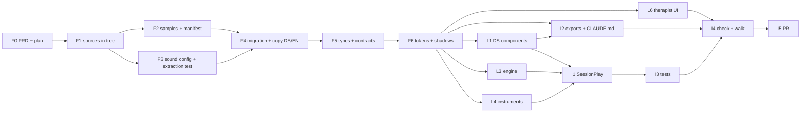

# Instruments · implementation plan

Three exercises of a new kind `instruments` — Kalimba, Marimba, Harfe — under
*Entspannen*, from the three experiments. **This file is the current state**:
updated after every task and every subagent result.

- PRD (the argument, the data model, every decision): `docs/plans/instruments-prd.md`,
  readable copy at https://claude.ai/artifact/3Eeyp413QwRHfmi3piW85h
- Branch: `feature/instruments-exercises`, cut from `origin/main` at `5c70a57`
- Decisions (Ben, 2026-11-09): only each experiment's DEFAULT sound; samples
  stay static (Cloudflare), the database indexes them by path, size and
  SHA-256; motion sensor 1:1, permission asked on the intro step with its
  state shown; play time = first own note → *Weiter zum Reflektieren*; Kalimba
  gets the marimba's timer and answer. PRD §Widersprüche 1, 6–12: proposal stands.

Status words: **offen** · **in Arbeit** · **erledigt** · **blockiert**.

## Sources, pinned

| Instrument | Version | Commit | Where it is on this branch |
| --- | --- | --- | --- |
| Harfe | `harp/261109-0920` (sound = `261104-1443`) | `d0e88ac` (PR #72) | merged in, task F1 |
| Kalimba | `kalimba/261106-1121` | `cd962d3` (on `main`) | already in the tree |
| Marimba | `marimba/261108-1740` | `5590e20` (PR #71) | merged in, task F1 |

CI checks out shallow (`ci.yml`, `actions/checkout@v4` with no depth), so a
test cannot `git show` a commit. The comparison "database = experiment" reads
the experiment files **in the tree**, which is why F1 brings #71 and #72 in.

## Tasks

### Foundation — serial, one session (rule 9: one writer for schema and shared files)

| # | Task | Status | Depends on | Files |
| --- | --- | --- | --- | --- |
| F0 | PRD (artifact) and this plan. The repo copy `docs/plans/instruments-prd.md` was written in I5 | erledigt | – | `docs/plans/*` |
| F1 | Merge PR #71 (marimba) and PR #72 (answering harp) into the branch, so every source is in the tree | erledigt (`ca1de81`, `93443c3`) | – | `apps/web/public/experiments/{marimba,harp/261109-0920}/**` |
| F2 | Copy the DEFAULT samples byte-identically to `apps/web/public/instruments/<id>/`; harp decoded from its base64. Manifest with path, bytes, SHA-256 | erledigt (`73b81f8`): 32 files, 6 harp · 16 kalimba · 10 marimba, 4.9 MB | F1 | `apps/web/public/instruments/**`, `supabase/content/instruments/samples.json`, `tools/instruments/extract-samples.mjs` |
| F3 | Sound + answer config per instrument as JSON, transcribed from the experiment; extraction test that reads the experiment HTML and compares | erledigt (`73b81f8`): 48 checks green | F1 | `supabase/content/instruments/{answer,harp,kalimba,marimba}.json`, `apps/web/src/instruments/sources.test.ts` |
| F4 | Migration: `instruments` kind, `play` step, `sessions.play_mode`/`play_seconds`, `instruments` / `instrument_sounds` / `instrument_samples` / `exercise_instruments` (RLS, revoke, grant to authenticated AND service_role), new `exercise_i18n` columns, **the three exercises and their copy DE/EN**, `missing_translations` extended | erledigt: applies cleanly on an isolated stack | F2, F3 | `supabase/migrations/20261109100000_instruments.sql`, `tools/instruments/sound-sql.mjs` |
| F5 | Types and pure contracts: `database.types.ts` (generated against the isolated stack — additions only), `STEP_IDS` + `play`, `STEPS.instruments`, `STEP_ICON`, step label keys, `Exercise.instrument`, `getInstrument`, the `InstrumentAdapter` / `InstrumentHost` contract | erledigt: typecheck green | F4 | `routeHandle.ts`, `lib/exerciseKind.ts`, `lib/stepIcons.ts`, `lib/chromeCopy.ts`, `lib/exerciseConfig.ts` (`STEP_FEATURES.play`), `i18n/{en,de}.ts` (two keys), `lib/content.ts`, `lib/instruments.ts`, `lib/database.types.ts`, `instruments/types.ts` |
| F6 | Tokens + instrument shadows — **moved forward from lane L2**: the engine's host and the harp both draw the shadow, so it had to exist before they are built in parallel. Tokens as amendment gap G5 (Layer 1 is `[LOCKED]`), `instrumentShadow.ts` as a pure function, foundations page „Instrument shadows“, a test that runs the harp experiment's own `shadowLayers` beside it | erledigt: `verify-tokens` green, 5 checks green | F5 | `packages/design-system/{tokens/musy-foundations-amendments.css,TOKEN-DRIFT.md,src/instrumentShadow.ts,src/index.ts,stories/foundations/InstrumentShadows.mdx,stories/foundations/_pages/Instruments.tsx}`, `apps/web/src/instruments/shadow.test.ts` |

### Lanes — parallel after F5, one worktree each, no file shared between lanes

| # | Lane | Status | Files (exclusive) | Definition of done |
| --- | --- | --- | --- | --- |
| L1 | DS components: **`DialogueNonModal`** — Storybook „Dialogue (non modal)“, generic, the settings are its first use (Ben, 2026-11-09) —, `Countdown`, `SegmentedControl` + `description`, `Switch` + `size="sm"` | **erledigt** (`bea11e3`, merged): checked in Chromium for focus, Escape, no inert/scroll lock, nested over an immersive Lightbox, the description in the accessibility tree, the countdown announcements | `packages/design-system/src/{DialogueNonModal,Countdown,SegmentedControl,Switch}.tsx`, `musy-components.css`, `stories/{DialogueNonModal,Countdown,SegmentedControl,Switch}.stories.tsx`, `reference/design_system/docs/07-components.md` | stories per CONVENTIONS.md (zu/offen/mit/ohne Vibration for the dialogue); keyboard + screen reader; `pnpm --filter @musie/design-system typecheck` green |
| L3 | Engine: audio unlock + master chain from config, answer (generalised from the marimba), play clock reducer, onboarding, haptics + feature detection, motion permission | **erledigt** (`aab22ea`, merged): 102 tests; the answer is shown note-for-note equal to the marimba's and the harp's own `compose` over 400 seeded phrases each; no master chain in the engine (decided); `played()` cancels the demo, advances the clock, interrupts any answer and — with Musie — joins the phrase | `apps/web/src/instruments/engine/**` | pure parts unit-tested: answer for 3 instruments on/off, clock (play, first note, demo does not start, pause, expire, play on, continue button), onboarding cancels on own touch, vibration detection |
| L4 | The three instruments as adapters (draw, hit, play), ported from the experiments onto the tokens | harp **erledigt** (`856c034`, merged `…` in this branch, 56 tests incl. parity against the experiment's own functions) · kalimba **erledigt** (`ce9aa3e`, merged, 103 tests incl. parity) · marimba **erledigt** (`d999b35`, merged, 86 tests incl. parity and frame-by-frame drawing against the experiment) | `apps/web/src/instruments/{harp,kalimba,marimba}/**` | each sounds from F2/F3 only; renders with `--instrument-*` tokens; keyboard-playable |
| L5 | Copy DE/EN | **aufgegangen in F4** — the rows the copy fills are created by F4, so a second migration would write the same rows twice. Remaining check is in I3: `missing_translations` empty for the three | – | – |
| L6 | Therapist UI: the three exercises at the end of `/exercise-builder`, every new text field editable | **erledigt** (`90223c1`, merged as `b7eadb5`): 30 new tests; the three appear last; every new text path classified `text`; the play step previews its copy and CTA, not the instrument | `lib/exerciseConfig.ts`, `lib/exerciseChanges.ts`, `lib/buildExerciseConfig.ts`, `lib/configToExercise.ts`, `routes/ExerciseBuilder.tsx`, `supabase/content/exercises/exercise.schema.json` | a text edit is classified `text`, not `structural`; builder previews the play step |

### Integration — serial, after the lanes

| # | Task | Status | Depends on | Files |
| --- | --- | --- | --- | --- |
| I1 | `SessionPlay` step: settings on the step, CTA opens the focus sheet with `InstrumentStage`, demo note, timer, settings in a `DialogueNonModal` in sync with the step, *Weiter zum Reflektieren*; intro additions (volume, browser, motion permission with its state) | **erledigt** (`083e495`): the step's buttons are the wizard's action row (Back · „Zur Harfe“ · „Weiter zum Reflektieren“ once paused or done); the sheet has headline + Countdown + one status line at the head, the instrument in the middle, settings icon + Weiter at the foot; closing the sheet pauses the clock; `--instrument-surface` became `--surface` so the instrument lies on the sheet | L1, L3, L4 | `components/SessionPlay.tsx`, `components/InstrumentStage.tsx`, `components/SessionIntro.tsx`, `routes/Session.tsx`, `lib/session.ts`, `i18n/{en,de}.ts` |
| I2 | DS exports of the L1 components + CLAUDE.md rule 10 sentence | **erledigt**: `DialogueNonModal`, `Countdown`, `SwitchSize` exported; CLAUDE.md rule 10 names the one way out (an experiment Ben turns into an exercise) and that the instruments' experiments are now load-bearing | L1 | `packages/design-system/src/index.ts`, `CLAUDE.md` |
| I3 | Tests: db (three exercises, kind, relax, samples, texts complete, sessions store mode + seconds, diary security unchanged), adjust `db.content` count; e2e walk intro → diary | **erledigt**: `db.instruments.db.test.ts` (15) and `e2e/instruments.spec.ts` (3 walks, library → diary, German; English skipped by name, not silently) | I1, F4 | `apps/web/src/lib/*.db.test.ts`, `apps/web/e2e/instruments.spec.ts` |
| I4 | `pnpm check`, both builds, isolated-stack `test:db`, walk on the dev server; **the three exercise images** (`assets/web/exercises/{kalimba,marimba,harp}.webp`, 768×768, referenced by the migration) rendered from the integrated instruments with Playwright + sharp — rendering them from the experiments would show the pre-token look (marimba bars sand-5, not the key token) | **erledigt**: `pnpm check` green (web 1197, docs 382, voice 51); web, storybook and docs builds green; db suite on the isolated stack 222 green, the 5 known snapshot tests red (see the log); the three images rendered from the app's own sheet at rest, 768×768 WebP | I1–I3 | – |
| I5 | PR, every deviation from the brief listed | **erledigt**: PRD copied to `docs/plans/instruments-prd.md`, the open points logged in `apps/web/OPEN-QUESTIONS.md`, PR opened | I4 | – |

## What the lanes left for integration (I1) and for Ben

**The stage (`InstrumentStage`, I1) must** — from the harp and kalimba reports:
size the canvas to box × dpr (adapters call `setTransform` themselves);
forward mouse `pointermove` with no button pressed (the harp's A-key strum);
send `keyUp` for held keys on window blur; call `requestDraw` when the palette
or shadow changes (a still instrument does not redraw itself); pass
`radius` (`Touch.radiusX` semantics — not `PointerEvent.width`, a diameter)
and `force` from touch events (marimba); capture pointers and pass
`pointercancel` on as `pointerUp`; show the marimba's rotate hint when its
adapter reports `orientationHint`.

**Decided by the integrator, sent to L3 while it ran:** every adapter builds
its own master chain into `audio.destination` (the chains differ per
instrument and are part of the locked sound); the engine adds none.
`vibrate(ms, 0)` = Android only, no iOS tick. `motion().rotation` is scaled
as the kalimba experiment does and keeps the maximum since the last read.
`joltsSince()` is raw |acceleration| in m/s² on the `performance.now()`
clock; the first note of a rolled answer is a normal stroke, the seven after
it roll strokes.

**Open, for Ben or Lucia — logged in `apps/web/OPEN-QUESTIONS.md` under „The instruments“:**
1. Kalimba bridge: the still wave is drawn at the full height the layout
   allows (±8.75 px on a phone); the swaying version at rest was 0.6 × that.
   Lucia's reference `261105-2047` is in no commit.
2. The bridge (`--instrument-detail`, sand-8) is now LIGHTER than the tines
   (`--instrument-key`, sand-9); in the experiment it was a step darker.
3. Kalimba and marimba get no instrument shadow (their experiments had none);
   only the harp draws it. Unify, or keep?
4. Harp strings run the full canvas height; should the top/bottom insets
   shorten them?
5. Four kalimba files (F4, C5 × closed/open) are indexed and fetched but the
   pentatonic tuning never plays them — the whole default sound was copied.
6. Marimba background warming: kept, scaled to 0.14 of the experiment's
   blend, because `--instrument-played` (terracotta-7) is far stronger than
   the experiment's terracotta-2; 0.14 reproduces its warmest ground. Keep,
   or keep only the softening of the sound?
7. Marimba holes (`--instrument-detail`, sand-8) are now lighter than the
   bars (`--instrument-key`, sand-9) in light mode; darker in the experiment.
8. „Ich spiele mit Musie“ is cut to „Ich spiele mit …“ in the settings
   dialogue at 393px (needs 136px, gets 115). Shorter labels in the copy, or a
   narrower panel inset on phones? Decided at I1 by looking.
9. `/exercise-builder`'s „Sag mir, was ich ändern soll“ box cannot reach the
   eight new fields: `supabase/functions/exercise-prompt/index.ts` lists its
   fields, and changing it needs a `functions deploy` (Ben).

## Parallelisation

**Why the foundation is serial.** The migration, the generated types and the
step list are read by every lane; two writers there is rule 9's failure
(interleaved timestamps, another branch's tables in `database.types.ts`).

**Merge order back onto the feature branch:** L1 → L3 → L4 → L6,
then I1–I5 on the branch itself. Each lane's worktree is cut from the feature
branch after F5 and touches only its own files; `index.ts` exports and
`CLAUDE.md` are deliberately nobody's lane (I2).

**Every subagent brief carries** the goal, its exclusive files, what it must
not touch (the migration, `database.types.ts`, another lane's files,
`index.ts`), the decisions above, and its definition of done — a subagent
inherits the directory, not this conversation (rule 9).

## Round 2 — what the instruments lost from the experiments

Ben, 2026-11-09, after playing the three on localhost: "wir haben bei den
Instrumenten Einiges verloren aus den Experimenten." Four changes, his answers
to four questions taken as decisions:

1. **Responsiveness exactly as in the experiments — the harp 1443 layout, for
   all three.** The instrument fills the whole sheet (the harp's strings run
   the full height, behind the headline and the foot). Headline laid over the
   top left; Countdown bottom left; „Weiter zum Reflektieren“ bottom right,
   shown on pause or at 0:00, rising above the clock where the two do not fit
   side by side (the harp's `placeFoot`). **The settings icon moves to the
   top, beside the X; the settings open at the top right.** The marimba in
   portrait on a touch screen shows the experiment's full-screen hint „Leg dein
   Handy quer vor dich“. The kalimba, which had no clock, gets the same layout.
2. **The mouse cursor in the focus sheet is the harp's green dot** for all
   instruments: `--interactive-primary`, 2 × `--sp-5` across, following mouse
   and pen over the instrument (and past its edge while a string is held), the
   normal pointer over controls, hidden for touch.
3. **The kalimba's tap effect for every own note, none for Musie's answer.**
   The soft dot (700 ms, radial gradient, grows with the stroke's strength,
   colour between rest and played). Harp: it appears at the grip point,
   travels with the finger while the string is pulled and fades after the
   release; a strum leaves one at each crossing. Marimba: replaces its own
   smaller dot (600 ms, also on answers). **Maintained centrally in the design
   system, with live controls in Storybook** — the cursor too.
4. **One key token, `--instrument-key: sand-5`** (the marimba's experiment
   value; the kalimba's tines were sand-7). Keys are now LIGHTER than strings
   (sand-7) — the family rule of the first brief is inverted, by Ben's choice.

**Ben, after R0's measurement:** the harp layout for the harp and the
kalimba; the **marimba keeps its own experiment's layout** — one-line headline
at the very top, the small clock (heading-md figure, `min` transport, caption
only from 760px) in the foot row beside Weiter — because the harp's big clock
would leave its bars ~150px of 274 in landscape. The settings icon moves to
the top beside the X for all three.

**Two assumptions, to be corrected if wrong:**
- The sheet's headline is the play step's heading AND its sentence, as one
  block, as each experiment's `<h1>` was a whole sentence („Atme tief ein und
  aus: Spiele dabei Musies Harfe im Rhythmus deines Atems.“) — not the heading
  alone.
- Colours other than the key stay as they are: `--instrument-detail` sand-8
  (now darker than the bars again, which settles open question 2/7), played
  terracotta-7, answer green-7. The marimba's experiment had cords at sand-6
  and its stroke at terracotta-9; matching those would be two more tokens.

### Tasks

| # | Task | Status | Depends on | Files |
| --- | --- | --- | --- | --- |
| R0 | **Measure the experiments first.** Playwright on the three experiments at 393×852, 430×932, 852×393 (marimba) and 1280×800: headline box, clock box, button box, instrument extent (top/bottom/side of strings, tines, bars), cursor size. Written into this file as the acceptance table; R5 compares the app against it pixel box by pixel box (memory: measure, never derive from CSS) | **erledigt**: table below | – | this file |
| R1 | **DS · `Sheet` overlay layout**: a `layout="overlay"` (name to settle) where the body fills the whole sheet under a transparent head and foot, pointer events passing through their empty parts; a header slot for actions beside the X (the settings icon). Stories + 07-components | **erledigt** `2e0a0ab`: settled as three props rather than a layout name — `stage` (the body behind head and foot), `actions` (beside the X), `density` (`compact` for the marimba's tighter head and foot) | R0 | `packages/design-system/src/Sheet.tsx`, `musy-components.css`, `stories/Sheet.stories.tsx`, docs |
| R2b | **DS · `Countdown` `size="compact"`**: the marimba's one-row clock (figure in heading-md, `min` transport, caption hidden below 760px) beside the existing display size | **erledigt** `2e0a0ab` | R0 | `Countdown.tsx`, CSS, story |
| R2 | **DS · `DialogueNonModal` `placement="top-end"`**: opens under the top bar at the right, the trigger beside the X | **erledigt** `2e0a0ab` | – | `DialogueNonModal.tsx`, CSS, story |
| R3 | **DS · tap effect + cursor, tokens and live controls**: tokens `--instrument-tap-*` (duration 700 ms, size, growth, opacity curve) and `--instrument-cursor-*` (size, colour) in the amendments; `instrumentTap.ts` (pure: the dot at time t for strength v — radius, alpha, gradient stops), its SIZE absolute (from the kalimba's tine width), not relative to what was hit, so a marimba bar does not get a dot five times as large; `InstrumentCursor` (follows mouse/pen over a target); Storybook „Instrument tap“ — a string, a tine and a bar to tap, with Controls bound to every parameter, the values shown as the token lines to paste. `--instrument-key` → sand-5. `TOKEN-DRIFT.md` | **erledigt** `818f8f9`, merged `fdb141f`; the host reads the tokens as `host.tap()` (`ecaeb97`) | – | `packages/design-system/{tokens/musy-foundations-amendments.css,TOKEN-DRIFT.md,src/instrumentTap.ts,src/InstrumentCursor.tsx,src/index.ts,stories/…}` |
| R4a | **Harp**: tap dot at the grip, travelling with the pull, fading after release; one per strum crossing | **erledigt** `9471769`, merged `19e1464`; keys 1–7 leave a dot at the string's middle (the lane's addition) | R3 | `apps/web/src/instruments/harp/**` |
| R4b | **Kalimba**: its dots through `instrumentTap` (parity test against the experiment's `dots` stays) | **erledigt** `6ba2dfa`, merged `47fee5c`: identical to the experiment at 393×852, where the tine is the size token | R3 | `apps/web/src/instruments/kalimba/**` |
| R4c | **Marimba**: the kalimba's dot replaces its own; none on answers; the portrait hint becomes the experiment's full-screen overlay (stage side, R5) | **erledigt** `9e4b612`, merged `dce9423` | R3 | `apps/web/src/instruments/marimba/**` |
| R5 | **App · the sheet as harp 1443**: `SessionPlay` on the overlay sheet; head = headline block; foot = Countdown left, Weiter right with the `placeFoot` rule (as CSS: the foot wraps, Weiter keeps to the end); settings icon in the header slot opening the dialogue top-end; `InstrumentStage` fills the sheet and passes the measured head/foot as `inset` (kalimba and marimba lay out between them, the harp ignores them as its experiment did); `InstrumentCursor` over the canvas; the marimba's rotate overlay | **erledigt** `000f6cc` (layout), `11f1e76` (cursor) | R1, R2, R3 | `components/SessionPlay.tsx`, `components/InstrumentStage.tsx`, `shell.css`, i18n |
| R6 | **Verify**: R0's table vs the app at the same four sizes (screenshots side by side, experiment left, app right, for each instrument), the e2e walk, `pnpm check`, the three builds; re-render the three exercise images (the key colour changed) | **erledigt**: see the log | R4, R5 | `e2e/instruments.spec.ts`, `public/assets/web/exercises/*.webp` |

**R0 · what the experiments measure** (Playwright, CSS px, `[x, y, w, h]`;
`paint` = the instrument's painted extent on the canvas; the done button shown):

| Experiment | Size | Instrument (paint) | Headline | Clock (figure px) | Done |
| --- | --- | --- | --- | --- | --- |
| harp 1443 | 393×852 | [46, 0, 306, 851] | [32, 44, 285, 83] | [32, 681, 329, 86] (40) | [242, 782, 119, 46] |
| harp 1443 | 430×932 | [50, 0, 334, 931] | [32, 44, 322, 83] | [32, 760, 366, 86] (40.8) | [279, 862, 119, 46] |
| harp 1443 | 852×393 | [60, 0, 736, 392] | [32, 44, 744, 59] | [32, 266, 788, 87] (50.5) | [699, 322, 121, 47] |
| harp 1443 | 1280×800 | [60, 0, 1164, 799] | [32, 44, 821, 32] | [32, 668, 1216, 92] (60.3) | [1125, 729, 123, 47] |
| kalimba 1121 | 393×852 | [0, 264, 392, 492] | [32, 44, 285, 110] | – | – |
| kalimba 1121 | 430×932 | [0, 236, 429, 599] | [32, 44, 322, 83] | – | – |
| kalimba 1121 | 852×393 | [113, 187, 626, 113] | [32, 44, 744, 59] | – | – |
| kalimba 1121 | 1280×800 | [327, 192, 626, 506] | [32, 44, 842, 63] | – | – |
| marimba 1740 | 393×852 | rotate overlay | [32, 16, 230, 28] | [92, 796, 188, 44] (22) | [208, 794, 153, 46] |
| marimba 1740 | 852×393 | [11, 54, 829, 274] | [32, 16, 248, 30] | [92, 337, 463, 44] (23.8) | [665, 334, 155, 47] |
| marimba 1740 | 1280×800 | [11, 56, 1257, 679] | [32, 16, 265, 32] | [92, 744, 476, 44] (25.4) | [1090, 741, 158, 47] |

The kalimba's extent is its tines between its header and its foot; with the
harp's foot (a taller clock) it will sit higher and shorter — that is the
consequence of Ben's layout choice, not a regression to fix. The marimba's
clock starts at x=92 in the experiment because the gear stood before it; with
the gear at the top it starts at the inset.

**Parallel:** R1, R2 and R3 touch different design-system files and can run
at once (R3 owns `index.ts` this round); R4a/b/c run at once after R3, one
instrument each; R5 after R1–R3; R6 last. R0 first, because it is the
definition of „exactly“.

## How the database is verified here

`supabase db reset` and `pnpm gen:types` are denied in `.claude/settings.json`
because they drive the ONE shared local stack (rule 9). This branch is
verified on a **separate** stack instead: a copy of `supabase/` with
`project_id = "musie-instruments"` and every port moved by 200 (API 54521,
DB 54522), started with `supabase start`, which applies every migration from
scratch. `database.types.ts` was generated from it with
`supabase gen types typescript --db-url …:54522` and diffed: additions only.
`pnpm test:db` runs against it with the three `SUPABASE_TEST_*` variables.
The shared stack is untouched. After the merge, the shared stack still needs
the usual `supabase db reset` from one session (Ben).

## Log

- 2026-11-09 — PRD written and decided; plan written; worktree cut.
- 2026-11-09 — F0–F3 committed (`73b81f8`). Samples identical by SHA-256 to
  the experiments, sound configs held against the experiments' HTML.
- 2026-11-09 — F4 + F5 done. **Deviation:** L5 (copy) folded into F4.
  The plan was not updated after F1–F3 as it should have been; caught up here.
- 2026-11-09 — F6 done: lane L2 moved into the foundation (see the row). `TOKEN-DRIFT.md`'s counts corrected to what `verify-tokens` measures (37 + 18 = 55; they read 36 + 4 = 40 before this change while 42 were listed).
- 2026-11-09 — Lanes L1, L3, L4 (harp, kalimba, marimba as three agents) and L6 started in parallel from `b4662bc`, each in its own worktree with exclusive files. Meanwhile I3's database tests on the feature branch.
- 2026-11-09 — I3 database half: whole db suite on the isolated stack: 222 green, 5 red — all five in `deck.db.test.ts` / `music.db.test.ts`, which compare to the hosted snapshots (10 cards, 89 pieces) while a fresh stack carries the factory content (9 cards, 9 pieces), CLAUDE.md rule 4.1. Not caused by this branch; they are red on any freshly started stack.
- 2026-11-09 — L6 merged (`b7eadb5`), then L4-kalimba and L4-harp: 1009 unit tests green on the branch. Merged as each finished rather than strictly L1 → L3 → L4 → L6: the files are exclusive, so the order changes nothing.
- 2026-11-09 — L4-marimba merged: 1095 unit tests green. All three adapters build their own master chain. L1 and L3 still running.
- 2026-11-09 — L1 merged, I2 done. Only L3 (engine) is still running.
- 2026-11-09 — L3 merged: every lane is in, 1197 unit tests green. `types.ts` comments corrected where L3 found them wrong (background token, motion units, `ticks: 0`, `holding`). I1 started.
- 2026-11-09 — I1 walked in Chromium and corrected by looking: the step's
  own button row became the wizard's (it stacked Zurück above the CTA); the
  Countdown moved into the sheet's head so the foot is one row and the
  dialogue sits above the settings icon; the instrument's surface is the
  sheet's; the Countdown's resume label is „Fortsetzen“, not „Weiter“, beside
  „Weiter zum Reflektieren“.
- 2026-11-09 — I3, I4 done. The e2e walk signs in by password through the
  service role (the sign-in screen mails a one-time code) and answers the two
  consent questions on the profile first.
- 2026-11-09 — I5: PRD in the repo, open points in the log, PR opened. The isolated stack (`musie-instruments`) and the dev server on :5191 were stopped afterwards.
- 2026-11-09 — Ben: the non-modal settings dialog is the generic component
  „Dialogue (non modal)“ — `DialogueNonModal` in code. PRD and plan renamed.
- 2026-11-09 — Round 2 planned with Ben (four answers, then „Marimba wie ihr
  Experiment“ after R0). R0 measured; R1, R2, R2b in one session on the
  branch (`2e0a0ab`); R3 as an agent in its own worktree, merged (`fdb141f`);
  R5's layout (`000f6cc`) measured against R0 until the boxes agreed: the
  harp's paint is identical, its headline stands at (32, 44), the clock's
  top is within 1 px at all four sizes, Weiter keeps to the right edge; the
  marimba in landscape has its headline at (32, 16) and bars from y 54 across
  the width. Two fixes found only by measuring: the stage header's top margin
  (32 → 44, the X's target height) and the marimba's status line, whose
  intrinsic width widened the sheet's grid column past the viewport.
- 2026-11-09 — R5's cursor (`11f1e76`): over the canvas the dot is visible,
  48 px, `--interactive-primary`, and the canvas hides the system pointer;
  over the settings button the dot hides and the pointer returns. The e2e
  walk is green on the new layout without a change: its selectors are roles
  and names, and neither moved with the buttons. R4a/b/c running as three
  agents from `ecaeb97`, one instrument each.
- 2026-11-09 — R4a/b/c merged: 1246 unit tests green. Looked at in the app
  at 1280×800: the demo lights a tine or bar and leaves no dot; a strum leaves
  a dot at each string it crosses; the kalimba's dot shows around the tine.
  **The marimba's dot does not show:** it is painted, but in the colour the
  bar is lit with — sampled at 40–690 ms its centre differs from the lit bar
  by at most 2 levels, and it grows past the bar only once mostly faded. The
  experiment's own dot shared that colour too and was visible only because it
  grew with the bar's width. Logged for Ben; not changed. With a mouse the
  48 px cursor also covers most of a fresh dot at the point of the click
  (touch has no cursor). Exercise images re-rendered (`d53f9f6`).
- 2026-11-09 — R6 done. Re-measured after the merges, unchanged from R5's
  numbers. The side-by-side screenshots found what the boxes did not: the
  marimba's rotate hint left the head and the foot showing (fixed, `fa212cd`:
  hidden, not removed, so the insets hold; X and settings stay) and its demo
  sentence is cut at 852 × 393 (logged for Ben — it is copy). The canvas's
  focus ring shows when the sheet is opened by keyboard and not after a
  click, checked both ways. `pnpm check` green (1246 web unit tests), the
  web, Storybook and docs builds green, the e2e walk green. `test:db` not
  re-run: round 2 changed nothing under `supabase/`; round 1's 222 green / 5
  known stand.
- 2026-11-09 — Ben: the marimba held upright turns instead of asking to be
  turned — bars across the screen, the low ones at the bottom, the words
  upright (`fbbd72a`). The stage hands the adapter a landscape box, turns the
  canvas a quarter turn counter-clockwise in CSS and the pointers back, so
  the experiment's drawing and hit test and their parity tests are untouched.
  Upright the marimba takes the harp's layout; the rotate hint, its two
  strings and the adapter's `orientationHint` are gone. Checked at 393×852
  and 430×932: a tap at the bottom lights the bottom bar, the clock starts,
  nothing overflows; turned to landscape mid-session and back, the layout
  follows without a new session. One thing tried and taken back: giving the
  turned bars the marimba's 8 px chrome gap at the sides broke the
  experiment's layout parity (its side insets are the notch's safe area), and
  the bars already clear the clock by about 12 px.
- 2026-11-09 — Ben: the clock stands on the bottom edge, never under a
  phone's bottom address bar (`8bbf540`). The foot wraps upward
  (`wrap-reverse`): the clock's row is the lowest, Weiter goes above it where
  both do not fit. Measured: the clock 23–24 px above the edge at all four
  sizes (the marimba's compact one 12). The edge is the immersive sheet's,
  `position: fixed; inset: 0`, which follows what the browser shows; the
  instruments measure that box, so they scale with it. A real bottom bar
  cannot be emulated — Ben tests on his phone through a Cloudflare quick
  tunnel to a production build, the local stack proxied through the same
  origin (setup in the session's scratchpad, not in the repo).
- 2026-11-09 — Ben: Weiter always under the clock, appearing smoothly and
  pushing the clock up (`c046ccf`). The row is shut (0fr) until a pause or
  0:00, so the clock stands on the edge; it opens over `--motion-sheet-slide`.
  Watched frame by frame on the kalimba at 393 × 852: the clock rises 743 →
  675 in about 300 ms, the tines' ends follow 712 → 644, never a blank frame
  (the stage now assigns the canvas size only when it changes). In the
  marimba's landscape the bars lose 68 px of 263 while Weiter shows.
- 2026-11-09 — Ben: no settings in the focus sheet; they are made on the
  step, before. The icon, its Dialogue (non modal) and three strings removed;
  the headline has the experiment's width again (285 at 393, 322 at 430, 744
  at 852). `DialogueNonModal` (with `top-end`) and `Sheet`'s `actions` stay
  in the design system, now without a consumer in the app.
- 2026-11-09 — Ben: `DialogueNonModal` and `Sheet`'s `actions` out of the
  design system, since nothing uses them. `pnpm check`, the web, Storybook and
  docs builds and the e2e walk green after the removal.
- 2026-11-09 — Ben: Weiter not in the sheet as it opens, only once the
  person pauses (`0f0095c`). It showed at once when the sheet was opened again
  on a clock its own closing had paused. The clock now records who paused it
  (`CLOSE` from the stage, `pausedBy`); the sheet asks `showContinueInSheet`
  (the person's pause, or 0:00), the step keeps `showContinue` so closing
  still leaves a way on. Walked: first open, play, close, reopen — hidden;
  Fortsetzen, Pause — shown. Kept at 0:00, which the brief named and Ben did
  not take back.
- 2026-11-09 — Ben cleaned up the three exercises (`311b001`), with four
  answers: the sheet keeps its headline in a field of its own; the marimba
  gets its own motion switch (on a MacBook tap strength has no effect — no
  sensor, and a mouse or trackpad reports no area or force — so both motion
  switches show on touch screens only); the browser hint and the silent-switch
  line go; the new words are editable in the builder. Einsteigen now holds
  the settings (Duett mit Musie | Alleine, „Instrument spüren“, the motion
  switch, off the first time and remembered once on); Musizieren says what to
  do, for touch or for mouse and keyboard. Migration `20261109160000`: four
  columns added, `volume_md` and `browser_md` dropped, the copy in German and
  English. Applied to the isolated stack, types regenerated from it, db suite
  223 green / the 5 known; `pnpm check` 1247 web tests; the walk on the
  desktop and on an emulated phone. The motion switch's iOS prompt can only
  be walked on a real iPhone.
- 2026-11-09 — Ben: once started, the play step's instrument button says
  „Weiterspielen“ and stays primary; „Weiter zum Reflektieren“ is the
  secondary. Checked on the step before and after a note, and in the walk.
