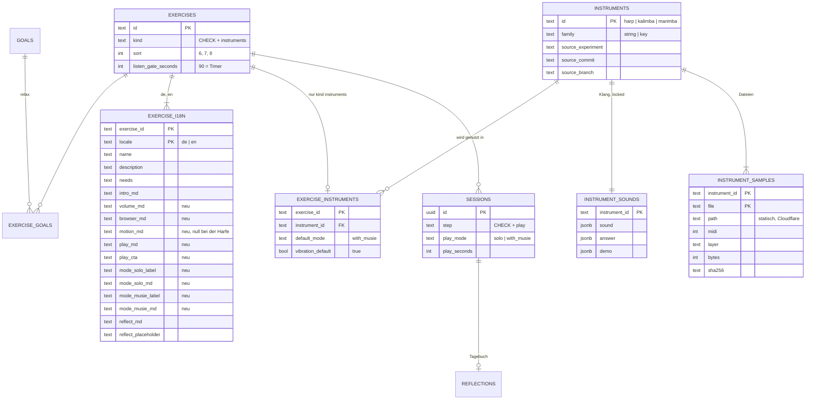

# PRD · Übungstyp Instruments

2026-11-09 · Ben. Lesbare, kommentierbare Fassung:
https://claude.ai/artifact/3Eeyp413QwRHfmi3piW85h — diese Datei ist ihre
Kopie im Repo, Stand der Übergabe. Der Bauplan steht daneben in
`docs/plans/instruments-exercises.md`.

Aus den Experimenten Harfe, Kalimba und Marimba werden drei Übungen eines
neuen Übungstyps `instruments` unter Entspannen: Einsteigen → Musizieren →
Nachdenken, mit Antworten von Musie für alle drei Instrumente. Klang und
Samples kommen unverändert aus dem jeweils neuesten Experiment.

## Ziel und Nutzerreise

Die drei Instrumente werden Übungen wie alle anderen: mit Session und
Reflexion im Tagebuch, Texten in der Hand der Musiktherapeutin, auf Deutsch und
Englisch. Die Experiment-Routen unter `/experiments` bleiben, wie sie sind.

1. Unter **Entspannung** (`relax`) stehen Kalimba, Marimba und Harfe am Ende
   der Liste, mit Titel, Bild, Dauer, „Du brauchst: …“ und Ortshinweis.
2. **Einsteigen:** ruhiger Ort, Lautstärke (immer sichtbar), Browser-Hinweis;
   bei Marimba und Kalimba die Sensor-Erlaubnis mit Knopf und Status.
3. **Musizieren:** Headline, Vibration (nur wo das Gerät sie kann,
   voreingestellt an), Zusammenspiel „Ich spiele allein“ / „Ich spiele mit
   Musie“ (voreingestellt: mit Musie) mit Erklärungstext, „Zur Harfe“.
4. **Fokus-Sheet:** öffnet mit einem Demo-Ton, den das Instrument auch zeigt;
   eigenes Spiel bricht ihn ab. Timer 1:30, Settings-Icon für den „Dialogue
   (non modal)“, „Weiter zum Reflektieren“ nach Pause oder Ablauf.
5. **Nachdenken:** unverändert. Die Session speichert zusätzlich Modus und
   Spieldauer in Sekunden.

## Verbindliche Quelle pro Instrument

| Instrument | Neuester Stand | Branch | Commit | Bemerkung |
| --- | --- | --- | --- | --- |
| Harfe | `harp/261109-0920` (antwortet) | `the-harp-answers` (PR #72) | `d0e88ac` | Klang identisch mit `harp/261104-1443` auf `main` |
| Kalimba | `kalimba/261106-1121` | `main` (PR #68) | `cd962d3` | – |
| Marimba | `marimba/261108-1740` (v6, Lucias Wahl) | `the-marimbaphon` (PR #71) | `5590e20` | – |

PR #71 und #72 sind in den Feature-Branch gemergt, damit alle drei Quellen im
Baum liegen: CI klont nur einen Commit tief, und `sources.test.ts` liest die
Experimente aus dem Baum.

## Klang und Samples pro Instrument

Alle drei spielen Aufnahmen; Synthese gab es nur als Alternative der Harfe
(„Berechnet“), sie ist nicht übernommen. **Entschieden: nur die Voreinstellung
jedes Experiments.**

| | Harfe | Kalimba | Marimba |
| --- | --- | --- | --- |
| Quelle | 6 M4A, base64 im HTML, byte-identisch dekodiert | 16 MP3 (closed + open) | 10 WAV („weich“, zwei Schichten) |
| Lizenz | VSCO 2 CE, CC0 | HCP-Soundfonts, CC0 | VCSL + VSCO, CC0 |
| Tonvorrat | 7 Saiten d e g a h d′ e′ | 9 Zungen, Pentatonik A H d e g a h d′ e′ | 10 Stäbe d … h′ |
| Voreinstellung | „Weich“, Ausklingen 2,5 s, Hall 32 % / 3,0 s, Dynamik 17 dB / 1,2 | Härte 0,35, Länge 4 s, Schwenken 0,8, „Ruhig“ | „Marimba, weich“, Schwelle 0,6 |
| Bewegungssensor | nein | Schwenk-Vibrato | Anschlagstärke |

Die Antwort-Logik ist die der Marimba (Pause 1,8–6 s, Gedächtnis 12 Töne,
höchstens 8 Töne und nie länger als das eigene Spiel, Abstände 220–1400 ms,
Lautstärke 0,45–0,85, Kopie-Prüfung). Instrumentspezifisch sind nur Tonvorrat
und Schlusstöne. **Entschieden: die Kalimba bekommt denselben Timer und
dieselbe Antwort wie die Marimba**; sie hat keinen Wirbel, die Wirbel-Regel
entfällt bei ihr.

## Datenmodell

Das echte Schema hat keine Typ-Tabelle; der Typ ist der CHECK
`exercises_kind_known`, Texte sind eine Spalte pro Schritt in `exercise_i18n`.

Abweichungen von der Skizze im Auftrag: `EXERCISE_TYPE` → `exercises.kind`;
`EXERCISE_TEXT` → Spalten in `exercise_i18n`; `timer_seconds` →
`listen_gate_seconds`; `SITUATION` → `goals`; der neue Schritt `play`
(Musizieren) steht in `STEP_IDS` und im CHECK `sessions_step_known`.
**Entschieden: die Samples bleiben statische Dateien**
(`apps/web/public/instruments/`, Cloudflare, kein Egress); die Datenbank hält
Pfad, Größe und SHA-256.

## Tokens und Komponenten

| Gebraucht | Ergebnis |
| --- | --- |
| Fokus-Sheet | `Sheet` (bestehend) |
| Settings, nicht-modal | **neu `DialogueNonModal`**, Storybook „Dialogue (non modal)“, generisch |
| Timer 1:30 | **neu `Countdown`** (Ziffern, Bildunterschrift, `TrackButton`, Ansagen) |
| Zusammenspiel mit Erklärung | `SegmentedControl` + `description` je Option |
| Vibration im Dialog | `Switch` + `size="sm"` |

Tokens als Lücke G5 in `musy-foundations-amendments.css`:
`--instrument-surface` (= `--surface`), `--instrument-string` (sand-7, heller),
`--instrument-key` (sand-9, dunkler), `--instrument-detail`,
`--instrument-played` (terracotta-7), `--instrument-answer` (green-7) und die
Parameter des Harfen-Schattens `--instrument-shadow-*` („euer Schatten,
4. November“). Die Schatten-Rechnung ist `instrumentShadow.ts`, die
Storybook-Seite heißt „Instrument shadows“.

## Browser-Empfehlung und iPhone-Stummschalter

„Am besten klingt es auf dem iPhone in Safari und auf Android in Chrome.“
`navigator.audioSession.type = 'playback'` spielt ab iOS 17 durch den
Stummschalter; ein Hinweis erscheint nur auf iOS Safari ohne diese API.
Vibration: `navigator.vibrate` oder der Switch-Haptik-Weg auf dem iPhone,
per Feature-Detection. Auf Geräten ungeprüft (siehe offene Punkte).

## Widersprüche & offene Punkte

Alle zwölf entschieden am 2026-11-09 — die Vorschläge gelten, dazu die vier
Antworten oben (Voreinstellung, statische Samples, Sensor 1:1 mit Erlaubnis im
Intro und sichtbarem Status, Spieldauer vom ersten eigenen Ton bis Weiter).
Festgehalten: `git checkout` gesperrt → Worktree; keine Versionstabelle unter
`musie.org/experiments`, nicht gebaut; CLAUDE.md Regel 10 nennt jetzt den
einen Ausweg (ein Experiment, das Ben zur Übung macht).

Was beim Bauen offen blieb, steht im Format des Logs in
`apps/web/OPEN-QUESTIONS.md` unter „The instruments“.

## Stand nach dem Bau

- **Die Kalimba-Antwort und der Timer** sind die der Marimba, gezeigt Ton für
  Ton gleich zum `compose` des Experiments.
- **Der Countdown sitzt im Kopf des Sheets**, nicht unten links wie bei der
  Harfe, damit der Fuß eine Zeile bleibt und der Dialog über dem Icon sitzt.
- **Schließen des Sheets pausiert den Timer**, der Weiter-Knopf erscheint dann
  auch auf dem Schritt.
- **Der Fortsetzen-Knopf des Countdowns heißt „Fortsetzen“**, nicht „Weiter“,
  neben „Weiter zum Reflektieren“.
- **Die Übungsbilder** sind die Instrumente selbst, aus der App gerendert —
  Platzhalter.
